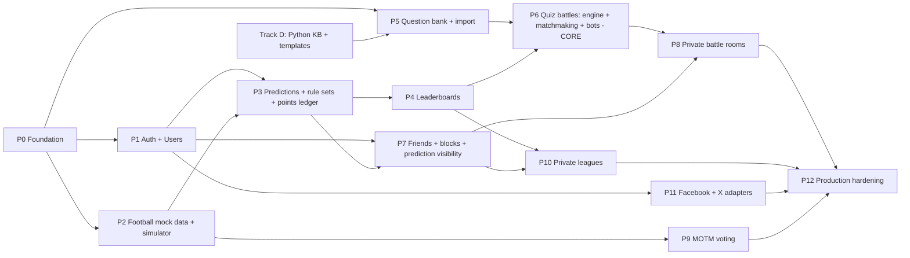

# Implementation Roadmap

Ordered by dependencies, not by the feature list. Each phase ends with a demoable result and explicit exit criteria. Durations are not estimated here on purpose; track them as you go.

## Dependency view

Changes vs the original proposed order, and why:

- **Points ledger moves into P3** with predictions: scoring needs somewhere to write, and the ledger is what makes recalculation possible from day one.
- **Leaderboards move up to P4:** predict → points → rank is the core loop; everything after it plugs into the same ledger.
- **Quiz battles are core and come right after the points loop (P5-P6, ADR-0010).** The Daily Quiz phase is gone; the battle engine, matchmaking and bot fallback come first because they make the feature playable even with very few users.
- **Friends before private rooms:** room joins need block checks (`social`), and friends are who you invite.
- **MOTM moves later (P9):** it is independent and can slot anywhere after P2.
- **Track D (Python knowledge base) runs in parallel** from P2 because it has no dependency on the NestJS code, only on the bundle contract. Battles can be played without limit, so the bank must be large before launch (risk K-09). P5-P6 can start with a small hand-written dev bundle.
- **Facebook and X adapters go late (P11):** the identity model is built in P1, so adding providers later changes no schema (DEC-26).

## Phases

### P0 — Foundation
- Monorepo layout from `CLAUDE.md` §4; Docker Compose (Postgres with `app` + `football_kb` DBs, Redis with `noeviction`); `.env.example`.
- NestJS app with `main.api.ts` and `main.worker.ts`; config schema validation; `nestjs-pino`; request id via `nestjs-cls`; problem+json filter; `ValidationPipe`; URI versioning; Swagger at `/docs`; health checks.
- Shared kernel: `Clock`, UUID v7 ids, `DomainError`.
- Prisma setup (multi-file schema), `@nestjs-cls/transactional`; `outbox_events` + publisher loop + BullMQ wiring + Bull Board.
- Testing harness: Jest unit, Testcontainers integration, Supertest e2e; dependency-cruiser boundary rules; CI pipeline.
- **Exit:** `docker compose up` + API/worker start; `/health/ready` green; one sample event goes from outbox to a BullMQ handler in an integration test; boundary lint fails on a deliberate violation.

### P1 — Auth + Users
- `users` (profile, privacy settings), `auth` (identities, sessions, JWT, refresh rotation with reuse detection), Google adapter, phone OTP with `ConsoleSmsSender`, a `FakeProvider` adapter for tests, session list/revoke, `GET/PATCH /me`, account deletion request (fan-out handlers stubbed per module as modules arrive).
- **Exit:** e2e: sign in with fake Google token → `/me` → refresh → reuse old refresh → family revoked; OTP lockout test; WS handshake guard tested with a dummy gateway.

### P2 — Football mock data + simulator
- Competitions/seasons/teams/players/matches/squads with AR/EN names; `FootballDataProvider` + `MockFootballProvider`; `ApplyProviderMatchUpdate` with versioning; lifecycle events via outbox; simulator CLI commands and scenarios.
- **Exit:** `mock:run-day` plays a matchday producing `MatchStarted/Finished` events; `GET /v1/matches` lists fixtures with `predictable` computed server-side.

### P3 — Predictions + rule sets + points ledger
- `prediction_picks` model, submit/edit with DB-clock lock, revisions, `PredictionScorer` driven by `scoring_rule_sets`, scoring job, void/carry-over policies behind config, `points` module recording/superseding.
- **Exit:** concurrency test around kickoff passes; result correction rescoring supersedes ledger entries; two different rule-set configs produce different points (proves nothing is hard-coded).

### P4 — Leaderboards
- Period calculator (timezone + season calendar config), periods lifecycle job, incremental recompute per (period, user), rebuild command, keyset pagination, my-rank endpoint, snapshots at finalization.
- **Exit:** rebuild equals incremental result on a seeded dataset; DST/new-year period tests; leaderboard page query uses the index (EXPLAIN check).

### Track D (parallel, Python) — Knowledge base + templates
- `football_kb` raw/staging/core for a first small slice: martj42 international results + openfootball top-5 + World Cup; entity crosswalk; facts with provenance; 10-20 bilingual templates; deterministic validation; bundle writer. Ollama phrasing optional and off by default.
- **Exit:** a bundle of ≥ 1,000 validated questions with a 200-question human review sample ≥ 98% correct (Arabic reviewed by a native speaker). **Before public launch:** several thousand questions, sized from expected battles per active user per week × `roundCount` against the exposure window (DEC-44, risk K-09).

### P5 — Question bank + import
- Tables, `questions:import` / `publish` / `disable` CLI, selection queries (locale intersection, difficulty/category balance, exclusion list), answer key, playable payload mapper, question reports endpoint, `BattleCompleted` stats handler (can be wired in P6).
- **Exit:** importing the same bundle twice is a no-op; a changed served question is versioned, not overwritten; payload mappers never expose correctness (test).

### P6 — Quiz battles: engine + matchmaking + bot fallback (CORE)
- `/battles` gateway per `WEBSOCKET.md`; battle engine for 2..N participants; question selection with recent-exposure exclusion (DEC-44); readiness, rounds, answers, scoring and placements from the BATTLE rule set with per-mode points (DEC-33/41); persistence of every transition; reconnection/resync; forfeit; Redis matchmaking queue + matcher loop; bot fallback with `BotPlayer` profiles (DEC-39/43); activity guard; `GET /v1/me/play-state`; completion → outbox → ledger → leaderboards; stale battle sweeper.
- **Exit:** WebSocket test suite for happy path, duplicate/late/out-of-order messages, disconnect/reconnect, forfeit, ready timeout; bot fallback fires after the configured wait and the bot battle replays identically with a fixed seed; two rule-set configs give different per-mode points (proves DEC-41 is config); a 3-participant battle runs in tests even though matchmaking only makes 1v1.

### P7 — Friends + blocks + prediction visibility
- Friend requests, friendships, blocks, user search; `PredictionVisibilityPolicy`; friends' predictions endpoints; blocked pairs skipped by the matchmaker.
- **Exit:** visibility matrix tests (owner, friend before/after kickoff, non-friend, blocked) for every read path.

### P8 — Private battle rooms
- `battle_rooms` + members; code generation; create/join/leave/remove/start/close endpoints; lobby pushes (`room:*`); host transfer; rematch back to `LOBBY` (DEC-42); idle timers + backstop sweeper; block checks on join; join rate limits.
- **Exit:** concurrency tests (last seat, join vs start, double start); blocked user gets `ROOM_NOT_FOUND`; room survives an API restart and returns to `LOBBY`; two `maxPlayers` configs work (DEC-38).

### P9 — MOTM voting
- Poll creation on `MatchFinished`, window from `ended_at`, votes with DB-clock window check, delayed close + sweeper, aggregation strategy registry, end-time correction handling.
- **Exit:** votes at window edges behave per spec; lost delayed job still closes via sweeper; aggregation strategies swappable by config.

### P10 — Private leagues
- Leagues, members, invites (code), competitions (PREDICTIONS first, then BATTLES), `LeaguePolicy`, league leaderboard from the ledger.
- **Exit:** league ranking matches a manual ledger sum under both counting policies (DEC-20).

### P11 — Facebook + X sign-in
- Adapters + account linking UX endpoints; verify current provider API constraints first.
- **Exit:** linking rules tested (no auto-merge, last-identity protection).

### P12 — Production hardening
- Rate limit tuning, app attestation for OTP (optional), backups, metrics dashboards, load test of leaderboard pages, matchmaking and concurrent battles, deployment scripts, licence/attribution screen, account deletion end-to-end, security review.
- **Exit:** checklist in `06-cross-cutting.md` §1.1 fully satisfied; restore-from-backup drill done.

## Deferred (Future)
Notifications, direct room invites via push, activity feed, share cards for X, achievements, skill rating for matchmaking and bots, admin dashboard, prize fulfillment, real football data provider, multi-instance WebSockets, semantic dedup with local embeddings.
