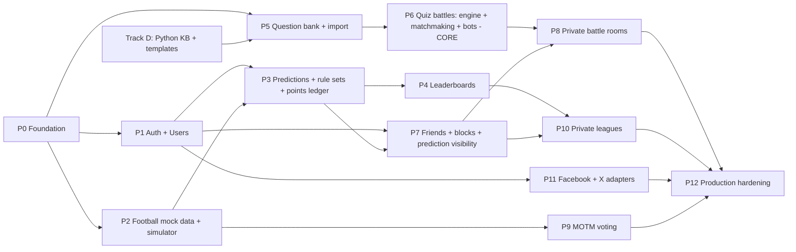

# Implementation Roadmap

Ordered by dependencies, not by the feature list. Each phase ends with a demoable result and explicit exit criteria. Durations are not estimated here on purpose; track them as you go.

## Dependency view

Changes vs the original proposed order, and why:

- **Points ledger moves into P3** with predictions: scoring needs somewhere to write, and the ledger is what makes recalculation possible from day one.
- **Leaderboards move up to P4:** predict → points → rank is the core loop; everything after it plugs into the same ledger.
- **Quiz battles are core and come right after the points loop (P5-P6, ADR-0010).** The Daily Quiz phase is gone; the battle engine, matchmaking and bot fallback come first because they make the feature playable even with very few users.
- **Order change (2026-11-10, product owner): question bank and battles (P5-P6) come before prediction scoring (P3.2-P3.3) and leaderboards (P4).** Prediction rules are not settled yet. The predictions and battles boards are separate (DEC-18), so battles do not wait for prediction scoring. They share only the generic plumbing (the `point_entries` ledger and the leaderboard projection), which is built at the end of P6 for the `BATTLES` category first; prediction scoring writes into the same ledger when it is picked up again.
- **Scope change (2026-11-10, product owner; ADR-0015, ADR-0016): battles are several game types with typed answers, not multiple choice.** v1.0 games: Buzzer, Career, Who is the player?, Tiki Taka Toe (if the data supports it), and Imposter in private rooms (P8). Consequences: the P5.2 and P6 designs are rewritten before any code (step "G0" below); Track D becomes the critical path, because Career and Tiki Taka Toe need player career data and Arabic names that our local data does not have; no monetization at launch. The effort table below predates this change and is re-estimated when G0 is done.
- **Friends before private rooms:** room joins need block checks (`social`), and friends are who you invite.
- **MOTM moves later (P9):** it is independent and can slot anywhere after P2.
- **Track D (Python knowledge base) runs in parallel** from P2 because it has no dependency on the NestJS code, only on the bundle contract. Battles can be played without limit, so the bank must be large before launch (risk K-09). P5-P6 can start with a small hand-written dev bundle.
- **Facebook and X adapters go late (P11):** the identity model is built in P1, so adding providers later changes no schema (DEC-26).

## Phases

### P0 — Foundation
- Monorepo layout from `CLAUDE.md` §4; Docker Compose (Postgres with `app` + `football_kb` DBs, Redis with `noeviction`); `.env.example`.
- NestJS app with `main.api.ts` and `main.worker.ts`; config schema validation; `nestjs-pino`; request id via `nestjs-cls`; problem+json filter; `ValidationPipe`; URI versioning; Swagger at `/docs`; health checks.
- Shared kernel: `Clock`, UUID v7 ids, `DomainError`.
- Prisma setup (multi-file schema), `@nestjs-cls/transactional`; `outbox_events` + publisher loop + BullMQ wiring + Bull Board.
- Testing harness: Jest unit, Testcontainers integration, Supertest e2e; dependency-cruiser boundary rules; CI pipeline.
- **Exit:** `docker compose up` + API/worker start; `/health/ready` green; one sample event goes from outbox to a BullMQ handler in an integration test; boundary lint fails on a deliberate violation.

### P1 — Auth + Users
- `users` (profile, privacy settings), `auth` (identities, sessions, JWT, refresh rotation with reuse detection), Google adapter, a dev/test fake sign-in, session list/revoke, `GET/PATCH /me`, account deletion request (fan-out handlers stubbed per module as modules arrive).
- **Exit:** e2e: sign in with a test-signed Google token → `/me` → refresh → reuse old refresh → family revoked; WS handshake guard tested with a dummy gateway.
- **Delivered in 4 PRs** (each reviewed and merged before the next):

| PR | Scope | Learning cards |
|---|---|---|
| P1.1 Design | Phone sign-in removed (ADR-0012); this plan; P1 notes in `04-auth.md` §11 | none (docs only) |
| P1.2 Schema + tokens | `users`, `user_profiles`, `user_privacy_settings`, `auth_identities`, `sessions` + migration; JWT key config + `keys:generate`; token service (sign/verify access JWT, generate/hash refresh tokens) | JWT, hashing tokens at rest |
| P1.3 Sign-in + refresh | Google ID token verifier, dev/test fake sign-in, `SignInWithVerifiedIdentity`, `POST /v1/auth/google`, `POST /v1/auth/refresh` with rotation and reuse detection | OpenID Connect token verification, refresh rotation, row locking |
| P1.4 Guards + me | Global `JwtAuthGuard` + `@Public()`, `POST /v1/auth/logout`, sessions list/revoke, `GET/PATCH /v1/me`, `DELETE /v1/me` (request only), WS handshake guard, rate limits on `/v1/auth/*`, exit e2e | Authentication vs authorization, rate limiting, soft delete |

- **Not in P1:** Facebook and X (P11), identity linking/unlinking (needs a second provider, P11), `favouriteTeamId` (needs `teams`, added in P2), deletion finalization after the grace period (P12).

### P2 — Football mock data + simulator
- Competitions/seasons/teams/players/matches/squads with AR/EN names; `FootballDataProvider` + `MockFootballProvider`; `ApplyProviderMatchUpdate` with versioning; lifecycle events via outbox; simulator CLI commands and scenarios.
- **Exit:** `mock:run-day` plays a matchday producing `MatchStarted/Finished` events; `GET /v1/matches` lists fixtures with `predictable` computed server-side.
- **Delivered in 3 PRs:**

| PR | Scope | Learning cards |
|---|---|---|
| P2.1 Schema + read API | Football tables, `FootballQuery`, `GET /v1/competitions`, `/v1/matches`, `/v1/matches/{id}`, `/squads`, request locale, `favouriteTeamId` | Keyset pagination, composite indexes, translated names, request pipeline |
| P2.2 Provider + lifecycle | `FootballDataProvider`, `MockFootballProvider` + seed, `ApplyProviderMatchUpdate` (idempotent, out-of-order, `version`), match state machine, outbox events, sync job | State machines, out-of-order updates, optimistic vs pessimistic locking, scheduled jobs |
| P2.3 Simulator | `nest-commander` CLI, `mock:*` commands, scenarios, `mock:run-day`, exit e2e | CLI entry points, simulating time |

### P3 — Predictions + rule sets + points ledger
- `prediction_picks` model, submit/edit with DB-clock lock, revisions, `PredictionScorer` driven by `scoring_rule_sets`, scoring job, void/carry-over policies behind config, `points` module recording/superseding.
- **Exit:** concurrency test around kickoff passes; result correction rescoring supersedes ledger entries; two different rule-set configs produce different points (proves nothing is hard-coded).
- **Delivered in 3 PRs:**

| PR | Scope | Learning cards |
|---|---|---|
| P3.1 Submit | `predictions`, `prediction_picks`, `prediction_revisions`; `PUT` and `GET /v1/matches/{id}/prediction`; database-clock lock; kickoff concurrency tests | Database clock for deadlines, shared vs exclusive locks |
| P3.2 Scoring | `scoring_rule_sets`, `PredictionScorer`, scoring job on `MatchFinished` and `MatchResultCorrected`, `prediction_scores`, `GET /v1/me/predictions` | To be named with the PR |
| P3.3 Ledger + voiding | `points` module, recording and superseding, void and carry-over policies, P3 exit e2e | To be named with the PR |

### P4 — Leaderboards
- Period calculator (timezone + season calendar config), periods lifecycle job, incremental recompute per (period, user), rebuild command, keyset pagination, my-rank endpoint, snapshots at finalization.
- **Exit:** rebuild equals incremental result on a seeded dataset; DST/new-year period tests; leaderboard page query uses the index (EXPLAIN check).

### Track D (parallel, Python) — Knowledge base + templates
- **Added by ADR-0015, now first in line:** the answer catalog (players, clubs, national teams, competitions with Arabic and English names and alternative names) and player careers, from Wikidata (CC0). Our local openfootball copy has about 32,000 players but no career history.
- `football_kb` raw/staging/core for a first small slice: martj42 international results + openfootball top-5 + World Cup; entity crosswalk; facts with provenance; 10-20 bilingual templates; deterministic validation; bundle writer. Ollama phrasing optional and off by default.
- **Exit:** a bundle of ≥ 1,000 validated questions with a 200-question human review sample ≥ 98% correct (Arabic reviewed by a native speaker). **Before public launch:** several thousand questions, sized from expected battles per active user per week × `roundCount` against the exposure window (DEC-44, risk K-09).

### G0 — Game types design (docs only, before P5.2 and P6)
- Rewrite for ADR-0015: `WEBSOCKET.md` (reveal, buzz, typed answer, turns), `03-workflows.md` §4 (shared engine + game rules), `02-database.md` (rounds, buzzes, answers, answer catalog), `07` (catalog and content shapes in the bundle, Wikidata as the career source), `01-modules.md`. Data check for Tiki Taka Toe: enough players per club and country pair.
- **Exit:** the four launch games can be walked through message by message from the docs; every number is named as configuration; the Tiki Taka Toe data check has a yes or no.
- **Done (2026-11-10):** `architecture/08-battle-games.md` (engine + game rules + catalog); `WEBSOCKET.md`, `API.md`, `01`, `02`, `03`, `07` updated; data check passed for `GRID` and `CAREER` (`07` §4.1); Arabic names are the data gap.
- **Order after G0:** D.1 (Wikidata → `football_kb`: players, clubs, careers, Arabic names; catalog export) → P5.2 (catalog + game content import, selection, answer checking; dev bundle rewritten as `BUZZER` + a few `CAREER` items) → P6.1 (engine + `BUZZER`, bot) → P6.2 (`CAREER`, `WHO_IS_PLAYER`) → P6.3 (matchmaking per game type, reconnect, forfeit, sweeper) → P6.4 (`GRID`). D.2 (generators for every game type) runs alongside P6: D.2a (`CAREER` and `BUZZER` generators, the `dev-0002` bundle, 07 §5.8) comes before P6.1; D.2b (`GRID`, `WHO_IS_PLAYER`) before P6.2 and P6.4. **D.3** (owner, 2026-11-11; widened 2026-11-18 by ADR-0022 and 07 §5.10): match data from several sources (Transfermarkt datasets, Fjelstul World Cup DB, martj42, openfootball, xgabora, hand-curated finals) in six steps: D.3a raw landing (**done 2026-11-18**: `sources:fetch`), D.3b linking (`core.entity_xref`), D.3c claims and conflict resolution, D.3d typed match tables, D.3e derived facts, D.3f quality gates. Scope and tiers in DEC-67, licences pending in DEC-66. Topic tags on every round (ADR-0020); its app side (`questions.topics`, the `topics` selection filter, `GET /v1/battle-topics`) ships with it, and the room filters with P8.

### P5 — Question bank + import
- Tables, `questions:import` / `publish` / `disable` CLI, selection queries (locale intersection, difficulty/category balance, exclusion list), answer key, playable payload mapper, question reports endpoint, `BattleCompleted` stats handler (can be wired in P6).
- **Exit:** importing the same bundle twice is a no-op; a changed served question is versioned, not overwritten; payload mappers never expose correctness (test).
- **Delivered in 2 PRs:**

| PR | Scope | Learning cards |
|---|---|---|
| P5.1 Import | Question tables (stats tables come with their `BattleCompleted` handler in P6), bundle validation, `questions:import`, a hand-written dev bundle of about 50 EN/AR questions | Content hash, immutable served content, partial unique index, advisory locks |
| P5.2 Catalog + game content | Answer catalog tables and import (`catalog.jsonl`), `GET /v1/answer-catalog` with `ETag`; `game_type` / `answer_kind` / `content` columns and `question_answers`; import checks per game type (`07` §5.5); `ContentSelector`, `RoundContentQuery`, `AnswerChecker`; `questions:publish` / `questions:disable` (question reports move to P6: they need `battle_rounds`). Delivered as P5.2a (import) and P5.2b (serving, `08` §5.4-5.6) | Bulk upsert with `unnest`, discriminated unions, HTTP caching with `ETag`, random sampling in SQL |

### P6 — Quiz battles: engine + matchmaking + bot fallback (CORE)
- **Rescoped by ADR-0015 (details in G0):** the engine is shared and each game type adds its rules. Build order: engine + the buzz mechanic with `BUZZER`, then `CAREER` and `WHO_IS_PLAYER` (same mechanic, new content), then `GRID`. The text below still describes the shared parts; "answers" now means buzzes and typed answers.
- `/battles` gateway per `WEBSOCKET.md`; battle engine for 2..N participants; question selection with recent-exposure exclusion (DEC-44); question reports endpoint; readiness, rounds, answers, scoring and placements from the BATTLE rule set with per-mode points (DEC-33/41); persistence of every transition; reconnection/resync; forfeit; Redis matchmaking queue + matcher loop; bot fallback with `BotPlayer` profiles (DEC-39/43); activity guard; `GET /v1/me/play-state`; completion → outbox → ledger → leaderboards (the generic `points` ledger and the leaderboard projection are built here for the `BATTLES` category, see the order change above); stale battle sweeper.
- **Exit:** WebSocket test suite for happy path, duplicate/late/out-of-order messages, disconnect/reconnect, forfeit, ready timeout; bot fallback fires after the configured wait and the bot battle replays identically with a fixed seed; two rule-set configs give different per-mode points (proves DEC-41 is config); a 3-participant battle runs in tests even though matchmaking only makes 1v1.
- **Delivered in slices** (each one playable end to end):

| PR | Scope | Not yet |
|---|---|---|
| P6.1 Engine + `BUZZER` + bot | Tables `battles`, `battle_participants`, `battle_rounds`, `battle_round_actions` (`rule_set_id` nullable until P6.5); battle config file (ADR-0018); `/battles` gateway with `time:sync`, `matchmaking:join` / `leave`, `battle:ready`, `round:buzz`, `round:answer`; **every join becomes a bot battle after `botFallbackAfterMs`** (no human pairing yet); the engine (one command queue per battle, timers, `seq`, persistence, ready timeout, completion); `RevealAndBuzzRules` for `BUZZER`; bot strategy with seeded profiles; in-game score and placements; activity guard in Redis; on boot, unfinished battles become `ABANDONED` | Human pairing, reconnect and resync, forfeit, ledger points |
| P6.2 `CAREER`, `WHO_IS_PLAYER` | Content kinds for the same rules: steps rendered per locale from spells (club names from the catalog, `showYears`) and clues; both game types in the battle config; the `WHO_IS_PLAYER` generator (the D.2b part that P6.2 needs) and the `dev-0003` bundle | `GRID` generator (with P6.4) |
| P6.3 Matchmaking and resilience | Redis queue per game type and matcher loop (human vs human, content in both players' locales), bot fallback from the queue, ghost tickets; `battle:resync` and snapshots (the resyncing socket becomes active); disconnect grace, forfeit (`battle:forfeit` and grace expiry), `ABANDONED` when no human is left; `GET /v1/me/play-state`, REST join and leave | Stale battle sweeper (needs several API instances, 05 §1); blocked pairs (P7) |
| P6.4 `GRID` | `GridRules` (turns, claims, line, draw, skips, timeouts), the grid bot, round runners per mechanic (08 §2.4), `grid:claim` / `grid:skip`, the `GRID` generator (clubs × nationalities, 07 §5.8) and the `dev-0004` bundle | Club × club boards, `COMPETITION_WON` |
| P6.5 Points | Three PRs. **P6.5a ledger:** `scoring_rule_sets` + `point_entries`, the `BATTLE` rule set (`08` §6.1) and `battles:activate-rule-set`, ledger points at battle completion, the `BattleCompleted` → `point_entries` handler (the first outbox subscriber). **P6.5b leaderboards:** periods in `Africa/Cairo` (DEC-15/16) from a calendar config, the `PointsRecorded` projection, the three `GET /v1/leaderboards` endpoints (03 §5.6; closing jobs wait for the prize work). **P6.5c questions:** the `BattleCompleted` → `question_stats` handler, `POST /v1/questions/{id}/reports`. P6.5a **Done (2026-11-12)**, PR #46; P6.5b **Done (2026-11-12)**, PR #47; P6.5c **Done (2026-11-12)** | `PREDICTIONS` board entries (need P3.2 scoring), snapshots and prizes (DEC-28/47), friends board (P7), automatic disabling by report count (a product rule), difficulty calibration from the stats |
| P6.6 Typed text answers | ADR-0021: `{ text }` answers, `AnswerChecker.judgeTypedText` (normalizer in TypeScript with the `07` §5.7 vectors, edit distance, distinctive words, exact-match guard), `answers.*` config, `name_words` + GIN index, `answer_text` / `answer_match` on actions, pipeline `nameWords`; remove `GET /v1/answer-catalog`. Before M3, so the app is built against text answers. **Done (2026-11-12)**, with the `dev-0005` bundle | Tuning the tolerance numbers from logged `answer_match` values (playtesting) |

### P7 — Friends + blocks + prediction visibility
- Friend requests, friendships, blocks, user search; `PredictionVisibilityPolicy`; friends' predictions endpoints; blocked pairs skipped by the matchmaker. Two PRs: **P7a** friends, blocks, search and per-user rate limits (#52); **P7b** prediction visibility and the matcher (03 §7.1). **Done (2026-11-13).**
- **Exit:** visibility matrix tests (owner, friend before/after kickoff, non-friend, blocked) for every read path.

### Track N — New game types (DEC-68; before P8)
- **Order change (2026-11-18, product owner):** D.3 and track N come before P8 private rooms. The new 1v1 games are the product's edge, and P8 waits for DEC-58 (Imposter rules) anyway.
- **Every N phase starts with its design section in `08`** (rules, messages, config, open rules as DECs), then the generator, the engine rules, the bot and tests, and a dev bundle. About 3-5 focused days each.

| Phase | Game type | Data it needs | Starts after |
|---|---|---|---|
| N0 Shared engine pieces (**design done 2026-11-18**: 08 §9, ADR-0023; **first-mover phase built 2026-11-19**; helpers come with N1) | all | none: rock-paper-scissors to pick who starts, simultaneous vs turn-based rounds, rounds with several accepted answers, lockout after a wrong answer (`08`) | D.3a (docs in parallel) |
| N1 `MINES` (لغم) (**design done 2026-11-19**: 08 §10, DEC-72..75; **backend + generator built 2026-11-19**) | club + nationality and club + decade pools | careers and nationalities we already have, plus the cities-as-clubs fix (D.3b) | N0 |
| N2 `AUCTION` (المزاد) (**design done 2026-11-19**: 08 §11, DEC-76, DEC-77; **goals, generator and backend built 2026-11-19**) | lists of 6-30 answers (scorers, assisters per club and competition season) | D.3d goals and assists | D.3d |
| N3 `VAULT` (الخزنة) (**design done 2026-11-19**: 08 §12, 07 §5.10 N3 slice, DEC-78; **lineups, generator and backend built 2026-11-20**) | facts with a 0-9 answer (scores, goals, shootouts, shirt numbers, national titles since 2000) | D.3d matches, goals and lineups (`core.lineup_slot`) | N2 |
| N4 `HEX` (الهجمة) | name answers filtered by first letter | the N2 lists and other name templates; Arabic names linked | N2 |
| N5 `LINEUP` (التشكيلة) | starting XIs of famous matches, captains, decoys | D.3d lineups, D.3e `famous_match`, curated finals | D.3e |
| N6 `TIME_MACHINE` (آلة الزمن) | one tournament edition per year (finals, scorers, top scorers, knockout paths) | D.3e `edition_summary` | D.3e |
| N7 `THREAD` (الخيط) | 5-hop chains where every hop has exactly one answer | the whole fact graph, coaches and venues | N6 (hardest generator) |

- **Exit per phase:** the game can be walked through message by message from `08`; its bot plays it; a dev bundle with generated content imports and plays end to end; every open rule is config plus a Pending DEC.

### P8 — Private battle rooms
- `battle_rooms` + members; topic and difficulty filters set by the host (ADR-0020, DEC-64); code generation; create/join/leave/remove/start/close endpoints; lobby pushes (`room:*`); host transfer; rematch back to `LOBBY` (DEC-42); idle timers + backstop sweeper; block checks on join; join rate limits.
- **Exit:** concurrency tests (last seat, join vs start, double start); blocked user gets `ROOM_NOT_FOUND`; room survives an API restart and returns to `LOBBY`; two `maxPlayers` configs work (DEC-38); a room with 3 or more players plays a full battle and a rematch.

### P9 — MOTM voting
- Poll creation on `MatchFinished`, window from `ended_at`, votes with DB-clock window check, delayed close + sweeper, aggregation strategy registry, end-time correction handling.
- **Exit:** votes at window edges behave per spec; lost delayed job still closes via sweeper; aggregation strategies swappable by config.

### P10 — Private leagues
- Leagues, members, invites (code), competitions (PREDICTIONS first, then BATTLES), `LeaguePolicy`, league leaderboard from the ledger.
- **Exit:** league ranking matches a manual ledger sum under both counting policies (DEC-20).

### P11 — Facebook + X sign-in
- Adapters + account linking UX endpoints; verify current provider API constraints first.
- **Exit:** linking rules tested (no auto-merge, last-identity protection).

### P12 — Production hardening
- Rate limit tuning, app attestation for sign-in and battles (optional), backups, metrics dashboards, load test of leaderboard pages, matchmaking and concurrent battles, deployment scripts, licence/attribution screen, account deletion end-to-end, security review.
- **Exit:** checklist in `06-cross-cutting.md` §1.1 fully satisfied; restore-from-backup drill done.

## Mobile track (Flutter, `apps/mobile`)

Each mobile phase starts once the backend phase it consumes is merged. The API contract is already written, so screens can be built against it with mocked responses even earlier.

### M0 — Mobile foundation (after P0)
- Decided in ADR-0014: Flutter latest stable pinned with `fvm`, Riverpod, go_router; the application id is deferred (DEC-52, placeholder until R2). Prompt: `docs/prompts/mobile-m0-foundation.md`. `flutter create` in `apps/mobile`; dev/prod flavors; Arabic + English with RTL; generated REST client from the backend `openapi.json`; secure token storage; error mapping from problem+json `code`; path-filtered CI (`flutter analyze`, tests).
- **Exit:** app runs on an Android emulator against the local backend, `/health` call works, RTL layout verified. iOS: the project is scaffolded, but running it needs macOS (the owner develops on Linux), so the iOS check moves to the first time a Mac or a macOS CI runner is available, before R2.
- **Done (2026-11-11):** PR #21. Flutter 3.38.5 pinned with `fvm`; Android exit verified, iOS check still pending (needs macOS).

### M1 — Sign-in and profile (after P1)
- Google sign-in, refresh rotation, sessions list, profile and privacy settings, account deletion.
- **Exit:** sign in → kill the app → reopen still signed in; refresh reuse forces sign-out.
- **Design:** ADR-0017 (refresh rotation on the client, Google sign-in, re-authentication), agent prompt `docs/prompts/mobile-m1-sign-in.md`.
- **Done (2026-11-11):** PRs #29 (design) and #30. Exit verified on an Android emulator against the local backend, including a refused refresh signing out. Not done yet: privacy settings (an M1 prompt non-goal), Google sign-in on a device (needs the owner's OAuth clients), iOS (needs macOS).

### M1.5 — Data layer before screens (ADR-0019)
- No new UI. Data and application code for every backend feature already merged: profile fields, football, predictions, and the `/battles` socket (clock, commands with typed text answers, state reducer). M2 and M3 screens build on it.
- **Exit:** each feature has tested repositories and use cases, and a run against the local backend reads matches, submits a prediction and plays a battle against the bot without a screen (the catalog download was removed by ADR-0021).
- **Exit check, automated:** `fvm flutter test test_live` (`apps/mobile/test_live/README.md`) runs the data layer against the local backend: REST through every repository (profile, sessions, football, a prediction, friends, blocks, directory, leaderboards, play-state), one battle against the bot for `BUZZER`, `CAREER`, `WHO_IS_PLAYER`, `GRID`, `MINES` and `AUCTION` (rock-paper-scissors, burying and the detector, bids, all-in, proofs and steals included), `battle:resync` after a dropped socket (mid-round, during rock-paper-scissors, during burying, during bidding), and a resume through play-state.

### M2 — Matches, predictions, leaderboards (after P3 + P4)
- Fixtures by date and competition, prediction editor locked by server `predictable` + `serverTime`, own history with scores, the four leaderboard periods, my rank.
- **Exit:** full predict → simulate match → see points and rank flow on a device.

### M3 — Quiz battles UI (after P6) — CORE
- Socket client per `WEBSOCKET.md`: matchmaking screen with bot fallback, battle screen with server-synced countdown, round results, placements, bot label, reconnect and resync, `GET /me/play-state` resume.
- **Exit:** two devices play a full battle; airplane mode for 5 seconds mid-round recovers via resync; a bot battle shows the bot badge.

### M4 — Friends and private rooms (after P7 + P8)
- User search, friend requests, blocks, friends' predictions; create room, share code, lobby, host start, rematch.
- **Exit:** three devices play a room battle started from a shared code.

### M5 — MOTM and leagues (after P9 + P10)
- MOTM voting screen with window countdown and results; league create/join/leaderboard.
- **Exit:** vote inside the window; a league ranking matches the backend.

## Release track

### R1 — Real football data provider (blocker for any public release)
- Mock data is useless in production. Choose a provider (DEC-45), implement its `FootballDataProvider` adapter, sync jobs, and attribution screen. Check its licence for commercial use before writing code.
- **Exit:** a real matchday syncs fixtures and results automatically; predictions score from real results.

### R2 — Store release
- Accounts: Google Play (one-time fee) and Apple Developer (yearly fee). Privacy policy and terms pages; official prize rules (risk K-07); store listings in Arabic and English; app icons and screenshots.
- Production deploy (P12 checklist), crash reporting with a free tier, backups verified.
- **Google Play closed test:** new personal developer accounts must run a closed test with a minimum number of testers (currently 12) for 14 days before production access. Plan the calendar time; verify the current rule when registering.
- **Exit:** app approved on both stores; staged rollout started.

**Zero budget ends at release.** Unavoidable costs: store accounts, a server, a domain, and backups. No SMS: phone sign-in was removed (ADR-0012).

## Release scope (Decided 2026-11-07, DEC-46)

**v1.0 contains everything:** P0-P12, Track D, M0-M5 (plus Facebook/X screens in the mobile sign-in flow), R1, R2. Consequences:
- R1 must also deliver timely **lineups** for MOTM candidates (DEC-27), not only fixtures and results. This is the riskiest release dependency (K-02).
- Google, Facebook and X sign-in ship at launch (DEC-26, ADR-0012). The iOS release also needs Sign in with Apple (DEC-48, App Store guideline 4.8).

## Order of work and rough effort

Estimates are **focused working days for one developer using coding agents**, including tests. At 5 focused days per week, v1.0 (everything) is roughly **5-6 months**.

| Stage | Phases (in order) | Focused days |
|---|---|---|
| A. Foundation | P0, M0 | 5-8 |
| B. Predict (submit only) | P1, M1, P2, P3.1 | 13-19 |
| C. Quiz battles (core) | P5, P6 (with the generic ledger + battles board), M3, P7, P8, M4 | 32-45 |
| C2. Predictions scoring | P3.2, P3.3, P4 for the predictions board, M2 | 10-14 |
| Parallel content | Track D (start during stage B; keep going until launch volume, K-09) | 10-15 |
| C3. New game types (before P8) | D.3, N0-N7 | 35-50 |
| D. Rest of the product | P9, P10, M5, P11 (+ Facebook/X in the app) | 14-22 |
| E. Release v1.0 | R1 (fixtures, results, lineups), P12, R2 | 12-20 + 14 days closed test |

## Deferred (Future)
Notifications, direct room invites via push, activity feed, share cards for X, achievements, skill rating for matchmaking and bots, admin dashboard, prize fulfillment, real football data provider, multi-instance WebSockets, semantic dedup with local embeddings.
