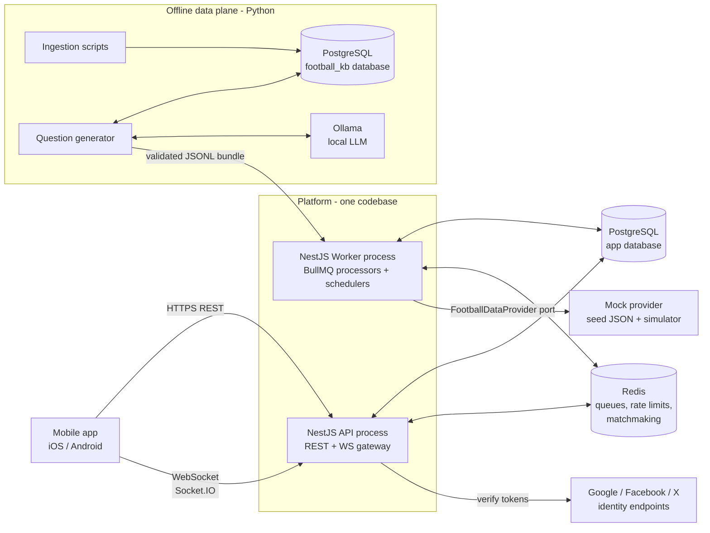
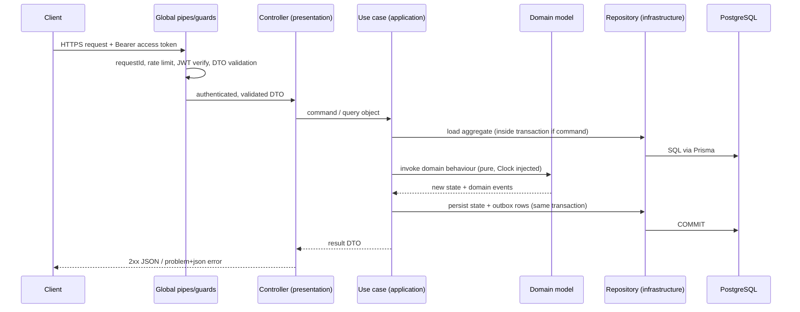
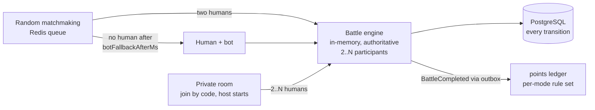
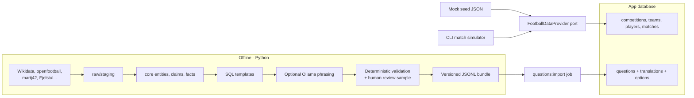

# 00 — Overview: Vision, Scope, Assumptions, Risks, System Architecture

## 1. Vision (Confirmed)

A football social gaming platform combining match predictions, real-time trivia battles between players (the core quiz feature, playable any time), Man of the Match voting, private leagues, friends, and four leaderboard periods, on top of a fact-first football knowledge database. It must be fun, fair, understandable, and extensible with new game modes without rewrites.

Guiding principles:

- **Fairness is a technical property.** Locks, windows, timers and scores are decided by the server and the database clock.
- **Privacy by default.** Predictions are private unless a visibility rule explicitly allows a viewer.
- **Rules are data, not code.** Every TBD rule (weights, timers, counts, tie-breaks) lives in versioned configuration.
- **Boring infrastructure.** One NestJS codebase, one Postgres, one Redis. Complexity is added only against a measured need.

## 2. Scope

### 2.1 Confirmed product scope

| Area | Confirmed | Open (see `DECISIONS.md`) |
|---|---|---|
| Predictions | Result and/or score predictions; editable until kickoff; private by default; friends can see per visibility rules | Scoring, mandatory types, visibility timing, postponement policy |
| MOTM | All users vote; after the match; window = 1 hour after authoritative end; aggregate community result | Aggregation, ties, vote changes, anonymity, verification, points, prediction timing |
| Quiz battles (**core**) | Football trivia played **against other players, any time, real-time only** (ADR-0010). Random matchmaking (1v1); multiplayer private rooms (2 or more players) with a unique code to invite friends; a bot when no human opponent is available. Multilingual (AR/EN) questions. **No** Daily Quiz, **no** solo mode, **no** async play | Round count, timers, scoring, room size, bot wait and disclosure, points per mode, repetition (DEC-31..33, 37..44) |
| Private leagues | Members, owner, predictions **and** battle competitions | Invitations, limits, duration, scoring, visibility, permissions |
| Leaderboards | Weekly, monthly, seasonal, all-time; **two separate boards: predictions and battles** (DEC-18); monthly leader gets a prize | Boundaries, timezone, season definition, tie-breaks, prize per board (DEC-47) |
| Social | Friends; friends can view predictions | Feed, sharing, achievements, following |
| Auth | Google, X, Facebook (no phone sign-in, ADR-0012) | Identity broker choice (DEC-25), Sign in with Apple for iOS (DEC-48), linking UX |
| Football data | Mock data first; free legal datasets later | Provider for live results in production |
| AI | Local Ollama, offline only | Model choice |

### 2.2 v1.0 scope (Decided 2026-11-07: everything ships in v1.0, DEC-46)

All items below ship in the first public release. The list is the build order:

1. Auth: **Google** first, then Facebook and X adapters, all before release (same identity model, so adding them later does not change the schema). No phone sign-in (ADR-0012). See DEC-26.
2. Mock competitions, teams, players, matches + a CLI simulator that drives the match lifecycle.
3. Predictions with server-side kickoff lock, revisions, and a pluggable scoring rule set.
4. Points ledger + weekly/monthly/seasonal/all-time leaderboards (global).
5. Question bank (import of validated bundles).
6. **Real-time quiz battles (core):** battle engine, random 1v1 matchmaking, bot fallback (single API instance).
7. Friends (mutual) + prediction visibility policy.
8. **Private battle rooms** with invite codes.
9. MOTM voting with authoritative window, scheduled close, aggregation strategy behind config.
10. Private leagues (prediction mode first, battle mode second).

### 2.3 Future (architecturally supported, not built now)

Activity feed, notifications (push), direct room invites to friends via push, share cards for X, achievements, head-to-head records, skill rating for matchmaking and bots, following/public profiles, admin dashboard, prize fulfillment, real football data provider, multi-instance WebSocket scaling, semantic question dedup with local embeddings.

Not planned (rejected by the product owner, 2026-11-07): Daily Quiz, solo/practice quiz, async (turn-based) challenges.

## 3. Requirements traceability (non-negotiable behaviours)

| ID | Requirement | Where it is enforced |
|---|---|---|
| R-01 | Prediction edits rejected at/after lock time | Conditional SQL using DB `now()` in `predictions` write (`03-workflows.md` §1) |
| R-02 | MOTM votes only inside `[opens_at, closes_at)` derived from authoritative `ended_at` | Conditional SQL in `motm_votes` write + scheduled close + sweeper |
| R-03 | Battle timing measured server-side | Round `started_at`/`deadline_at` and answer `received_at` stored server-side; client timestamps ignored for scoring |
| R-04 | Scores recalculable after rule changes | `scoring_rule_sets` versions + `point_entries` supersession + leaderboard rebuild |
| R-05 | Private predictions never leak | Single `PredictionVisibilityPolicy` used by every read path; integration tests per path |
| R-06 | Gameplay works with Ollama off | Generation is an offline pipeline; API only reads published questions |
| R-07 | No paid dependency in development | Ports with free/dev adapters: `FootballDataProvider` (mock). Phone/SMS sign-in removed (ADR-0012) |
| R-08 | Account deletion | Required by app stores; anonymization flow (`04-auth.md` §8) |

## 4. Assumptions (labeled, replaceable)

| ID | Assumption | Why it was needed | Impact if wrong |
|---|---|---|---|
| A-01 | Primary clients are native mobile apps (iOS/Android); a web client may come later | Auth flows differ for mobile vs web | Auth adapters change, schema does not |
| A-02 | Friendship is **mutual** (request + accept). "Following" is future | "Friends can view each other's predictions" implies mutual consent | Add `follows` table later; no change to friendships |
| A-03 | One active MOTM vote per user per match (whether it can be changed is DEC-05) | Needed for a unique constraint that is valid under every DEC-05 option | None: both options keep one active row |
| A-04 | *Withdrawn (2026-11-07):* was "Daily Quiz: same question set for everyone". Within one battle all participants get the same questions in the same order; that is a protocol rule, not an assumption | | |
| A-05 | A multiple-choice question has exactly one correct option | Validation rule "answer uniqueness" in the brief | Multi-answer types would need a new question type |
| A-06 | Single platform timezone for period boundaries (value is DEC-15/16) | Leaderboards must agree for all users | Per-region boards would add a `region` dimension |
| A-07 | Launch scale: < 50k registered users, < 2k concurrent, < 200 concurrent battles | Sizing for a single API instance + single worker | Section 06 lists the scaling steps |
| A-08 | MOTM candidates = players in both teams' matchday squads, supplied by the football data provider (mock now) | MOTM needs a candidate list | See risk K-02 |
| A-09 | The mobile app is **Flutter** (Dart), living in `apps/mobile` of the same monorepo (ADR-0011). **Confirmed 2026-11-10 (ADR-0014): Riverpod, go_router, fvm-pinned stable** | The owner works in Flutter; the monorepo layout needs a toolchain | A different framework changes only `apps/mobile` tooling; the backend and the contract are unaffected |

## 5. Architectural risks

| ID | Risk | Mitigation |
|---|---|---|
| K-01 | ~~Phone OTP costs money in production (SMS), conflicting with the zero budget~~ | **Resolved (2026-11-08, ADR-0012):** phone sign-in removed; no SMS anywhere |
| K-02 | **Free data sources do not provide timely lineups**, but MOTM needs candidates within minutes of full time | Mock provides squads now; production needs either a paid live provider or a weaker candidate source (current squad from Wikidata). Flagged as DEC-27 |
| K-03 | Friends seeing predictions **before kickoff** lets league members copy picks | Recommend visibility only after lock (DEC-21 default) |
| K-04 | Real-time battles with few users online means long matchmaking waits | Bot fallback after a configured wait (DEC-39); private rooms for friends. Async play was rejected, so bots are the only cure for an empty queue |
| K-05 | Small local LLMs produce weak Arabic | Templates write the canonical text; LLM output is optional and must pass validation + human review of Arabic before publish |
| K-06 | Leaderboard disputes after result corrections | Ledger supersession + monthly finalization grace window before prize snapshot (DEC-28) |
| K-07 | Prize competitions have legal/app-store requirements (official rules, store "not a sponsor" statement) | Non-technical; track before the first prize |
| K-08 | Three OAuth providers (four with Apple, DEC-48) is a lot of security-sensitive code for a solo developer | Phase them; consider an identity broker (DEC-25) |
| K-09 | **Question volume.** Battles can be played without limit, so an active player sees hundreds of questions a week. A small bank causes repeats, which reward memorizing over knowledge | Per-player exposure exclusion (DEC-44); the knowledge-base pipeline targets thousands of questions before launch (Track D); `question_stats` flags overexposed questions |
| K-10 | **Collusion and farming in prize-linked leaderboards:** friends throwing games in private rooms, second accounts, easy bot wins | Points per battle mode are rule-set values; none for rooms and bots (Decided, DEC-41); prize eligibility checks (`06-cross-cutting.md` §1.2). Second accounts are cheaper without phone sign-in (ADR-0012) |
| K-11 | Undisclosed bots damage trust and may break store or consumer rules in a game with prizes | Bots always labeled (Decided, DEC-40) |
| K-12 | **App Store guideline 4.8:** an iOS app with Google/Facebook/X sign-in must also offer an equivalent privacy-focused sign-in, such as Sign in with Apple | DEC-48; decide before the iOS release (R2) |

## 6. System architecture

### 6.1 System context



Key points:

- **Two processes, one codebase:** `main.api.ts` (HTTP + WebSocket) and `main.worker.ts` (jobs). They share modules; the worker simply does not start the HTTP server or WS gateway. This lets the API scale independently of jobs without a microservice split.
- **The offline data plane** (Python + Ollama + `football_kb`) never sits on a request path. Its only output into the app is a versioned, validated question bundle imported by the worker (ADR-0007).
- **Two logical databases** on the same Postgres server: `app` (owned by NestJS/Prisma) and `football_kb` (owned by the Python pipeline). ADR-0005.

### 6.2 Request flow (REST)



### 6.3 Background flow (outbox → BullMQ)

```mermaid
sequenceDiagram
  participant UC as Use case (API or worker)
  participant DB as PostgreSQL
  participant OP as Outbox publisher (worker)
  participant Q as BullMQ (Redis)
  participant H as Event handler (worker)
  UC->>DB: BEGIN; state change; INSERT outbox_events; COMMIT
  loop every ~1s
    OP->>DB: SELECT ... FOR UPDATE SKIP LOCKED (unpublished)
    OP->>Q: add one job per subscriber (jobId = eventId__subscriber)
    OP->>DB: mark published_at
  end
  Q->>H: deliver job (at-least-once)
  H->>DB: idempotent effect (unique keys / upsert)
```

### 6.4 Real-time flow (quiz battles)

Three ways into a battle, one engine:



```mermaid
sequenceDiagram
  participant A as Player A
  participant B as Player B or bot
  participant GW as Battle gateway (API process)
  participant BE as Battle engine (in-memory, authoritative)
  participant DB as PostgreSQL
  A->>GW: matchmaking:join, or room start by host (REST)
  GW->>BE: participants formed (pair, human+bot, or room members)
  BE->>DB: INSERT battle, participants, rounds (question ids)
  BE-->>A: battle:found (players[], youParticipantId)
  BE-->>B: battle:found (a bot needs no message and is ready at once)
  A->>GW: battle:ready
  B->>GW: battle:ready
  loop each round
    BE->>DB: round.started_at
    BE-->>A: round:start, then round:clue step by step (reveal games, 08-battle-games.md)
    BE-->>B: round:start, round:clue
    A->>GW: round:buzz (clientMsgId)
    GW->>BE: first valid buzz wins (one battle's commands are processed in arrival order)
    BE-->>B: round:buzzed (reveal paused)
    A->>GW: round:answer (entityId picked from the answer catalog)
    Note over BE: a bot's buzz and answer are scheduled by the engine and use the same path
    BE->>DB: INSERT battle_round_actions (buzz, answer, in accepted order)
    BE-->>A: ack
    BE->>BE: correct → close round; wrong → lock A out, resume reveal
    BE-->>A: round:result
    BE-->>B: round:result
  end
  BE->>DB: battle COMPLETED + placements + outbox BattleCompleted
  BE-->>A: battle:completed
  BE-->>B: battle:completed
```

### 6.5 Football data and question pipeline



## 7. Deployment views

| Environment | Composition | Cost |
|---|---|---|
| Local dev (Confirmed) | Docker Compose: postgres (with `app` + `football_kb` DBs), redis, optional ollama, optional prometheus + grafana; API and worker run with `nest start --watch` | Free |
| Free-tier demo (Recommended, limited) | One always-free VM running the same Compose stack. Free managed Postgres/Redis tiers are a poor fit: BullMQ polls Redis constantly and burns request-based free quotas | Free while the free tier exists; no SLA, no backups by default |
| Production (later) | 1 VM (API + worker) → 2+ API instances behind a load balancer + 1-N workers; managed or self-hosted Postgres with backups; Redis; domain/TLS | Paid. Realistically tens of USD/month at small scale |

Production cannot run indefinitely at zero cost. Minimum unavoidable costs: a domain, off-site backups, and app store developer accounts.
