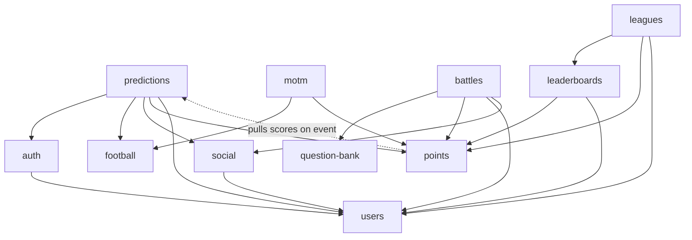

# 01 — Modular Monolith: Modules, Boundaries, Dependency Rules, Events

## 1. Module map

The brief listed 20 candidate modules. Many change together or are too small to stand alone, so they are grouped into **11 MVP modules** plus a shared kernel. Question generation lives **outside** the monolith. (There were 12; the `quiz` module was removed with the Daily Quiz by ADR-0010. Row 7 is kept empty so section numbers stay stable.)

| # | Module | Groups these candidates | MVP? | Why this boundary |
|---|---|---|---|---|
| 1 | `auth` | Auth | Yes | Security-sensitive, changes for different reasons than profiles |
| 2 | `users` | Users, Profiles | Yes | Profile + privacy settings + account deletion are one lifecycle |
| 3 | `football` | Competitions, Teams, Players, Matches, Football Data Ingestion (app side) | Yes | Reference data that changes together; one owner of the match lifecycle |
| 4 | `predictions` | Predictions, Prediction Scoring | Yes | Scoring is a domain service of predictions, not a separate bounded context |
| 5 | `motm` | MOTM Voting | Yes | Own window, own aggregate, own rules |
| 6 | `question-bank` | Questions | Yes | Content lifecycle (import, publish, disable, stats) independent of play |
| 7 | ~~`quiz`~~ | — | Removed | Daily Quiz removed (ADR-0010). Quiz = real-time battles only |
| 8 | `battles` | Quiz, Real-Time Battles, Matchmaking, private rooms, bots | Yes (**core**) | The only trivia mode. One real-time engine fed by three entry points (matchmaking, rooms, bot fallback) that change together |
| 9 | `points` | (new) points ledger + scoring rule sets | Yes | Single append-only source for every score; decouples games from leaderboards (ADR-0003) |
| 10 | `leaderboards` | Leaderboards | Yes | Read-heavy projections over the ledger |
| 11 | `leagues` | Private Leagues | Yes (after core) | Membership + league competitions; reuses ledger and leaderboard queries |
| 12 | `social` | Friends / Social | Yes | Friend requests + friendships; future follows/feed |
| — | `shared` | — | Yes | Kernel (Clock, ids, errors, pagination) + infra (Prisma, Redis, BullMQ, outbox, logger, health) |
| F1 | `notifications` | Notifications | Future | Push/in-app; consumes events only |
| F2 | `activity` | Activity feed, achievements | Future | Consumes events; no writes into other modules |
| F3 | `admin` | Admin dashboard backend | Future | Thin presentation layer over existing facades with admin authorization |
| — | `data/` (Python) | Question Generation, KB ingestion | Offline | Different runtime, different lifecycle, never on the request path (ADR-0007) |

## 2. Module catalog

Format per module: **Purpose · Responsibilities · Owned tables · Public interface · Depends on · Publishes · Consumes · Must not.**

### 2.1 `auth`
- **Purpose:** Prove who the caller is and manage sessions.
- **Responsibilities:** Verify provider credentials (Google, Facebook, X; no phone sign-in, ADR-0012); map provider identities to an internal user; issue access tokens and rotating refresh tokens; list/revoke sessions; link/unlink identities; WebSocket handshake authentication.
- **Owned tables:** `auth_identities`, `sessions`.
- **Public interface:** `AuthFacade.verifyAccessToken(token) → AuthContext`, `AuthFacade.revokeAllSessions(userId)`; guards `JwtAuthGuard`, `WsAuthGuard`; decorator `@CurrentUser()`.
- **Depends on:** `users` (create user on first sign-in, check status).
- **Publishes:** `UserSignedIn`, `IdentityLinked`, `IdentityUnlinked`, `SessionRevoked`.
- **Consumes:** `UserDeleted` (revoke sessions, delete identities).
- **Must not:** store provider access tokens longer than needed; implement authorization rules of other modules; auto-merge accounts by email.

### 2.2 `users`
- **Purpose:** The internal user and their profile, preferences, privacy settings.
- **Responsibilities:** Create user, profile (display name, avatar, locale, favourite team), privacy settings, account deletion/anonymization orchestration, user search for friend requests.
- **Owned tables:** `users`, `user_profiles`, `user_privacy_settings`.
- **Public interface:** `UsersFacade.createFromIdentity()`, `UserQuery.getPublicProfiles(ids)`, `UserQuery.search(term)`, `UsersFacade.requestDeletion(userId)`.
- **Depends on:** nothing.
- **Publishes:** `UserRegistered`, `UserProfileUpdated`, `UserDeletionRequested`, `UserDeletionCancelled`, `UserDeleted`.
- **Consumes:** none.
- **Must not:** know about providers or tokens; decide prediction visibility (it only stores the user's preference).

### 2.3 `football`
- **Purpose:** Single owner of competitions, seasons, teams, players, matches and the match lifecycle.
- **Responsibilities:** Persist reference data; run the match state machine (`SCHEDULED → LIVE → FINISHED`, plus `POSTPONED`, `CANCELLED`, `ABANDONED`); store authoritative `kickoff_at`, `ended_at`, scores, squads; apply provider updates idempotently; expose match queries; run the mock provider and CLI simulator.
- **Owned tables:** `competitions`, `seasons`, `teams`, `players`, `matches`, `match_squad_players`, `provider_sync_runs`.
- **Public interface:** `FootballQuery.getMatch(id)`, `listMatches(filter)`, `getSquads(matchId)`, `getLockInfo(matchId)`; port `FootballDataProvider` (`MockFootballProvider` now).
- **Depends on:** nothing.
- **Publishes:** `MatchScheduled`, `MatchKickoffChanged`, `MatchStarted`, `MatchFinished`, `MatchResultCorrected`, `MatchEndTimeCorrected`, `MatchPostponed`, `MatchCancelled`, `MatchAbandoned`.
- **Consumes:** none (driven by provider sync jobs and the simulator).
- **Must not:** know about predictions, votes, or points.
- **Locale:** controllers read the resolved language with `@RequestLocale()`. `auth` sets it (header, else profile), so `football` stays free of a `users` dependency.

### 2.4 `predictions`
- **Purpose:** Users' match predictions, their privacy, and their scoring.
- **Responsibilities:** Submit/replace prediction before lock; keep revision history; enforce lock with the DB clock; compute per-prediction scores using the active rule set; recompute on result correction or rule change; void/carry-over on postponement/cancellation according to policy; enforce visibility through `PredictionVisibilityPolicy`.
- **Owned tables:** `predictions`, `prediction_picks`, `prediction_revisions`, `prediction_scores`.
- **Public interface:** `PredictionsFacade.submit()`, `PredictionQuery.getOwn()`, `getVisibleForViewer()`, `PredictionScoreQuery.listForMatch(matchId, ruleSetId, cursor)`.
- **Depends on:** `football` (match + lock info), `social` (are friends), `points` (active rule set), `users` (public profiles for display).
- **Publishes:** `PredictionSubmitted` (internal analytics), `PredictionsScored {matchId, ruleSetId}`, `PredictionsVoided {matchId}`.
- **Consumes:** `MatchFinished`, `MatchResultCorrected`, `MatchCancelled`, `MatchPostponed`, `MatchKickoffChanged`, `MotmResultFinalized` (only if MOTM picks are enabled, DEC-08), `ScoringRuleSetActivated`.
- **Must not:** write leaderboard rows; trust client time; expose other users' predictions without the policy.

### 2.5 `motm`
- **Purpose:** Community Man of the Match voting.
- **Responsibilities:** Create a poll per finished match with candidates from squads; open at authoritative `ended_at`, close at `ended_at + 1h`; accept/replace votes per DEC-05; aggregate per configured strategy; finalize result; handle end-time corrections.
- **Owned tables:** `motm_polls`, `motm_candidates`, `motm_votes`.
- **Public interface:** `MotmFacade.castVote()`, `MotmQuery.getPollForMatch(matchId, viewerId)`.
- **Depends on:** `football` (match, squads), `points` (rule set, only if voting itself earns points, DEC-08).
- **Publishes:** `MotmVotingOpened`, `MotmVotingClosed`, `MotmResultFinalized {matchId, winners[]}`.
- **Consumes:** `MatchFinished`, `MatchEndTimeCorrected`, `MatchCancelled`.
- **Must not:** score predictions itself (predictions consumes the result).

### 2.6 `question-bank`
- **Purpose:** The playable round content of every game type, and the answer catalog (ADR-0015, `08-battle-games.md` §4-5).
- **Responsibilities:** Import validated bundles (idempotent by `external_key` + `content_hash`; catalog upsert by `external_ref`); status workflow `DRAFT → APPROVED → PUBLISHED → DISABLED`; selection queries per game type (difficulty, category, locale availability, exclusion lists); accepted answers; serving the answer catalog snapshot; usage statistics.
- **Owned tables:** `questions`, `question_translations`, `question_options`, `question_option_translations` (legacy, unused by games), `question_answers`, `answer_entities`, `answer_entity_aliases`, `question_categories`, `question_import_batches`, `question_stats`, `question_stats_applied`.
- **Public interface** (details in `08-battle-games.md` §5.4):
  - `ContentSelector.pickContentIds(criteria) → contentIds`.
  - `RoundContentQuery.getContentForEngine(id, locales)`: full content for the server-side engine only, never sent to clients as is.
  - `AnswerChecker.judgeTypedText(contentId, slot, text, rules) → { verdict: CORRECT | WRONG, entityId, match }` (`08` §5.3). Bots skip it: the round runner checks their entity ids against the accepted answers it already holds.
  - `AnswerCatalogQuery.findEntitiesByIds(ids)` (names for events).
  - `QuestionBankFacade.disableQuestion(id, reason)`.
- **Depends on:** nothing.
- **Publishes:** `QuestionsPublished`, `QuestionDisabled`.
- **Consumes:** `BattleCompleted` (its `questionResults` summary updates `question_stats`; deduplicated by battle id in `question_stats_applied`).
- **Must not:** generate questions (offline pipeline does), call Ollama, or read `football_kb`.

### 2.7 (removed) `quiz`
Removed with the Daily Quiz (ADR-0010, 2026-11-07). The section number is kept so references stay valid. Everything trivia lives in `battles`.

### 2.8 `battles` (core)
- **Purpose:** Real-time football trivia between players at any time: the only quiz mode (ADR-0010).
- **Responsibilities:**
  - **Matchmaking:** 1v1 Redis queue (strategy DEC-37), plus a bot fallback after a configured wait (DEC-39).
  - **Private rooms:** create a room with a unique code; join by code; lobby (members, host, leave, remove, host transfer); host starts (DEC-38); rematch and idle expiry (DEC-42).
  - **Battle engine:** 2..N participants (`HUMAN` or `BOT`); one game type per battle, whose game rules run inside the engine (`08-battle-games.md` §2); content selection with per-player exposure exclusion (DEC-44); readiness; rounds; one battle's commands processed one at a time in arrival order (first buzz wins); idempotency by `clientMsgId`; scoring and placements with the active BATTLE rule set (DEC-33); disconnect grace, reconnection and snapshot resync; forfeits; completion; persistence of every state transition.
  - **Game rules:** `RevealAndBuzzRules` (`BUZZER`, `CAREER`, `WHO_IS_PLAYER`) and `GridRules` (`GRID`), pure domain code with their bot strategies.
  - **Bots:** server-side participants driven by bot profiles (DEC-43) and an injected random source. They answer through the same path as humans.
  - **One activity per user:** a user can be in the matchmaking queue, a room lobby, or a battle, never two at once.
- **Owned tables:** `battle_rooms`, `battle_room_members`, `battles`, `battle_participants`, `battle_rounds`, `battle_round_actions`. Redis keys: `mm:*` (queue, tickets) and `act:*` (current activity per user).
- **Public interface:** WS namespace `/battles` (`api/WEBSOCKET.md`). REST through `MatchmakingFacade.join()/leave()`, `RoomsFacade.create()/join(code)/leave()/remove()/start()/close()`, `BattleQuery.get(id, viewer)`, `BattleQuery.listForUser(userId, cursor)`, `PlayStateQuery.get(userId)` (current queue, room or battle, used for app resume).
- **Depends on:** `question-bank` (selector + answer key + playable payloads), `points` (active BATTLE rule set), `users` (public profiles), `social` (`isBlocked` checks when joining rooms).
- **Publishes:** `BattleCompleted {battleId, gameType, mode, hasBot, roomId?, participants[{participantId, kind, userId?, score, placement, outcome, points}], questionResults[{questionId, endReason, stepsRevealed?, wrongAnswers, solved}], endedAt}` (`questionResults` has one item per round, so the payload stays small; it feeds difficulty calibration).
- **Consumes:** `UserDeleted` (remove from queue and rooms, anonymize participants).
- **Must not:** let the client advance rounds, decide correctness, or report scores; send a client any step or answer before it is revealed; compare answer text instead of entity ids; branch on `gameType` outside the game rules registry; create bots as `users` rows; give bots ledger points; hard-code round count, timers, room size, bot wait or per-mode points (DEC-31..33, 38..44).

### 2.9 `points`
- **Purpose:** Append-only ledger of every point awarded, plus the versioned scoring rule sets.
- **Responsibilities:** Store `scoring_rule_sets` (config JSON per game type, versioned, activation dates); record ledger entries idempotently from game events; supersede entries when scores are recalculated; expose sums by user/category/time window.
- **Owned tables:** `scoring_rule_sets`, `point_entries`.
- **Public interface:** `ScoringRuleSetQuery.getActive(gameType, at)`, `PointsQuery.sum(userIds, category, from, to)`, `PointsQuery.listEntries(userId, cursor)`.
- **Depends on:** `predictions` (`PredictionScoreQuery`, pulled by handler), otherwise event payloads.
- **Publishes:** `PointsRecorded {userIds, categories, occurredAtMin, occurredAtMax}`, `PointsSuperseded {...}`, `ScoringRuleSetActivated`.
- **Consumes:** `PredictionsScored`, `PredictionsVoided`, `MotmResultFinalized` (if votes earn points), `BattleCompleted` (human participants only; points per mode from the rule set, DEC-41).
- **Must not:** contain game rules (each game module calculates, including per-mode battle points; the ledger only records).

### 2.10 `leaderboards`
- **Purpose:** Fast, paginated rankings per period and category.
- **Responsibilities:** Generate periods (weekly/monthly/seasonal/all-time) from a timezone + season calendar config; maintain `leaderboard_entries` incrementally from `PointsRecorded`; rebuild a period from the ledger; compute ranks with configured tie-breaks; freeze snapshots at period close (prize); expose global and user-set (league) rankings.
- **Owned tables:** `leaderboard_periods`, `leaderboard_entries`, `leaderboard_snapshots`, `season_calendar`.
- **Public interface:** `LeaderboardQuery.page(periodKey, category, cursor)`, `aroundUser(...)`, `forUserSet(userIds, window, category, cursor)`.
- **Depends on:** `points` (ledger reads for rebuild and user-set rankings), `users` (display data).
- **Publishes:** `LeaderboardPeriodClosed`, `LeaderboardSnapshotFinalized` (prize workflow, future).
- **Consumes:** `PointsRecorded`, `PointsSuperseded`, `UserDeleted`.
- **Must not:** recompute game scores; know league membership rules (callers pass user sets).

### 2.11 `leagues`
- **Purpose:** Private leagues for prediction and battle competitions.
- **Responsibilities:** Create league, owner/admin roles, join mechanism (DEC-19), membership lifecycle, league competitions (mode + window + filters), league leaderboards via `LeaderboardQuery.forUserSet`.
- **Owned tables:** `leagues`, `league_members`, `league_invites`, `league_competitions`.
- **Public interface:** `LeaguesFacade.*`, `LeagueQuery.getMembers(leagueId)`, `isMember(leagueId, userId)`.
- **Depends on:** `leaderboards`, `points`, `users`, `social` (future: invite friends).
- **Publishes:** `LeagueCreated`, `LeagueMemberJoined`, `LeagueMemberLeft`.
- **Consumes:** `UserDeleted`.
- **Must not:** copy prediction or battle data into league tables.

### 2.12 `social`
- **Purpose:** Relationships between users.
- **Responsibilities:** Friend requests (send, accept, decline, cancel), friendships (mutual), unfriend, blocking (Recommended for abuse prevention), friendship queries.
- **Owned tables:** `friend_requests`, `friendships`, `user_blocks`.
- **Public interface:** `SocialQuery.areFriends(a, b)`, `listFriendIds(userId)`, `isBlocked(a, b)`.
- **Depends on:** `users`.
- **Publishes:** `FriendshipCreated`, `FriendshipRemoved`, `UserBlocked`.
- **Consumes:** `UserDeleted`.
- **Must not:** decide what friends may see (each owning module's policy decides, using `areFriends`).

### 2.13 `shared` (not a business module)
- `shared/kernel`: `Clock` (+ `SystemClock`, `FixedClock` for tests), `IdGenerator` (UUID v7), `DomainError` base with `code`, pagination types, `Locale` type.
- `shared/infrastructure`: `PrismaService`, transaction host (`@nestjs-cls/transactional`), `RedisService`, BullMQ setup, **outbox writer + publisher**, logger, config (validated with a schema at boot), health indicators, problem+json exception filter, rate limiting.

## 3. Dependency graph (allowed synchronous dependencies)



Rules:

1. **No cycles.** The graph above is the whitelist; dependency-cruiser enforces it in CI.
2. `points → predictions` is the only "pull" edge: the `PredictionsScored` handler pages through `PredictionScoreQuery` instead of carrying thousands of scores in one event payload. (`question-bank` gets answer statistics from the `BattleCompleted` event, never by calling `battles`, because `battles → question-bank` already exists and the reverse edge would be a cycle.)
3. Reverse reactions go through **events**, never through a new synchronous edge. Example: when a match finishes, `football` does not call `predictions`; it emits `MatchFinished`.

## 4. Layering and dependency direction

```
presentation  ──►  application  ──►  domain
      ▲                 ▲  (ports)
      └── infrastructure implements ports ┘
```

| Layer | Contains | May import | Must not import |
|---|---|---|---|
| `domain` | Aggregates, value objects, domain services, domain errors, domain events, policies (lock, window, scoring calculators) | `shared/kernel` only | NestJS, Prisma, Redis, BullMQ, Socket.IO, Ollama, `process.env`, other modules |
| `application` | Use cases (commands/queries), ports (repository and reader interfaces), transaction boundaries, event → command mapping | own `domain`, `shared/kernel`, **public entry of allowed modules** | Prisma client, Redis client, framework request objects |
| `infrastructure` | Prisma repositories, Redis adapters, provider adapters, outbox writer usage | everything needed to implement ports | other modules' internals |
| `presentation` | **All inbound adapters:** HTTP controllers + DTOs, WS gateways, BullMQ processors, CLI commands | own `application`, NestJS | `domain` mutation without a use case, Prisma |

Concrete examples:

- ✅ `SubmitPredictionUseCase` (application) depends on the `PredictionRepository` interface (application/ports) and `Clock`. `PrismaPredictionRepository` (infrastructure) implements it.
- ✅ `PredictionScorer` (domain) is a pure function `(picks, matchResult, ruleSetConfig) → {points, breakdown}`: fully unit-testable, no DB.
- ✅ `predictions/application` calls `FootballQuery.getLockInfo()` from `@modules/football` (public entry).
- ❌ `Prediction` entity calling `prisma.match.findUnique()`: domain must not touch the DB.
- ❌ `predictions` importing `football/infrastructure/prisma-match.repository.ts`: internal of another module.
- ❌ `battles` gateway computing `isCorrect` from data the client sent.
- ✅ `BotPlayer` (domain) is a pure strategy `(question difficulty, bot profile, RandomSource) → {optionChoice, delayMs}`; the engine schedules its answer and submits it through the same use case as a human answer.
- ❌ Inserting a `users` row for a bot so it "fits" the participant table.
- ❌ A `BaseRepository<T>` with generic `findAll/update`: hides intent, leaks Prisma semantics, solves no problem.

When to add a port: (a) to swap an implementation (mock vs real football provider), (b) for a time or randomness seam in tests, (c) to translate another module's shape into your own language. Otherwise call the concrete class.

## 5. Module folder template

```
src/modules/predictions/
├── index.ts                               # PUBLIC API ONLY: facades, query services, DTO types, event types
├── predictions.module.ts                  # Nest DI wiring
├── domain/
│   ├── prediction.ts                      # aggregate root (picks, status, version)
│   ├── prediction-pick.ts
│   ├── lock-policy.ts
│   ├── scoring/prediction-scorer.ts       # pure, rule-set driven
│   ├── visibility/prediction-visibility.policy.ts
│   ├── events.ts
│   └── errors.ts                          # PredictionLockedError (code PREDICTION_LOCKED) ...
├── application/
│   ├── commands/submit-prediction.use-case.ts
│   ├── commands/score-match-predictions.use-case.ts
│   ├── queries/get-visible-predictions.query.ts
│   └── ports/prediction.repository.ts
├── infrastructure/
│   └── prisma-prediction.repository.ts
└── presentation/
    ├── http/predictions.controller.ts
    ├── http/dto/submit-prediction.dto.ts
    └── jobs/match-finished.processor.ts   # BullMQ inbound adapter → use case
```

`index.ts` is the only import target for other modules. Configure a path alias `@modules/<name>` that resolves to it, and forbid deep imports with dependency-cruiser.

## 6. Events

### 6.1 Mechanism (ADR-0004)

- Use cases write `outbox_events` rows **in the same transaction** as the state change.
- The worker's outbox publisher claims unpublished rows (`FOR UPDATE SKIP LOCKED`), adds a BullMQ job per subscriber queue with `jobId = <eventId>__<subscriber>` (dedup; BullMQ rejects `:` in custom job ids), and marks the row published.
- Delivery is **at-least-once**. Every handler is idempotent through natural unique keys (for example `point_entries(source_type, source_id, rule_set_id)`).
- Event payloads are small, versioned (`type`, `version`, `occurredAt`, `aggregateId`, `data`), and contain IDs, not full entities.

### 6.2 Catalog (MVP)

| Event | Producer | Key payload | Consumers |
|---|---|---|---|
| `UserRegistered` | users | userId | (future) notifications |
| `UserDeleted` | users | userId | auth, social, leagues, battles (leave queue/rooms, anonymize), leaderboards, predictions (anonymize) |
| `UserDeletionRequested` | users | userId | none yet: fan-out handlers arrive with their modules (P12) |
| `UserDeletionCancelled` | users | userId | none yet: undoes whatever `UserDeletionRequested` handlers did |
| `MatchScheduled` | football | matchId, kickoffAt | none yet |
| `MatchKickoffChanged` | football | matchId, previousKickoffAt, kickoffAt | predictions (reopen/keep per DEC-24) |
| `MatchStarted` | football | matchId, startedAt | predictions (visibility unlock cache), future feed |
| `MatchFinished` | football | matchId, endedAt, score | predictions (score), motm (open poll) |
| `MatchResultCorrected` | football | matchId, score, correctedAt | predictions (rescore) |
| `MatchEndTimeCorrected` | football | matchId, endedAt | motm (adjust window if still open) |
| `MatchPostponed` / `MatchCancelled` | football | matchId, reason | predictions (DEC-24), motm (cancel poll) |
| `MatchAbandoned` | football | matchId, reason | none yet: predictions wait for a replay, then void (DEC-24) |
| `PredictionsScored` | predictions | matchId, ruleSetId | points (pull scores, record/supersede) |
| `PredictionsVoided` | predictions | matchId | points (supersede with zero) |
| `MotmResultFinalized` | motm | matchId, pollId, winnerPlayerIds | predictions (MOTM picks, DEC-08), points |
| `QuestionsPublished` | question-bank | batchId, publishedCount | none yet |
| `QuestionDisabled` | question-bank | questionId, reason | none yet |
| `BattleCompleted` | battles | battleId, mode, hasBot, roomId?, participants (kind, userId?, score, placement, outcome, points), questionResults, endedAt | points (humans only, per-mode rule set), question-bank (stats) |
| `PointsRecorded` / `PointsSuperseded` | points | userIds, categories, occurredAt range | leaderboards |
| `ScoringRuleSetActivated` | points | ruleSetId, gameType, recalcFrom | predictions, battles (optional recalculation job) |
| `FriendshipCreated` / `FriendshipRemoved` | social | userA, userB | (future) feed, cache invalidation |
| `LeagueMemberJoined` / `LeagueMemberLeft` | leagues | leagueId, userId | (future) notifications |

## 7. Data ownership and cross-module reads

- One owner per table; enforced by convention + review + a test that greps Prisma usage per module directory (cheap and effective).
- Cross-module **foreign keys are allowed** (e.g., `predictions.user_id → users.id`, `predictions.match_id → matches.id`) because there is one database and referential integrity is valuable. If a module is ever extracted, those FKs become IDs, which is the normal extraction cost.
- Cross-module **joins in SQL are not allowed** in application code, with one exception: leaderboard rebuild and league rankings may run read-only SQL over `point_entries` joined to a user-id list, because performance matters there and `points` exposes that query itself.

## 8. Extraction readiness (future, only when justified)

Candidates in order of likelihood: `battles` (WebSocket fan-out), `leaderboards` (read scaling), `question-bank` (content tooling). Because they already communicate via public interfaces + outbox events, extraction means swapping in-process calls for HTTP/queue calls, not rewriting domains.
