# 02 — Database Design

PostgreSQL (16+), managed by Prisma migrations. One **app** database (this document) and a separate logical **football_kb** database owned by the Python pipeline (see `07-football-data-and-questions.md`).

## 1. Conventions

- Primary keys: `uuid` generated in the app as **UUID v7** (time-ordered, good index locality). Composite PKs for pure association tables.
- Timestamps: `timestamptz`, stored in UTC. `created_at`/`updated_at` on mutable tables.
- Names: `snake_case` tables/columns; Prisma models in PascalCase mapped with `@@map`/`@map`.
- Multilingual reference names (teams, players, competitions, categories): `names jsonb` shaped `{"en": "...", "ar": "..."}`, with `en` required by app validation. Question text uses translation tables because each translation has its own review status.
- **Business rules that are still open (DECISIONS.md) are never DB constraints.** Constraints only encode confirmed facts or data shape (uniqueness of identity, one correct option, one prediction per user per match).
- `version int` columns are used for optimistic concurrency where two writers can race (matches, polls, battles).
- Extensions: `citext` (case-insensitive usernames/emails), `pg_trgm` (user search). `pgvector` is not needed in the app DB.
- Prisma schema is split **one file per module** (Prisma multi-file schema) if the installed Prisma version supports it; otherwise one `schema.prisma` with a section per module.

## 2. Enums

| Enum | Values | Notes |
|---|---|---|
| `user_status` | `ACTIVE`, `SUSPENDED`, `PENDING_DELETION`, `DELETED` | |
| `auth_provider` | `GOOGLE`, `FACEBOOK`, `X` | No `PHONE` (ADR-0012); `APPLE` only if DEC-48 adds it |
| `match_status` | `SCHEDULED`, `LIVE`, `FINISHED`, `POSTPONED`, `CANCELLED`, `ABANDONED` | |
| `match_decided_by` | `REGULAR_TIME`, `EXTRA_TIME`, `PENALTIES` | Which score counts for predictions is DEC-01 related |
| `pick_type` | `RESULT`, `EXACT_SCORE`, `MOTM` | `MOTM` disabled until DEC-08; new types = new enum value |
| `outcome` | `HOME`, `DRAW`, `AWAY` | |
| `prediction_status` | `ACTIVE`, `VOID` | `VOID` set by cancellation policy |
| `motm_poll_status` | `PENDING`, `OPEN`, `CLOSED`, `FINALIZED`, `CANCELLED` | |
| `question_status` | `DRAFT`, `APPROVED`, `PUBLISHED`, `DISABLED` | |
| `battle_game_type` | `BUZZER`, `CAREER`, `WHO_IS_PLAYER`, `GRID` (`IMPOSTER` added with P8) | Which game a battle plays (ADR-0015). Named apart from `game_type`, which is the points category |
| `answer_kind` | `PLAYER`, `CLUB`, `NATIONAL_TEAM`, `COUNTRY`, `COMPETITION`, `COACH`, `NUMBER` | What a typed answer must be (`08-battle-games.md` §4) |
| `battle_mode` | `MATCHMAKING`, `ROOM` | How the participants were brought together; a bot can only appear in `MATCHMAKING` (DEC-39) |
| `battle_status` | `WAITING_READY`, `IN_PROGRESS`, `COMPLETED`, `ABANDONED`, `CANCELLED` | |
| `battle_outcome` | `WIN`, `LOSS`, `DRAW` | Derived from placement: sole first = WIN, shared first = DRAW, otherwise LOSS. `end_reason` explains forfeits |
| `participant_kind` | `HUMAN`, `BOT` | |
| `battle_room_status` | `LOBBY`, `IN_BATTLE`, `CLOSED` | |
| `game_type` | `PREDICTION`, `MOTM`, `BATTLE` | Also used as point category (`QUIZ` removed with the Daily Quiz, ADR-0010) |
| `rule_set_status` | `DRAFT`, `ACTIVE`, `RETIRED` | |
| `leaderboard_kind` | `WEEKLY`, `MONTHLY`, `SEASONAL`, `ALL_TIME` | Confirmed four periods |
| `leaderboard_category` | `PREDICTIONS`, `BATTLES` | Decided (DEC-18): two separate boards, no overall |
| `period_status` | `OPEN`, `CLOSED`, `FINALIZED` | |
| `league_role` | `OWNER`, `ADMIN`, `MEMBER` | Permissions per role: DEC-22 |
| `membership_status` | `ACTIVE`, `LEFT`, `REMOVED` | |
| `league_mode` | `PREDICTIONS`, `BATTLES` | |
| `friend_request_status` | `PENDING`, `ACCEPTED`, `DECLINED`, `CANCELLED` | |

## 3. ERD

```mermaid
erDiagram
  users ||--|| user_profiles : has
  users ||--|| user_privacy_settings : has
  users ||--o{ auth_identities : "signs in with"
  users ||--o{ sessions : owns

  competitions ||--o{ seasons : has
  competitions ||--o{ matches : schedules
  seasons ||--o{ matches : contains
  teams ||--o{ matches : "home/away"
  matches ||--o{ match_squad_players : lists
  players ||--o{ match_squad_players : "appears in"

  users ||--o{ predictions : makes
  matches ||--o{ predictions : "predicted in"
  predictions ||--o{ prediction_picks : contains
  predictions ||--o{ prediction_revisions : "history"
  predictions ||--o{ prediction_scores : "scored as"
  scoring_rule_sets ||--o{ prediction_scores : "computed with"

  matches ||--o| motm_polls : "voted in"
  motm_polls ||--o{ motm_candidates : offers
  motm_polls ||--o{ motm_votes : receives
  users ||--o{ motm_votes : casts

  question_categories ||--o{ questions : groups
  questions ||--o{ question_translations : "text per locale"
  questions ||--o{ question_options : has
  question_options ||--o{ question_option_translations : "text per locale"
  question_import_batches ||--o{ questions : imported

  users ||--o{ battle_rooms : hosts
  battle_rooms ||--o{ battle_room_members : has
  users ||--o{ battle_room_members : "joins"
  battle_rooms ||--o{ battles : "plays (rematches)"
  battles ||--o{ battle_participants : has
  users ||--o{ battle_participants : "plays as (humans only)"
  battles ||--o{ battle_rounds : runs
  questions ||--o{ battle_rounds : "asked in"
  battle_rounds ||--o{ battle_round_actions : records
  battle_participants ||--o{ battle_round_actions : acts
  questions ||--o{ question_answers : accepts
  answer_entities ||--o{ question_answers : "is accepted in"
  answer_entities ||--o{ answer_entity_aliases : "also called"

  users ||--o{ point_entries : earns
  scoring_rule_sets ||--o{ point_entries : "computed with"
  leaderboard_periods ||--o{ leaderboard_entries : ranks
  users ||--o{ leaderboard_entries : "ranked in"
  leaderboard_periods ||--o{ leaderboard_snapshots : freezes

  users ||--o{ leagues : owns
  leagues ||--o{ league_members : has
  users ||--o{ league_members : "member of"
  leagues ||--o{ league_invites : issues
  leagues ||--o{ league_competitions : runs

  users ||--o{ friend_requests : "sends/receives"
  users ||--o{ friendships : "is friend in"
  users ||--o{ user_blocks : blocks
```



## 4. Tables by owning module

Notation: `PK`, `FK → table`, `UQ` unique, `IX` index, `NULL` nullable (columns are NOT NULL unless marked).

### 4.1 `users`

```sql
users (
  id uuid PK,
  status user_status DEFAULT 'ACTIVE',
  created_at timestamptz, updated_at timestamptz,
  deleted_at timestamptz NULL           -- when deletion was requested; cleared if the user cancels
)
user_profiles (
  user_id uuid PK FK → users ON DELETE CASCADE,
  display_name text,                    -- 1..40 chars (app validation)
  username citext NULL UQ,              -- optional handle for search/sharing
  avatar_url text NULL,
  locale text DEFAULT 'ar',             -- 'ar' | 'en' (A: Arabic-first; changeable)
  country_code char(2) NULL,
  favourite_team_id uuid NULL FK → teams,
  updated_at timestamptz
)
  IX user_profiles USING gin (display_name gin_trgm_ops)   -- friend search
user_privacy_settings (
  user_id uuid PK FK → users ON DELETE CASCADE,
  prediction_visibility text NULL,      -- unused in v1.0: visibility is fixed to friends-after-kickoff (DEC-21); kept for future settings
  updated_at timestamptz
)
```

### 4.2 `auth`

```sql
auth_identities (
  id uuid PK,
  user_id uuid FK → users,
  provider auth_provider,
  provider_subject text,                -- Google 'sub', Facebook user id, X user id
  email citext NULL, email_verified boolean DEFAULT false,
  display_name text NULL,
  created_at timestamptz, last_used_at timestamptz
)
  UQ (provider, provider_subject)       -- one provider account → one internal user
  IX (user_id)
sessions (
  id uuid PK,
  user_id uuid FK → users,
  family_id uuid,                       -- rotation chain; reuse of an old token revokes the family
  refresh_token_hash bytea UQ,          -- SHA-256 of the opaque token; never store the token
  replaced_by_session_id uuid NULL,
  platform text NULL, device_name text NULL, user_agent text NULL, created_ip inet NULL,
  created_at timestamptz, last_used_at timestamptz,
  expires_at timestamptz,               -- sliding (60 days), pushed forward on rotation
  absolute_expires_at timestamptz,      -- family limit (180 days), copied unchanged on rotation
  revoked_at timestamptz NULL, revoke_reason text NULL
)
  IX (user_id)                          -- a user has few sessions; a partial index adds nothing yet
  IX (family_id)
```

### 4.3 `football`

```sql
competitions (
  id uuid PK, code text UQ,             -- 'ENG-PL', 'ESP-LL', 'FIFA-WC', 'INTL-FRIENDLY'
  names jsonb, type text,               -- LEAGUE | CUP | INTERNATIONAL_TOURNAMENT | FRIENDLY
  country_code char(2) NULL, is_national_teams boolean,
  external_refs jsonb DEFAULT '{}',     -- {"wikidata":"Q9448","openfootball":"en.1"}
  is_active boolean DEFAULT true
)
seasons (
  id uuid PK, competition_id uuid FK → competitions,
  label text,                           -- '2026-27' or '2026'
  starts_on date, ends_on date, is_current boolean DEFAULT false
)
  UQ (competition_id, label)
teams (
  id uuid PK, names jsonb, short_name text NULL,
  type text,                            -- CLUB | NATIONAL
  country_code char(2) NULL, crest_url text NULL,
  external_refs jsonb DEFAULT '{}'
)
players (
  id uuid PK, names jsonb, known_as text NULL,
  birth_date date NULL, nationality_code char(2) NULL,
  position text NULL,                   -- GK | DF | MF | FW
  external_refs jsonb DEFAULT '{}'
)
matches (
  id uuid PK,
  competition_id uuid FK → competitions, season_id uuid FK → seasons,
  round_label text NULL,
  home_team_id uuid FK → teams, away_team_id uuid FK → teams,
  kickoff_at timestamptz,               -- authoritative; prediction lock instant (confirmed: until kickoff)
  status match_status DEFAULT 'SCHEDULED',
  started_at timestamptz NULL,
  ended_at timestamptz NULL,            -- authoritative end; MOTM window basis
  home_score smallint NULL, away_score smallint NULL,
  decided_by match_decided_by NULL,
  home_penalties smallint NULL, away_penalties smallint NULL,
  result_version int DEFAULT 0,         -- increments on every result correction
  provider text, provider_match_id text,
  provider_updated_at timestamptz NULL,
  version int DEFAULT 0,                -- optimistic concurrency for provider updates
  created_at timestamptz, updated_at timestamptz,
  CHECK (home_team_id <> away_team_id)
)
  UQ (provider, provider_match_id)
  IX (kickoff_at)
  IX (status, kickoff_at)
  IX (competition_id, kickoff_at)
match_squad_players (
  match_id uuid FK → matches, player_id uuid FK → players, team_id uuid FK → teams,
  role text,                            -- STARTER | SUBSTITUTE
  shirt_number smallint NULL,
  PRIMARY KEY (match_id, player_id)
)
provider_sync_runs (
  id uuid PK, provider text, kind text, started_at timestamptz, finished_at timestamptz NULL,
  status text, stats jsonb NULL, error text NULL
)
```

### 4.4 `predictions`

```sql
predictions (
  id uuid PK,
  user_id uuid FK → users, match_id uuid FK → matches,
  status prediction_status DEFAULT 'ACTIVE',
  revision int DEFAULT 1,               -- increments per accepted edit
  created_at timestamptz, updated_at timestamptz
)
  UQ (user_id, match_id)                -- confirmed: one prediction per user per match (edits replace it)
  IX (match_id)
  IX (user_id, created_at DESC)
prediction_picks (
  prediction_id uuid FK → predictions ON DELETE CASCADE,
  pick_type pick_type,
  outcome outcome NULL,
  home_score smallint NULL, away_score smallint NULL,
  player_id uuid NULL FK → players,
  PRIMARY KEY (prediction_id, pick_type),
  CHECK ( (pick_type = 'RESULT'      AND outcome IS NOT NULL AND home_score IS NULL AND player_id IS NULL)
       OR (pick_type = 'EXACT_SCORE' AND home_score >= 0 AND away_score >= 0 AND player_id IS NULL)
       OR (pick_type = 'MOTM'        AND player_id IS NOT NULL) )
)
prediction_revisions (
  id uuid PK, prediction_id uuid FK → predictions,
  revision int, picks jsonb,            -- full snapshot of picks at that revision
  submitted_at timestamptz DEFAULT now(),  -- DB clock
  request_id text NULL
)
  UQ (prediction_id, revision)
prediction_scores (
  prediction_id uuid FK → predictions,
  rule_set_id uuid FK → scoring_rule_sets,
  match_result_version int,             -- which matches.result_version was scored
  points int, breakdown jsonb,          -- per pick_type explanation for the UI
  calculated_at timestamptz,
  PRIMARY KEY (prediction_id, rule_set_id, match_result_version)
)
```
Why `prediction_picks` instead of a JSON blob or one wide table: new prediction types become a new enum value + CHECK branch, scoring stays per pick type, and SQL stays queryable. Whether `RESULT` and `EXACT_SCORE` are both mandatory is DEC-03, enforced in the domain from config, not by the schema.

### 4.5 `motm`

```sql
motm_polls (
  id uuid PK, match_id uuid UQ FK → matches,
  status motm_poll_status DEFAULT 'PENDING',
  ended_at_basis timestamptz,           -- matches.ended_at used to compute the window
  opens_at timestamptz, closes_at timestamptz,   -- closes_at = ended_at_basis + interval '1 hour' (confirmed)
  aggregation_strategy text,            -- e.g. 'PLURALITY_V1' (DEC-04); stored per poll for reproducibility
  result jsonb NULL,                    -- per-candidate tallies + method output
  winner_player_ids uuid[] NULL,        -- array: tie policy (DEC-04b) may yield >1
  finalized_at timestamptz NULL,
  version int DEFAULT 0
)
  IX (status, closes_at)                -- sweeper for overdue closes
motm_candidates (
  poll_id uuid FK → motm_polls, player_id uuid FK → players, team_id uuid FK → teams,
  PRIMARY KEY (poll_id, player_id)
)
motm_votes (
  poll_id uuid, user_id uuid FK → users, player_id uuid,
  created_at timestamptz, updated_at timestamptz, change_count int DEFAULT 0,
  PRIMARY KEY (poll_id, user_id),       -- A-03: one active vote per user per poll
  FOREIGN KEY (poll_id, player_id) REFERENCES motm_candidates
)
  IX (poll_id, player_id)               -- tallies
```

### 4.6 `question-bank`

```sql
question_categories ( id uuid PK, slug text UQ, names jsonb, parent_id uuid NULL FK → question_categories )
question_import_batches (
  id uuid PK, bundle_version text UQ, checksum text, generator_version text, kb_version text,
  status text, stats jsonb NULL, imported_at timestamptz   -- stats: counts per import outcome
)
questions (
  id uuid PK,
  external_key text,                    -- stable key from the generator (template + fact key + angle)
  key_version int DEFAULT 1,            -- +1 when changed content replaces a question that could have been served
  content_hash text,                    -- computed by the app; detects changed content on re-import (07 §5.5)
  type text DEFAULT 'SINGLE_CHOICE',
  category_id uuid FK → question_categories,
  difficulty smallint,                  -- predicted 1..5 from generator
  calibrated_difficulty numeric NULL,   -- from play data (future job)
  status question_status DEFAULT 'DRAFT',
  available_locales text[],             -- e.g. {en,ar}; selection filters on viewer locale
  topics text[] DEFAULT '{}',           -- e.g. {la-liga,premier-league}; room filters (ADR-0018); empty = General only
  provenance jsonb,                     -- {facts:[...], sources:[...], licenses:[...], kbVersion:"..."}
  license_flags text[] DEFAULT '{}',    -- e.g. {CC-BY-SA-4.0}: lets us filter or attribute
  valid_until timestamptz NULL,         -- volatile facts ("current record holder")
  import_batch_id uuid FK → question_import_batches,
  published_at timestamptz NULL, disabled_at timestamptz NULL, disabled_reason text NULL,
  created_at timestamptz, updated_at timestamptz
)
  UQ (external_key, key_version)
  IX (status, difficulty, category_id)
  IX USING gin (available_locales)
  IX USING gin (topics)
question_translations (
  question_id uuid FK → questions ON DELETE CASCADE, locale text,
  text text, explanation text NULL, human_reviewed boolean DEFAULT false,
  PRIMARY KEY (question_id, locale)
)
question_options (
  id uuid PK, question_id uuid FK → questions ON DELETE CASCADE,
  position smallint, is_correct boolean, entity_ref text NULL
)
  UQ (question_id, position)
  UQ (question_id) WHERE is_correct     -- A-05: exactly one correct option (at most one in DB; "at least one" checked on import)
question_option_translations (
  option_id uuid FK → question_options ON DELETE CASCADE, locale text, text text,
  PRIMARY KEY (option_id, locale)
)
```

**Game content (ADR-0015, built in P5.2).** A row in `questions` is one round of one game type. P5.1 built it for `SINGLE_CHOICE`, which no game serves any more. P5.2 adds the columns and tables below. The option tables stay until a later cleanup; no game type uses them.

```sql
-- questions gains:
--   game_type battle_game_type NULL      -- NULL only for legacy SINGLE_CHOICE rows (never selected)
--   answer_kind answer_kind NULL         -- reveal-and-buzz types
--   content jsonb NULL                   -- per game type shape, validated at import (08 §4); read whole, never queried inside
--   IX (status, game_type, difficulty, category_id)
question_answers (                      -- accepted answers: indexed answer check (08 §5.3)
  question_id uuid FK → questions ON DELETE CASCADE,
  slot smallint,                        -- 0 for reveal-and-buzz; 0..8 = grid cell (row * 3 + col)
  entity_id uuid FK → answer_entities,
  PRIMARY KEY (question_id, slot, entity_id)
)
answer_entities (                       -- the answer catalog (08 §5)
  id uuid PK,
  external_ref text UQ,                 -- e.g. wikidata:Q11571; upsert key on import
  kind answer_kind,                     -- CHECK kind <> 'NUMBER'
  names jsonb,                          -- {en, ar}; display names
  popularity int DEFAULT 0,             -- ranks suggestions; from the pipeline (Wikipedia sitelinks)
  search_forms text[],                  -- normalized names + aliases (07 §5.7); what the app matches against
  catalog_version text,                 -- bundle version that last imported it
  status text DEFAULT 'ACTIVE',         -- ACTIVE | HIDDEN (dropped by a newer catalog; kept for history)
  updated_at timestamptz
)
  IX (kind)
answer_entity_aliases (                 -- alternative names per locale, shown as "also known as"
  entity_id uuid FK → answer_entities ON DELETE CASCADE,
  locale text, alias text,
  PRIMARY KEY (entity_id, locale, alias)
)
-- questions also gets: CHECK ((type = 'GAME') = (game_type, answer_kind and content are all set))
-- question_import_batches also gets: catalog_checksum text NULL
```

The app searches the catalog on the phone (`08` §5.2), so the server needs no search index; `GET /v1/answer-catalog` streams the active catalog as one versioned, cached document.

```sql
question_stats (
  question_id uuid PK FK → questions, times_served int DEFAULT 0, times_solved int DEFAULT 0,
  wrong_answers int DEFAULT 0,          -- total wrong typed answers across battles
  steps_to_solve_sum int DEFAULT 0,     -- reveal games: with times_solved gives the average step at which it was solved
  updated_at timestamptz
)
question_stats_applied (
  battle_id uuid PK,                    -- BattleCompleted already folded into question_stats (at-least-once dedup)
  applied_at timestamptz
)
```

### 4.7 (removed) `quiz`

The Daily Quiz tables (`quizzes`, `quiz_questions`, `quiz_sessions`, `quiz_session_questions`, `quiz_answers`) were removed by ADR-0010. The section number is kept so references stay valid.

### 4.8 `battles`

Rooms are lobbies; a battle is one game. A room can produce several battles (rematches, DEC-42). Bots are participants, never `users` rows.

```sql
battle_rooms (
  id uuid PK,
  code text,                            -- shareable code, e.g. 6 chars from an unambiguous alphabet (no 0/O/1/I/L)
  host_user_id uuid FK → users,
  status battle_room_status DEFAULT 'LOBBY',
  game_type battle_game_type,           -- picked by the host; can change in LOBBY between battles
  config jsonb,                         -- {maxPlayers, ...} (DEC-38) and the host's filters {topics, difficultyLevel} (ADR-0018); game config is snapshotted on each battle
  current_battle_id uuid NULL,          -- set while IN_BATTLE (FK added after battles exists)
  created_at timestamptz, last_activity_at timestamptz,
  expires_at timestamptz,               -- idle timeout (DEC-42); pushed forward on activity
  closed_at timestamptz NULL, close_reason text NULL,   -- HOST_CLOSED | EMPTY | IDLE | USER_DELETED
  version int DEFAULT 0
)
  UQ (code) WHERE status <> 'CLOSED'    -- a code is unique among live rooms and reusable after close
  IX (status, expires_at)               -- idle sweeper
  IX (host_user_id) WHERE status <> 'CLOSED'
battle_room_members (
  room_id uuid FK → battle_rooms, user_id uuid FK → users,
  joined_at timestamptz,                -- earliest joined member becomes host if the host leaves
  left_at timestamptz NULL, removed_by uuid NULL FK → users,
  PRIMARY KEY (room_id, user_id)        -- re-joining clears left_at
)
  IX (user_id) WHERE left_at IS NULL
battles (
  id uuid PK, status battle_status,
  mode battle_mode,
  game_type battle_game_type,
  room_id uuid NULL FK → battle_rooms,  -- set when mode = ROOM
  has_bot boolean DEFAULT false,
  config jsonb,                         -- snapshot of the game type's config (08 §6) + engine timers
  rule_set_id uuid FK → scoring_rule_sets,
  created_at timestamptz, ready_deadline_at timestamptz,
  started_at timestamptz NULL, ended_at timestamptz NULL,
  end_reason text NULL,                 -- COMPLETED | FORFEIT | ABANDONED | CANCELLED
  owner_instance_id text NULL,          -- which API instance runs it (multi-instance future)
  version int DEFAULT 0,
  CHECK ((mode = 'ROOM') = (room_id IS NOT NULL))
)
  IX (status, created_at)
  IX (room_id, created_at) WHERE room_id IS NOT NULL
battle_participants (
  id uuid PK,                           -- participantId in the protocol (same shape for humans and bots)
  battle_id uuid FK → battles,
  kind participant_kind,
  user_id uuid NULL FK → users,         -- humans only
  bot_profile text NULL,                -- key into bot config (DEC-43); bots only
  bot_display jsonb NULL,               -- snapshot of the bot's display name/avatar per locale
  seat smallint,
  ready_at timestamptz NULL, score int DEFAULT 0,
  placement smallint NULL,              -- 1 = best; ties share a placement (DEC-33)
  outcome battle_outcome NULL,
  disconnected_at timestamptz NULL, forfeited_at timestamptz NULL,
  UNIQUE (battle_id, seat),
  CHECK ((kind = 'HUMAN' AND user_id IS NOT NULL AND bot_profile IS NULL)
      OR (kind = 'BOT'   AND user_id IS NULL     AND bot_profile IS NOT NULL))
)
  UQ (battle_id, user_id) WHERE user_id IS NOT NULL
  IX (user_id, battle_id) WHERE user_id IS NOT NULL   -- history + recent-exposure lookups (DEC-44)
battle_rounds (
  battle_id uuid FK → battles, round_no smallint, question_id uuid FK → questions,
  started_at timestamptz NULL, closed_at timestamptz NULL,
  steps_revealed smallint NULL,         -- reveal-and-buzz: how far the reveal got
  winner_participant_id uuid NULL FK → battle_participants,   -- NULL = nobody won / grid draw
  end_reason text NULL,                 -- CORRECT | NO_WINNER | ALL_LOCKED_OUT | GRID_LINE | GRID_FULL | MAX_TURNS | FORFEIT
  PRIMARY KEY (battle_id, round_no),
  UNIQUE (battle_id, question_id)       -- no repeated content inside one battle
)
battle_round_actions (                  -- everything players did in a round, in the order the engine accepted it
  battle_id uuid, round_no smallint,
  action_no smallint,                   -- 1, 2, 3... per round: the engine's acceptance order
  participant_id uuid FK → battle_participants,
  kind text,                            -- BUZZ | ANSWER | ANSWER_TIMEOUT | GRID_CLAIM | GRID_SKIP | TURN_TIMEOUT
  entity_id uuid NULL FK → answer_entities,   -- ANSWER / GRID_CLAIM with an entity
  number_answer numeric NULL,           -- ANSWER when answer_kind = NUMBER
  cell smallint NULL,                   -- GRID_* : row * 3 + col
  is_correct boolean NULL, points int DEFAULT 0,
  client_msg_id text NULL,              -- NULL for bots and timeouts
  received_at timestamptz,
  PRIMARY KEY (battle_id, round_no, action_no),
  FOREIGN KEY (battle_id, round_no) REFERENCES battle_rounds
)
  UQ (participant_id, client_msg_id) WHERE client_msg_id IS NOT NULL   -- duplicate message detection
```

"First buzz wins" is not a database constraint: the engine processes one battle's commands one at a time (`08` §2.1), and `action_no` records the order it decided. The table is the history, the engine is the referee.

Not in the database: the matchmaking queue and tickets (Redis `mm:*`) and the "one activity per user" guard (Redis `act:{userId}`, set with `NX`, holding `QUEUE:<ticketId>`, `ROOM:<roomId>` or `BATTLE:<battleId>`). Postgres stays the source of truth for rooms and battles; on boot the guard is rebuilt from open rooms and live battles.

Recent-exposure lookup for question selection (DEC-44), using the participant index:

```sql
SELECT DISTINCT r.question_id
FROM unnest($human_user_ids::uuid[]) AS u(user_id)
CROSS JOIN LATERAL (
  SELECT battle_id FROM battle_participants
  WHERE user_id = u.user_id
  ORDER BY battle_id DESC LIMIT $window       -- last N battles of this player (DEC-44)
) recent
JOIN battle_rounds r ON r.battle_id = recent.battle_id;
```

(UUID v7 ids are time-ordered, so `ORDER BY battle_id DESC` means "most recent battles". If this becomes hot, cache each user's recent question ids in Redis.)

### 4.9 `points`

```sql
scoring_rule_sets (
  id uuid PK, game_type game_type, version int, name text,
  config jsonb,                         -- ALL weights/points live here; values TBD (DEC-01..)
  status rule_set_status DEFAULT 'DRAFT',
  effective_from timestamptz NULL,
  created_at timestamptz, created_by text
)
  UQ (game_type, version)
  UQ (game_type) WHERE status = 'ACTIVE'
point_entries (
  id uuid PK,
  user_id uuid FK → users,
  category game_type,
  source_type text,                     -- PREDICTION | MOTM_VOTE | BATTLE_PARTICIPANT
  source_id uuid,                       -- prediction id, battle participant id...
  source_revision int DEFAULT 0,        -- e.g. matches.result_version used for the score
  rule_set_id uuid FK → scoring_rule_sets,
  points int,
  occurred_at timestamptz,              -- business time: match end, battle end
  recorded_at timestamptz DEFAULT now(),
  superseded_at timestamptz NULL, superseded_by uuid NULL,
  context jsonb DEFAULT '{}'            -- {matchId, competitionId, seasonId} or {battleId, battleMode, hasBot, roomId}
)
  UQ (source_type, source_id, rule_set_id, source_revision)   -- idempotent recording
  IX (user_id, category, occurred_at) WHERE superseded_at IS NULL
  IX (occurred_at) WHERE superseded_at IS NULL
```
Battle points are recorded per human participant (`source_id` = participant id, so one entry per player per battle). Entries whose computed points are 0 (for example a mode that earns nothing under DEC-41) are not written. `occurred_at` decides which period a point belongs to. Which instant is used for predictions (kickoff vs end) is part of DEC-15/16; the recommended default is the match `ended_at`.

### 4.10 `leaderboards`

```sql
season_calendar ( id uuid PK, label text UQ, starts_at timestamptz, ends_at timestamptz )   -- DEC-17
leaderboard_periods (
  id uuid PK, kind leaderboard_kind, category leaderboard_category,
  period_key text,                      -- '2026-W45' | '2026-11' | '2026-27' | 'all'
  starts_at timestamptz, ends_at timestamptz NULL,   -- NULL for ALL_TIME
  timezone text,                        -- IANA name used to compute boundaries (DEC-15/16)
  status period_status DEFAULT 'OPEN',
  closed_at timestamptz NULL, finalized_at timestamptz NULL
)
  UQ (kind, category, period_key)
leaderboard_entries (
  period_id uuid FK → leaderboard_periods, user_id uuid FK → users,
  points bigint DEFAULT 0,
  tiebreak_1 bigint DEFAULT 0, tiebreak_2 bigint DEFAULT 0,  -- meaning set by tie-break config (DEC-23)
  last_scored_at timestamptz NULL,
  updated_at timestamptz,
  PRIMARY KEY (period_id, user_id)
)
  IX (period_id, points DESC, tiebreak_1 DESC, tiebreak_2 DESC, user_id)   -- ranking + keyset pagination
leaderboard_snapshots (
  period_id uuid FK → leaderboard_periods, user_id uuid FK → users,
  rank int, points bigint, tiebreak_1 bigint, tiebreak_2 bigint, frozen_at timestamptz,
  PRIMARY KEY (period_id, user_id)
)
  IX (period_id, rank)
```

### 4.11 `leagues`

```sql
leagues (
  id uuid PK, name text, description text NULL,
  owner_user_id uuid FK → users,
  status text DEFAULT 'ACTIVE',         -- ACTIVE | ARCHIVED
  settings jsonb DEFAULT '{}',          -- maxMembers, joinPolicy... (DEC-19/22), validated by domain
  created_at timestamptz, updated_at timestamptz
)
league_members (
  league_id uuid FK → leagues, user_id uuid FK → users,
  role league_role, status membership_status DEFAULT 'ACTIVE',
  joined_at timestamptz, left_at timestamptz NULL,
  PRIMARY KEY (league_id, user_id)
)
  IX (user_id) WHERE status = 'ACTIVE'
league_invites (
  id uuid PK, league_id uuid FK → leagues, code text UQ,   -- one option for DEC-19
  created_by uuid FK → users, expires_at timestamptz NULL, max_uses int NULL,
  uses int DEFAULT 0, revoked_at timestamptz NULL, created_at timestamptz
)
league_competitions (
  id uuid PK, league_id uuid FK → leagues, mode league_mode, name text,
  starts_at timestamptz, ends_at timestamptz NULL,
  filters jsonb DEFAULT '{}',           -- {competitionIds:[...]} for PREDICTIONS, {battleModes:[...]} for BATTLES
  counting_policy text,                 -- FROM_COMPETITION_START | FROM_MEMBER_JOIN (DEC-20)
  status text DEFAULT 'ACTIVE', created_at timestamptz
)
  IX (league_id)
```

### 4.12 `social`

```sql
friend_requests (
  id uuid PK, requester_id uuid FK → users, addressee_id uuid FK → users,
  status friend_request_status DEFAULT 'PENDING',
  created_at timestamptz, responded_at timestamptz NULL,
  CHECK (requester_id <> addressee_id)
)
  UQ (LEAST(requester_id, addressee_id), GREATEST(requester_id, addressee_id)) WHERE status = 'PENDING'
  IX (addressee_id, status)
friendships (
  user_low_id uuid FK → users, user_high_id uuid FK → users, created_at timestamptz,
  PRIMARY KEY (user_low_id, user_high_id),
  CHECK (user_low_id < user_high_id)    -- one row per pair, no duplicates in reverse order
)
  IX (user_high_id)
user_blocks ( blocker_id uuid, blocked_id uuid, created_at timestamptz, PRIMARY KEY (blocker_id, blocked_id) )
```

### 4.13 `shared`

```sql
outbox_events (
  id uuid PK, type text, version int, aggregate_type text, aggregate_id uuid,
  payload jsonb, occurred_at timestamptz, published_at timestamptz NULL,
  attempts int DEFAULT 0,               -- publishes started; a row released untried gets its attempt back
  last_error text NULL,
  available_at timestamptz DEFAULT now(),  -- earliest claim time: moved by the lease and by retry backoff (ADR-0013)
  claimed_by uuid NULL,                 -- per-batch owner; later writes must match it
  dead_lettered_at timestamptz NULL     -- attempts exhausted; waits for an operator
)
  IX (published_at, dead_lettered_at, available_at, id)
  IX (occurred_at) WHERE published_at IS NULL
idempotency_keys (
  user_id uuid, key text, method text, path text, request_hash text,
  response_status int NULL, response_body jsonb NULL,
  created_at timestamptz, expires_at timestamptz,
  PRIMARY KEY (user_id, key)
)
```

## 5. Concurrency-sensitive statements (reference)

Prediction upsert, locked by the DB clock (see `03-workflows.md` §1):

```sql
WITH m AS (
  SELECT id FROM matches
  WHERE id = $match_id AND status = 'SCHEDULED' AND kickoff_at > now()
  FOR SHARE                                   -- blocks a concurrent kickoff/status update until commit
)
INSERT INTO predictions (id, user_id, match_id, revision, created_at, updated_at)
SELECT $id, $user_id, m.id, 1, now(), now() FROM m
ON CONFLICT (user_id, match_id) DO UPDATE
  SET revision = predictions.revision + 1, updated_at = now()
RETURNING id, revision;                       -- 0 rows ⇒ locked or not predictable ⇒ PREDICTION_LOCKED
```

MOTM vote inside the window:

```sql
INSERT INTO motm_votes (poll_id, user_id, player_id, created_at, updated_at)
SELECT p.id, $user_id, $player_id, now(), now()
FROM motm_polls p
WHERE p.id = $poll_id AND p.status = 'OPEN' AND now() >= p.opens_at AND now() < p.closes_at
ON CONFLICT (poll_id, user_id) DO UPDATE      -- only if vote changes are allowed (DEC-05); else DO NOTHING
  SET player_id = EXCLUDED.player_id, updated_at = now(), change_count = motm_votes.change_count + 1
RETURNING poll_id;                            -- 0 rows ⇒ VOTING_CLOSED (or DUPLICATE_VOTE when changes are disabled)
```

The prediction write runs as separate statements in one transaction: the `SELECT ... FOR SHARE` above, then lock or insert the prediction, then compare with the stored picks. A single upsert would raise `revision` even when nothing changed. The guarantee is the same, because `now()` is fixed at transaction start and the shared lock is held until commit.

These statements are written as Prisma `$queryRaw` inside repository methods (typed result mapping, parameterized, so no injection risk).

## 6. Data retention

| Data | Retention (Recommended) | Reason |
|---|---|---|
| `prediction_revisions`, `prediction_scores` | Life of account; anonymized on deletion | Dispute resolution, rescoring |
| `point_entries` | Forever (anonymized user on deletion) | Ledger is the source of truth for leaderboards and prizes |
| `leaderboard_snapshots` | Forever | Prize evidence |
| `motm_votes` | Life of account; anonymized on deletion | Audit of results |
| `battle_round_actions` | 12 months (stats are already folded into `question_stats` on completion) | Volume; calibration only needs aggregates |
| `battle_rooms`, `battle_room_members` | Delete 30 days after close | Lobbies have no long-term value; battles keep `room_id` as a plain id |
| `question_stats_applied` | 30 days | Only needed while `BattleCompleted` redeliveries are possible |
| `sessions` | Delete 30 days after expiry/revocation | Security hygiene |
| `outbox_events` | Delete 7 days after publish; dead letters stay until handled | Volume |
| `idempotency_keys` | 24-48 hours | Purpose is retry windows |
| `provider_sync_runs` | 90 days | Debugging |
| Logs | Per hosting; no PII in logs | Privacy |

Account deletion: `users.status = PENDING_DELETION` → job revokes sessions, deletes identities, profile and social graph, removes league memberships, keeps ledger and votes linked to the same `user_id` but with the profile anonymized ("Deleted user"). Details in `04-auth.md` §8.

## 7. Partitioning

Not needed at launch (A-07). First candidates if volume grows: `point_entries` and `battle_round_actions` by month (native range partitioning). Indexes above are designed so partitioning can be added without changing queries.
