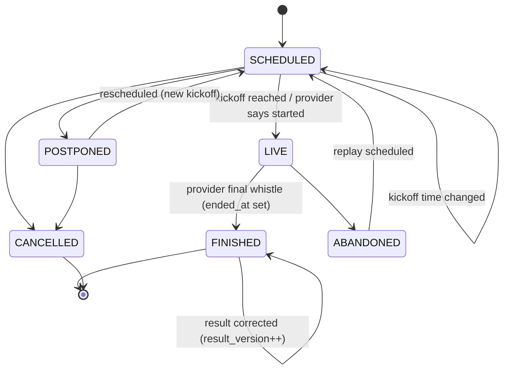
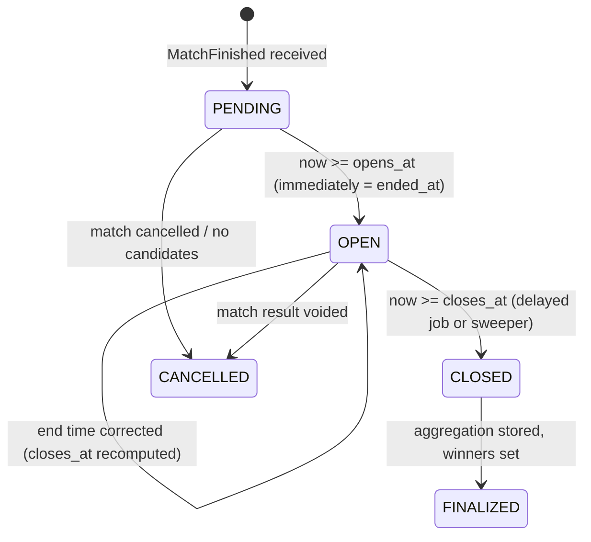
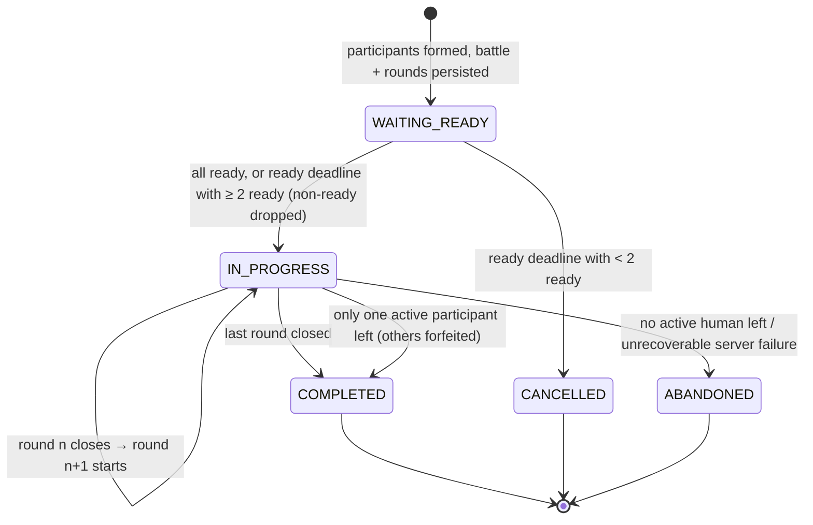

# 03 — Workflows

Each workflow lists steps, transaction boundaries, race conditions and edge cases. Open rules reference `DECISIONS.md` and stay configurable.

---

## 1. Prediction workflow

### 1.1 Match state machine (owned by `football`)



Two implementation rules: a provider polled too rarely can go from `SCHEDULED` straight to `FINISHED`, which is treated as passing through `LIVE` (both events fire). A match first seen already finished publishes only `MatchScheduled`, because it was never open to predictions or votes.

Predictability rule (Confirmed: editable until kickoff): a prediction may be written **only if** `status = SCHEDULED AND kickoff_at > now()` (DB clock) at write time. The `LIVE` transition is not required for locking; the timestamp comparison alone locks. This removes any dependence on a job running exactly at kickoff.

### 1.2 Steps

```mermaid
sequenceDiagram
  participant U as User
  participant API as PredictionsController
  participant UC as SubmitPredictionUseCase
  participant DB as PostgreSQL
  participant W as Worker
  U->>API: PUT /v1/matches/{id}/prediction {picks}
  API->>UC: command(userId, matchId, picks, requestId)
  UC->>UC: validate picks shape vs active prediction config (DEC-03)
  UC->>DB: BEGIN
  UC->>DB: conditional upsert (match SCHEDULED AND kickoff_at > now(), FOR SHARE)
  alt 0 rows
    UC-->>API: PREDICTION_LOCKED (409)
  else ok
    UC->>DB: replace prediction_picks; insert prediction_revisions(revision)
    UC->>DB: COMMIT
    UC-->>API: 200 {prediction, revision}
  end
  Note over W,DB: later: provider/simulator marks match FINISHED (outbox MatchFinished)
  W->>DB: ScoreMatchPredictionsUseCase(matchId, result_version)
  W->>DB: page predictions, compute PredictionScorer(picks, result, ruleSet) → prediction_scores
  W->>DB: outbox PredictionsScored(matchId, ruleSetId)
  W->>DB: points handler: upsert point_entries (supersede older revisions)
  W->>DB: leaderboards handler: increment entries for affected periods
```

1. **Retrieve match:** `GET /v1/matches/{id}` returns `kickoffAt`, `status`, `predictable` (computed server-side) and `serverTime`. The client may show a countdown but the server decides.
2. **Submit:** `PUT /v1/matches/{id}/prediction` (idempotent by nature: same body twice = same state).
3. **Validate:** DTO shape → domain validation (Decided, DEC-03: exactly one `EXACT_SCORE` pick; the outcome is derived from it; score bound from `PREDICTION_MAX_GOALS`, DEC-51).
4. **Save:** a single transaction: conditional upsert of `predictions` (the statement in `02-database.md` §5), replace `prediction_picks`, append `prediction_revisions`.
5. **Edit:** same endpoint; revision increments. A no-op edit (identical picks) returns 200 without a new revision (compare with the last snapshot).
6. **Lock:** implicit at `kickoff_at`. `MatchStarted` only drives UX and visibility, not correctness.
7. **Match completion:** football applies the provider update (`FINISHED`, `ended_at`, score), increments `result_version`, writes outbox `MatchFinished`.
8. **Result ingestion:** provider updates are applied with optimistic concurrency (`version`) and ignored if `provider_updated_at` is older than the stored value (out-of-order protection).
9. **Score calculation:** a worker job per (matchId, result_version, ruleSetId) pages predictions (1,000 at a time), runs the pure `PredictionScorer`, upserts `prediction_scores`. Idempotent by PK.
10. **Leaderboard update:** `PredictionsScored` → `points` records/supersedes ledger entries → `PointsRecorded` → `leaderboards` increments `leaderboard_entries` for every affected period.

### 1.3 Transaction boundaries

| Boundary | Contains | Why |
|---|---|---|
| T1 submit | prediction upsert + picks + revision | Atomic user intent; lock check and write in one statement |
| T2 match update | match row + outbox event | Event exists iff state changed |
| T3 scoring page | `prediction_scores` for one page | Small transactions; whole job is idempotent and resumable |
| T4 ledger | `point_entries` insert + supersede + outbox `PointsRecorded` | Ledger and its notification are atomic |
| T5 leaderboard | `leaderboard_entries` increments for one batch | Rebuildable projection; failure = retry or rebuild |

No transaction spans modules except through the outbox. Scoring 50k predictions never holds one huge transaction.

### 1.4 Race conditions and how they are handled

| Race | Handling |
|---|---|
| Edit arrives at 19:59:59.900 for a 20:00 kickoff, processed at 20:00:00.050 | Decided by DB `now()` = **transaction start**. If the transaction started before kickoff, it is accepted: the request reached the server before kickoff, which is the fair interpretation. Clients get `serverTime` to avoid last-second surprises |
| Two concurrent edits from two devices | Both serialize on the `(user_id, match_id)` unique row; last commit wins; both are recorded as revisions with increasing numbers. Optional `If-Match: <revision>` lets a client detect it overwrote another device (Recommended, not required) |
| Kickoff moved **earlier** while a user edits | The provider update takes `FOR UPDATE` on the match row; the prediction statement takes `FOR SHARE`. They serialize, so a prediction is never accepted against a stale kickoff |
| Duplicate submit (client retry) | PUT is idempotent; an identical body creates no new revision |
| Result corrected while the first scoring job is still running | Jobs are keyed by `result_version`; the ledger supersedes lower revisions, so the latest version always wins regardless of completion order |
| Scoring job crashes halfway | Re-run: `prediction_scores` upserts by PK; ledger idempotent by unique key |

### 1.5 Edge cases (policies are Pending; recommended defaults behind config)

| Case | Options | Recommended default |
|---|---|---|
| Kickoff time changed later (DEC-24) | (a) keep predictions, extend the edit window; (b) reset predictions | (a) The window simply follows `kickoff_at`, no data change |
| Postponed, no new date (DEC-24) | (a) keep predictions until rescheduled or cancelled; (b) void now | (a) Keep; void if not rescheduled within N days (N configurable) |
| Postponed and rescheduled | (a) carry predictions over, editable again until the new kickoff; (b) void and require new predictions | (a) |
| Cancelled | Void (`status=VOID`), supersede any ledger entries with zero | Void |
| Abandoned mid-match | (a) void; (b) wait for replay; (c) score with the score at abandonment | (b), then (a) after N days |
| Delayed result | Nothing to do: scoring is triggered by `MatchFinished`, whenever it arrives. Leaderboard finalization waits a grace window (DEC-28) |
| Which score counts in knockout games (90' vs extra time vs penalties) | Configured in the prediction rule set (`resultBasis`) | **Decided (DEC-02):** regular time + extra time, penalty shootouts excluded |

---

## 2. MOTM workflow

### 2.1 Poll state machine



### 2.2 Steps

1. **Match completion:** `MatchFinished(matchId, endedAt)` is consumed by `motm`.
2. **Open voting:** create `motm_polls` with `ended_at_basis = endedAt`, `opens_at = endedAt`, `closes_at = endedAt + 1 hour` (Confirmed), candidates from `match_squad_players` (A-08), `aggregation_strategy` from the active config, status `OPEN`. Schedule a BullMQ delayed job `motm.close` at `closes_at` (jobId = `motm-close:{pollId}:{closes_at}`). If the event is processed late (worker was down), the window is still anchored at `ended_at`, so lateness does not extend voting.
3. **Accept votes:** `PUT /v1/matches/{id}/motm/vote {playerId}`. Validations: user status active (verified-account requirement is DEC-07), candidate belongs to the poll (FK), the window is checked inside the SQL statement with DB `now()`.
4. **Duplicates:** PK `(poll_id, user_id)`. If changes are disallowed (DEC-05 option), use `ON CONFLICT DO NOTHING` and return `MOTM_ALREADY_VOTED`; if allowed, update and increment `change_count`.
5. **Close:** the delayed job runs `CloseMotmPollUseCase`: `UPDATE motm_polls SET status='CLOSED' WHERE id=$1 AND status='OPEN' AND closes_at <= now()` (idempotent). A **sweeper** every minute closes overdue polls in case a delayed job was lost.
6. **Aggregate:** the `MotmAggregationStrategy` selected by `aggregation_strategy` (DEC-04) computes the tallies and winners (tie policy DEC-04b: possibly several winners). Store `result` and `winner_player_ids`, status `FINALIZED`, outbox `MotmResultFinalized`.
7. **Related points:** if MOTM picks exist in predictions (DEC-08), `predictions` consumes `MotmResultFinalized` and scores the `MOTM` pick type; if voters earn points, `points` records them. Both are switched off until decided.

### 2.3 Edge cases

| Case | Handling |
|---|---|
| `ended_at` corrected while the poll is OPEN | Recompute `closes_at = new ended_at + 1h`; if the new `closes_at` is in the past, close immediately; re-schedule the close job (new jobId) |
| `ended_at` corrected after FINALIZED | Recommended: do not reopen; log and keep the result (DEC-29) |
| Match result voided/cancelled after finalization | Poll `CANCELLED`; ledger entries superseded |
| Vote request at closes_at ± milliseconds | DB `now()` decides; the API returns `MOTM_VOTING_CLOSED` |
| No candidates (provider had no squads) | Poll `CANCELLED` with reason; surfaced in logs/metrics |
| Anonymous vs visible votes (DEC-06) | The API never exposes individual votes by default; only aggregates after close. Revealing own vote to self is always allowed |

---

## 3. Quiz battles: getting players into a battle

Quiz battles are the **only** quiz mode and a core feature (ADR-0010): real-time football trivia against other players, any time. No Daily Quiz, no solo mode, no async play.

### 3.1 Entry points

| Entry | Participants | Battle `mode` | Notes |
|---|---|---|---|
| Random matchmaking | 2 humans (1v1) | `MATCHMAKING` | FIFO in MVP (DEC-37) |
| Bot fallback | 1 human + 1 bot | `MATCHMAKING`, `has_bot = true` | When no human is found within `botFallbackAfterMs` (DEC-39) |
| Private room | 2..`maxPlayers` humans (DEC-38) | `ROOM` | Friends join with a code; the host starts; rematches in the same room (DEC-42) |

All three end in the same battle engine (§4). Per-mode differences in points are rule-set values (DEC-41), never code branches.

Every battle also has a **game type** (`BUZZER`, `CAREER`, `WHO_IS_PLAYER`, `GRID`; ADR-0015). In matchmaking the player picks it, and each game type has its own queue (DEC-59). In a room the host picks it. The game's mechanics run inside the engine as game rules: `08-battle-games.md`.

**Play access (ADR-0016):** joining matchmaking (§3.3 step 1) and starting a room battle (§3.4 step 6) are the only two ways to start playing. A future limit (free matches, membership) is checked there and nowhere else.

### 3.2 One activity per user

A user is in at most one of: the matchmaking queue, a room, a battle. The guard is a Redis key `act:{userId}` written with `SET NX`, holding `QUEUE:<ticketId>`, `ROOM:<roomId>` or `BATTLE:<battleId>`. Joining anything while the key exists returns `PLAYER_BUSY` (with the current activity, so the client can navigate there). Room members keep the `ROOM` guard while their room plays a battle. On API boot, the guard is rebuilt from Postgres (open rooms, live battles); queue tickets are rebuilt from Redis.

### 3.3 Random matchmaking with bot fallback

1. **Join:** `POST /v1/battles/matchmaking { gameType }` or WS `matchmaking:join { gameType }`. Acquire the activity guard; add a ticket to the Redis sorted set `mm:queue:{gameType}` (score = server enqueue time) with details in `mm:ticket:{ticketId}` (`userId`, `gameType`, `locale`, `enqueuedAt`). Reply `matchmaking:queued { queuedAt, botFallbackAt }`. A game type that is switched off in config answers `GAME_TYPE_UNAVAILABLE`.
2. **Matcher loop** (API process, every `matchmaking.tickMs`, once per game type queue): a Lua script atomically removes the two oldest compatible tickets of that queue (compatibility rules: DEC-37; MVP = any). The matcher then checks `SocialQuery.isBlocked(a, b)`; a blocked pair goes back to the queue with original scores and is skipped for that pair (from P7, when blocks exist). The two players' content must be available in both their locales. **Single API instance until a measured need (ADR-0001):** the matcher runs in the one API process, which also owns the battles it creates; several instances need battle ownership and the Socket.IO Redis adapter first.
3. **Bot fallback:** a ticket waiting `≥ botFallbackAfterMs` is removed atomically and gets a battle with a bot (§3.5).
4. **Bots disabled** (DEC-39 option): after `queueTimeoutMs`, emit `matchmaking:timeout` and release the guard.
5. **Leave:** `DELETE /v1/battles/matchmaking` or `matchmaking:leave` removes the ticket. If the Lua removal returns 0, the ticket was already matched and the client receives `battle:found` instead (leave and match race; the atomic removal decides).
6. **Ghost tickets:** when the user's last socket disconnects while queued, the ticket is removed after `queueDisconnectGraceMs`, so nobody is matched with an absent player.
7. **Battle creation:** §4.3 step 1.

### 3.4 Private rooms

```mermaid
stateDiagram-v2
  [*] --> LOBBY: host creates (code issued)
  LOBBY --> LOBBY: members join / leave / are removed; host transferred
  LOBBY --> IN_BATTLE: host starts (≥ 2 members)
  IN_BATTLE --> LOBBY: battle ends (rematch allowed, DEC-42)
  LOBBY --> CLOSED: host closes / last member leaves / idle timeout
  IN_BATTLE --> CLOSED: battle ends and no members remain
  CLOSED --> [*]
```



1. **Create:** `POST /v1/battle-rooms { gameType }` (`Idempotency-Key`). The host can change the game type while the room is in `LOBBY` (`PATCH /v1/battle-rooms/{roomId}`), so friends can play different games in rematches. Acquire the guard. Generate the code with a CSPRNG: 6 characters from a 31-symbol alphabet without look-alikes (`23456789ABCDEFGHJKMNPQRSTUVWXYZ`, about 887 million codes). Insert the room; on a unique conflict with a live room, regenerate (at most 5 tries). Snapshot the room config (`maxPlayers`, round count, timers: DEC-38/31/32). The host is the first member.
2. **Share:** the client shares the code (a deep link containing the code is a client concern).
3. **Join:** `POST /v1/battle-rooms/join { code }` (code is trimmed and upper-cased). In one transaction:
   - Lock the room with `SELECT … FOR UPDATE` where `code = $code AND status <> 'CLOSED'`.
   - Check that it is `LOBBY`, not expired, and below `maxPlayers` (count of members with `left_at IS NULL`).
   - Check that the caller has no block in either direction with any active member (`SocialQuery.isBlocked`). A block answers `ROOM_NOT_FOUND`, so blocks stay invisible.
   - Upsert the member row (clear `left_at`) and push `last_activity_at` / `expires_at` forward.

   Joining a room you are already in returns `200` with the room (idempotent). After commit: acquire the guard and emit `room:updated` to the room channel.
4. **Live lobby:** on join, the gateway adds all of the user's sockets to channel `room:{roomId}`. On every (re)connect, it reads `act:{userId}` and re-adds them. `room:resync` returns a fresh snapshot.
5. **Leave / remove:** a member leaves (`left_at`, guard released). The host can remove a member while in `LOBBY`; that user gets `room:removed`. If the host leaves, the earliest-joined remaining member becomes host. If the last member leaves, the room is `CLOSED` (`EMPTY`).
6. **Start:** `POST /v1/battle-rooms/{roomId}/start` (host only). In one transaction: lock the room; require `LOBBY` and at least 2 active members (`ROOM_NOT_ENOUGH_PLAYERS`); require a member count the game type allows (`GRID`: exactly 2, DEC-61 → `GAME_TYPE_PLAYER_COUNT`); set `IN_BATTLE` and `current_battle_id`; create the battle with every active member as a participant (§4.3 step 1). A repeated start (double tap) returns the same battle id.
7. **After the battle:** the room returns to `LOBBY` (rematch, DEC-42 default) with `current_battle_id = NULL`. Members who left during the battle are removed. If no members remain, the room becomes `CLOSED`.
8. **Idle expiry:** in the MVP the API process owns room timers (in-memory, rebuilt on boot from `IX (status, expires_at)`), so it can close the room and emit `room:closed { reason: "IDLE" }` to connected members. A worker sweeper closes overdue rooms in the database as a backstop; clients see the closed state on their next request or resync. With several API instances, the worker can emit through `@socket.io/redis-emitter`.

Race conditions:

| Race | Handling |
|---|---|
| Two players join for the last seat | The room row lock serializes them; the second gets `ROOM_FULL` |
| Join arrives while the host starts | Start holds the same lock; the late join sees `IN_BATTLE` and gets `ROOM_NOT_IN_LOBBY` |
| Host double-taps start | Second call sees `IN_BATTLE` and returns the existing battle id |
| Someone guesses codes | About 887M codes, live only while a room is open; join attempts are rate limited per user and IP (`API.md` §7); failed attempts are counted in metrics |

### 3.5 Bots

1. **When:** only from matchmaking fallback (DEC-39), one bot per battle. Never in rooms (not requested; would be a new decision).
2. **Profile:** chosen from config (DEC-43), with skill values per game type (for example how early it buzzes and how often it is right, per difficulty), plus a localized display-name pool. Stored on the participant (`bot_profile`, `bot_display`).
3. **Per round:** the bot strategy of the game's mechanic decides what the bot does and when (`08-battle-games.md` §3.3). The engine schedules those decisions as timers that send the **same** commands humans send (`round:buzz`, `round:answer`, `grid:claim`), with `participantId` and no `clientMsgId`. A wrong bot answer is a real entity of the right kind from the catalog.
4. **Lifecycle:** ready immediately; never disconnects; its score and placement are shown like anyone's; it never gets ledger entries.
5. **Disclosure:** every payload carries `kind: "BOT"` and the UI always shows a bot badge (Decided, DEC-40).
6. **Determinism:** randomness comes from a `RandomSource` port. Tests seed it with the battle id, so a bot battle replays identically.

---

## 4. Battle engine workflow (all modes)

### 4.1 Roles of WebSocket vs PostgreSQL vs Redis

| Component | Responsibility | Not responsible for |
|---|---|---|
| **WebSocket (Socket.IO)** | Low-latency delivery of commands/events, presence, acks, lobby pushes | Durability, ordering guarantees, exactly-once |
| **Battle engine (in-memory, API process)** | Authoritative state machine and timers for the battles it owns, including bot timers | Survival across restarts on its own |
| **PostgreSQL** | Durable record of rooms, battles, participants, rounds, answers, results; recovery source | Real-time fan-out |
| **Redis** | Matchmaking queue and tickets, activity guard, battle ownership lock and Socket.IO adapter (multi-instance, future) | Source of truth for rooms or results |

### 4.2 Battle state machine



In a 1v1, "≥ 2 ready" means both, so a missing player cancels the battle. A bot counts as a participant but cannot keep a battle alive alone.

### 4.3 Steps

1. **Battle creation:** in one transaction, insert `battles` (`mode`, `game_type`, `has_bot`, `room_id`, config snapshot of that game type, active BATTLE rule set), all `battle_participants` (humans + optional bot), and `battle_rounds` with **pre-selected content ids** of that game type. Every participant gets the same content in the same order. Selection uses `ContentSelector.pick`:
   - `gameType` and `count = roundCount` of that game type (DEC-31);
   - only questions available in every participant's locale;
   - excluding recent exposures of every human participant (DEC-44, query in `02-database.md` §4.8), relaxing the window step by step when the bank cannot supply enough;
   - balancing difficulty and category per config.

   The engine registers the battle in memory and sets `owner_instance_id`. Each human's guard becomes `BATTLE:<id>` (room members keep `ROOM`).
2. **Readiness:** human sockets join channel `battle:{id}` and emit `battle:ready` (that socket becomes the *active socket*). Bots are ready at once. At `ready_deadline_at`, non-ready participants are dropped (`forfeited_at`). The battle starts if at least 2 participants remain, otherwise `CANCELLED` (no points).
3. **Round start:** for round n the engine sets `started_at` (server clock), persists it, loads the content (server side only) and hands it to the game rules, which emit `round:start` and then reveal or deal what the game shows (`08-battle-games.md` §3). The engine carries out the rules' effects: emit, schedule or cancel a timer, record an action, end the round.
4. **Player commands:** `round:buzz`, `round:answer`, `grid:claim`, `grid:skip` from humans; the same commands from bot timers. The engine first checks what every game shares: the battle is `IN_PROGRESS`, `roundNo` is the current round, the sender is an active participant (active socket for humans), the `clientMsgId` is new. Then the game rules decide the rest and return effects or a rejection code. **One battle's commands and timer firings are processed one at a time, in arrival order**, which is what makes "first buzz wins" exact. Accepted actions are persisted to `battle_round_actions` in that order (`action_no`), and the sender gets the ack `{ clientMsgId, accepted, code? }`. Typed answers are checked by entity id on the server (`AnswerChecker`, `08` §5.3).
5. **Round close:** when the game rules end the round (correct answer, no winner, grid line, draw). The engine persists `closed_at`, `winner_participant_id`, `end_reason` and emits `round:result` with the full reveal and the running scores. Every server event carries a per-battle monotonically increasing `seq`.
6. **Scoring:** each round's points come from the game rules (per game type config, DEC-33); `BattleScorer` totals them and `PlacementCalculator(scores, tieBreakConfig)` gives placements (ties share a placement; DEC-33). `outcome` is derived from placement.
7. **Completion:** in one transaction, write participants' `score`, `placement`, `outcome`; compute each human's **ledger points** from the rule set's per-mode section snapshotted at creation (DEC-41: matchmaking vs human, vs bot, room; `08` §6.1); set battle `COMPLETED`; write outbox `BattleCompleted` (participants with `score` and `points`, plus `questionResults` for stats). Then emit `battle:completed`, release guards (or return the room to `LOBBY`). `score` is the in-game number players see; `points` is what reaches the ledger (0 for rooms and bot battles: Decided, DEC-41).
8. **Disconnects:** on a human's last socket disconnect, set `disconnected_at`, start the reconnect grace timer (DEC-32), and emit `player:disconnected { participantId, graceUntil }`. The battle keeps running: the player just does not buzz, a held buzz runs out, a grid turn times out. When grace expires, the player forfeits (`forfeited_at`, last placement) and `player:forfeited` is emitted. With one active participant left the battle completes (`end_reason = FORFEIT`); with no active human left it is `ABANDONED`. Forfeit points policy: DEC-33.
9. **Reconnection:** the client reconnects with a valid token and emits `battle:resync { battleId, lastSeq }`. The engine replies with a full snapshot (current round, deadline, players, scores, own answers). Missed events are not replayed one by one; the snapshot is the source of truth.
10. **Duplicate, late, out-of-order messages:** a duplicate gets the same ack as the first (looked up by `clientMsgId`); a late command (after the round closed) gets `accepted: false, code: ROUND_CLOSED`; a late answer inside an open round gets `ANSWER_WINDOW_CLOSED` / `TURN_CLOSED`; a command for a future round is rejected (`ROUND_NOT_CURRENT`); a buzz while someone else holds it gets `BUZZ_TAKEN`.
11. **Client/server time sync:** `time:sync` returns `serverTime`; the client estimates `offset = serverTime − (t0 + rtt/2)` and renders countdowns from `deadlineAt`. The server never uses client timestamps for scoring.

### 4.4 Server restart / crash

- Single instance (MVP): on boot, `IN_PROGRESS` battles with no owner heartbeat are marked `ABANDONED` (no points); clients learn on reconnect. Rooms survive because they are in Postgres: a room whose battle was abandoned returns to `LOBBY`, and members reconnect and resync. Matchmaking tickets survive in Redis; tickets without a live socket expire through the ghost-ticket rule (§3.3). Full mid-battle recovery is a future improvement (the DB already holds everything needed to resume a round).
- Multi-instance (future): Redis ownership lock `battle:owner:{id}` with a TTL heartbeat; Socket.IO Redis adapter for cross-instance channels; sticky sessions at the load balancer; one matcher leader (Redis lock) so two instances never pop the same queue.

---

## 5. Leaderboard workflow

### 5.1 Period definitions (boundaries Pending: DEC-15/16/17)

| Kind | `period_key` | Boundary rule (configurable) |
|---|---|---|
| WEEKLY | ISO week `2026-W45` | Week start day + timezone from config (recommended: Monday 00:00 platform timezone) |
| MONTHLY | `2026-11` | Calendar month in the platform timezone |
| SEASONAL | `2026-27` | From the `seasons` list of the leaderboard config (DEC-17 pending, `DEV_ONLY` dates) |
| ALL_TIME | `all` | Never closes |

The period calculator is a pure domain function `(occurredAt, kind, tz, seasonCalendar) → periodKey`, heavily unit-tested around DST and year boundaries.

### 5.2 Score aggregation (Recommended MVP approach)

Options considered:

| Option | Pros | Cons |
|---|---|---|
| A. Compute on read from transactional data | Always consistent, no projection code | Expensive joins at every page view; does not scale for global boards |
| **B. Materialized projection in Postgres, updated asynchronously from the ledger, rebuildable** | Fast reads with one index scan, recalculation = rebuild, simple | Eventual consistency (seconds) |
| C. Redis sorted sets as primary | Very fast ranks | Second source of truth, persistence/rebuild complexity, memory |
| D. Event-sourced leaderboards | Full history | Complexity with no requirement behind it |

**Choose B.** Optionally add Redis ZSET as a cache in front of hot global boards later (measured need only).

Incremental update: on `PointsRecorded` (batch of entries), for each entry determine `periodKey`s for all kinds × categories it contributes to (Decided, DEC-18: `PREDICTIONS` and `BATTLES` only; prediction points feed the first, battle points the second), then:

```sql
INSERT INTO leaderboard_entries (period_id, user_id, points, last_scored_at, updated_at)
VALUES (...) ON CONFLICT (period_id, user_id)
DO UPDATE SET points = leaderboard_entries.points + EXCLUDED.points,
              last_scored_at = GREATEST(leaderboard_entries.last_scored_at, EXCLUDED.last_scored_at),
              updated_at = now();
```

Supersession sends a negative delta (old) and a positive delta (new). Idempotency: the handler records processed ledger entry ids per period in a small `leaderboard_applied_entries` set, or (simpler, Recommended) leaderboards are **recomputed per affected (period, user)** from the ledger: `SELECT sum(points) ... WHERE user_id = $u AND occurred_at in period AND superseded_at IS NULL` followed by an upsert of the absolute value. This is naturally idempotent and cheap with the `(user_id, category, occurred_at)` index.

### 5.3 Recalculation

- **Rebuild a period:** `DELETE` its entries, then `INSERT ... SELECT user_id, sum(points) ... GROUP BY user_id` from the ledger inside one transaction. Minutes at worst at launch scale.
- **Rule change:** activate a new rule set → recalculation jobs rescore → ledger supersession → affected periods rebuilt.
- **Closed periods:** CLOSED periods can still change until FINALIZED (grace window DEC-28); FINALIZED periods are frozen in `leaderboard_snapshots` (prize evidence). Corrections after finalization are an admin decision (logged).

### 5.4 Ties, query performance, pagination

- Tie-breaks are configured (DEC-23) and mapped into `tiebreak_1`, `tiebreak_2` (e.g., exact-score count, earliest `last_scored_at` inverted). Final fallback `user_id` keeps ordering deterministic.
- Rank display: dense or standard competition ranking is a product choice; computed with a window function on the page being read, or stored in snapshots.
- Pagination: **keyset** on `(points DESC, tiebreak_1 DESC, tiebreak_2 DESC, user_id)`; cursor = base64 of the last row's tuple. `GET /leaderboards/.../me` returns the user's rank (`COUNT(*)` of rows ahead using the same index) plus neighbours.
- Cache the first page of each global board for ~30-60s (in-memory or Redis) only when traffic justifies it.

### 5.5 Future expansion

New categories (e.g., MOTM accuracy) = new enum value + contribution mapping. League boards reuse the same ledger query with a user set.

### 5.6 What P6.5b builds

- **Calendar config** (`config/leaderboards.dev.json`, path in `LEADERBOARD_CONFIG_PATH`): `timezone` (`Africa/Cairo`, DEC-15/16), `weekStartsOn` (`MONDAY`), `seasons: [{ key, startsOn, endsBefore }]` (local dates, DEC-17). The file carries `devOnly` while the season dates are placeholders, and production refuses it. Seasons live in config instead of a `season_calendar` table: they are a tuning value, not data. Changing the timezone or week start later means rebuilding the boards.
- **Period keys:** `WEEKLY` is the ISO week of the week's first local day (`2026-W46`; with a Monday start it is the plain ISO week), `MONTHLY` is `2026-11`, `SEASONAL` is the season's `key`, `ALL_TIME` is `all`. A time outside every season belongs to no seasonal board. The period calculator is a pure domain function, using the built-in `Intl` time zone data, tested across Cairo's daylight saving changes.
- **Boards per ledger category:** `BATTLE` → `BATTLES`, `PREDICTION` → `PREDICTIONS`, `MOTM` → none (DEC-08).
- **Projection:** `PointsRecorded` → queue `leaderboards` → for each board and kind, every period from the one containing `occurredAtMin` to the one containing `occurredAtMax`: upsert the period row, then recompute each user's absolute sum from the ledger (`PointsQuery.sumPointsOfUsers`) and upsert it (delete the row when the sum is 0). One transaction holds an advisory lock per (board, user), taken in user id order, so two handlers for one player run one after the other and the last one reads every committed entry.
- **Ranking:** rows are ordered by `points DESC, tiebreak_1 DESC, tiebreak_2 DESC, user_id`, the index order. The tie-break columns stay 0 until DEC-23 picks their meaning (`TODO(DEC-23)`). The rank shown is standard competition ranking on points only: equal points share a rank (1, 1, 3), the recommended display default.
- **Status:** `OPEN` until `endsAt`, then `CLOSED`, derived from the server clock on read. Closing jobs, `FINALIZED`, snapshots and prizes come with the prize work (DEC-28/47); until then `leaderboard_periods.status` stays `OPEN`.
- **Endpoints** (`docs/api/API.md` §6.8): `category` is required (`BATTLES` or `PREDICTIONS`); the `PREDICTIONS` board stays empty until prediction scoring (P3.2). `periods` is computed from the calendar (the current period and up to 11 before it), so it needs no database. A malformed key or an unknown season is `404 PERIOD_NOT_FOUND`; a well-formed key with no points yet is an empty page. `/me` returns the player's rank and two rows on each side.

---

## 6. Private league workflow

1. **Creation:** `POST /v1/leagues {name, competitions:[{mode, filters, startsAt}]}`; the creator becomes `OWNER`. League settings (max members, join policy) validated by domain from config (DEC-19/22).
2. **Join mechanism (DEC-19, options):** (a) invite code (`league_invites.code`, recommended MVP: shareable link works on X); (b) owner invites friends; (c) request-to-join with approval. The schema supports (a) now; (b)/(c) add a `league_join_requests` table later.
3. **Membership:** `league_members` with role and status; leaving keeps history (`LEFT`).
4. **Competition modes:** each `league_competitions` row has `mode` (`PREDICTIONS` or `BATTLES`), a window, and filters (which football competitions count; which battle modes count). Whether a league can have both at once is DEC-22; the schema allows it.
5. **League leaderboard:** `LeaderboardQuery.forUserSet(memberIds, window, category, filters)` aggregates **from the ledger** (no duplication of prediction/battle data): `SUM(points) WHERE user_id = ANY($members) AND occurred_at >= starts_at (or member joined_at, DEC-20) AND category = $mode AND context->>'competitionId' = ANY($filters)`. With league sizes in the tens to hundreds this is fast with the ledger index; add a projection only if measurements demand it.
6. **Permissions (DEC-22, default):** OWNER manages settings/invites/removals and can transfer ownership; ADMIN manages invites/removals; MEMBER views and leaves. Enforced by a `LeaguePolicy` domain service.

---

## 7. Friends and prediction visibility

1. **Requests:** `POST /v1/friend-requests {userId}` → pending (partial unique index prevents duplicates in either direction). Accept creates a `friendships` row (low/high ordering) in the same transaction. Blocks prevent requests and visibility.
2. **Visibility policy** (`PredictionVisibilityPolicy`, the only place the rule lives):

```
canView(viewer, owner, match, ownerSettings, platformDefault):
  if viewer == owner → true
  if blocked(viewer, owner) → false
  if not areFriends(viewer, owner) → false            (Confirmed: friends only)
  return match.kickoff_at <= now                       (Decided, DEC-21: friends after kickoff)
```

Decided (DEC-21): friends see predictions only after kickoff, with no per-user setting in v1.0, because seeing friends' picks before kickoff enables copying in leagues (risk K-03). Every read path (`friends' predictions for a match`, `a user's prediction history`, future feed and share cards) must go through this policy and has its own integration test.

### 7.1 What P7 builds

**A block is invisible.** Every path answers a blocked user (either direction) exactly like an unknown one: `404 USER_NOT_FOUND`. Blocks are checked in both directions everywhere.

**P7a: friends, blocks, search** (module `social`; users search lives here too, because `users` cannot depend on `social`):

- **Send** `POST /v1/friend-requests { userId }` → `201` with the request.
  - The same request again (same direction, still pending) → `200` with that request: naturally idempotent. A generic `Idempotency-Key` store is not built yet.
  - The other player already asked you → `409 FRIEND_REQUEST_EXISTS`, with `requestId` in the problem details so the app can offer "accept".
  - Already friends → `409 ALREADY_FRIENDS`. Yourself → `422 CANNOT_TARGET_YOURSELF`. Unknown, deleted or blocked either way → `404 USER_NOT_FOUND`.
  - Two players asking each other at the same moment: the partial unique index lets one insert win; the other gets `409 FRIEND_REQUEST_EXISTS`.
- **Accept / decline** (addressee only) and **cancel** `DELETE` (requester only): someone else's or unknown → `404 FRIEND_REQUEST_NOT_FOUND`; no longer pending → `409 FRIEND_REQUEST_NOT_PENDING`. Each is a conditional update `WHERE status = 'PENDING'`, so accept and cancel racing cannot both win. Accept inserts the friendship in the same transaction and writes `FriendshipCreated`.
- **Lists:** `GET /v1/friend-requests?direction=incoming|outgoing`, `GET /v1/me/friends` (`{ user, since }`, newest first) and `GET /v1/me/blocks`, all keyset pages.
- **Unfriend** `DELETE /v1/me/friends/{userId}` → `204`, also when not friends; writes `FriendshipRemoved` when a row was removed.
- **Block** `PUT /v1/me/blocks/{userId}` → `204`, idempotent. In one transaction: the block row, the friendship removed, every pending request between the two cancelled, `UserBlocked` (and `FriendshipRemoved` if they were friends). **Unblock** `DELETE` → `204`, restores nothing.
- **A profile** `GET /v1/users/{userId}` → `PublicUser` + `relationship`: `SELF | NONE | FRIENDS | REQUEST_SENT | REQUEST_RECEIVED` (+ `requestId` for the last two).
- **Search** `GET /v1/users?query=` (2 to 50 characters, trimmed): username starting with the query, or display name containing it, both case-insensitive; active users only; never yourself or a block either way; ordered by display name, then id; keyset pages. A trigram index (`pg_trgm`) serves the display-name match.
- **Rate limits per user** (API §7): search 30 per minute, friend requests 30 per hour, from config (`RATE_LIMIT_USER_SEARCH_PER_MINUTE`, `RATE_LIMIT_FRIEND_REQUESTS_PER_HOUR`); `429 RATE_LIMITED` with `Retry-After`.
- **Events** (no consumers yet): `FriendshipCreated { userA, userB }`, `FriendshipRemoved { userA, userB, reason: UNFRIENDED | BLOCKED }`, `UserBlocked { blockerId, blockedId }`.

**P7b: prediction visibility and matchmaking:**

- `GET /v1/matches/{matchId}/predictions/friends` → friends' predictions for that match, only once kickoff has passed (before it: an empty page). `GET /v1/users/{userId}/predictions` → yourself: everything; a friend: only matches past kickoff; anyone else, or a block → `404 USER_NOT_FOUND`. Both read kickoff against the **database clock** in the query. `score` stays `null` until prediction scoring (P3.2).
- **The matcher skips blocked pairs:** it takes up to 50 of the oldest tickets in one script, pairs them oldest first while skipping blocked pairs (`SocialQuery.findBlockedPairs`), and puts the rest back with their original queue time. A ticket goes back only if the player still holds that queue activity, so a player who left meanwhile leaves no ghost. A blocked pair that stays alone falls back to bots as usual.

**Not in P7:** cleanup on `UserDeleted` (nothing publishes it yet), the friends leaderboard, the activity feed (DEC-34), Arabic letter normalization in search.
