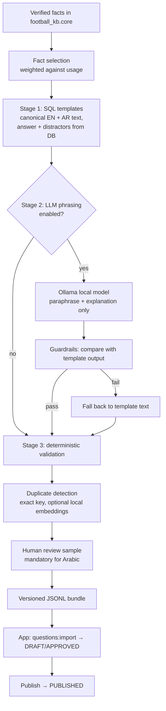

# 07 — Football Data, Knowledge Database, Question Generation

## 1. Two different kinds of football data

| | Operational football data | Football knowledge data |
|---|---|---|
| Purpose | Predictions, MOTM, fixtures UI | Trivia questions |
| Freshness | Minutes (match status, results) | Days to months (history) |
| Volume | Small (current seasons) | Large (all history, hundreds of thousands of players) |
| Owner | `football` module (app DB) | Python pipeline (`football_kb` DB) |
| Source now | **Mock provider** (Confirmed) | Free licensed datasets (research context) |

Mixing them in one schema would couple a fast-changing operational model to a large, slowly curated knowledge graph. They are kept separate and linked only by optional external ids (`external_refs.wikidata`).

## 2. Operational data: mock first, real later

### 2.1 Provider port

```ts
// football/application/ports/football-data-provider.ts (shape, not final code)
interface FootballDataProvider {
  listCompetitions(): Promise<ProviderCompetition[]>;
  listFixtures(range: { from: Date; to: Date }): Promise<ProviderMatch[]>;
  getMatch(providerMatchId: string): Promise<ProviderMatch>;
  getSquads(providerMatchId: string): Promise<ProviderSquadPlayer[]>;
}
```

`football` applies provider data through `ApplyProviderMatchUpdate`, which handles idempotency (`provider`, `provider_match_id`), out-of-order updates (`provider_updated_at`), optimistic locking (`version`), and emits the lifecycle events. The rest of the system never knows which provider is plugged in.

### 2.2 Mock provider (MVP)

- Seed JSON in `apps/backend/prisma/seed/football/`: the 5 leagues + national-team competitions (World Cup qualifiers, friendlies), one current season, teams with AR/EN names, squads (~25 players per team), and fixtures spread around "today" (past, live window, future) generated relative to the seed date.
- `MockFootballProvider` reads the seed. The simulation state is the `matches` row itself: seed updates carry a fixed `updatedAt`, so a later sync can never overwrite a newer simulator update.
- The schedule is generated from an **anchor**: the start of the first `provider_sync_runs` row for `mock`. A moving anchor would shift every kickoff on each sync.
- The seed is deliberately small: 6 clubs per league and 8 national teams, enough for every workflow. Players are fictional, 25 per team, combined from name lists; a matchday squad is 18 (11 starters, 7 substitutes).
- **Simulator CLI** (`nest-commander`): `mock:kickoff <matchId>`, `mock:score <matchId> 2-1`, `mock:finish <matchId> [score]`, `mock:postpone`, `mock:reschedule <matchId> <iso>`, `mock:cancel`, `mock:abandon`, `mock:correct-result <matchId> <score>`, `mock:correct-end-time <matchId> <iso>`, `mock:scenario <name>`, and `mock:run-day --speed 60x` (plays a matchday in accelerated time). This makes every workflow and edge case testable without any external API.
  - Every command goes through `ApplyProviderMatchUpdate`, so it obeys the state machine and publishes the same events as a provider. The commands exist only outside production and refuse matches from any other provider.
  - A matchday is every `SCHEDULED` mock match within 24 hours of the earliest one. Goals are derived from the match id, so a day replays the same way. `mock:scenario` uses the next scheduled match.
  - Simulated `started_at` and `ended_at` are the real current time, so windows that start at the match end (MOTM) open right away. `kickoff_at` keeps its scheduled value: a match can be `FINISHED` with a future `kickoff_at`, and predictions are closed by its status.

### 2.3 Real providers later (free first)

| Need | Free candidate | Gap |
|---|---|---|
| Fixtures + results, top-5 leagues | openfootball (CC0; includes current seasons; community-updated, not live) | Delay of hours/days; no live status |
| International results | martj42/international_results (CC0) | Not live |
| Live status, minute-level results | No reliable free + commercially licensed option found | Needs a paid API or accepting delayed results |
| **Match squads/lineups for MOTM** | Not available free and timely (risk K-02) | Paid live provider, or candidates = current club squads from Wikidata (lower quality) |

Decision DEC-27 covers the production source. The architecture only needs a new `FootballDataProvider` adapter.

## 3. Knowledge database placement (Recommended: separate logical database)

| Option | Pros | Cons |
|---|---|---|
| A. Inside the app database, same schema | One connection, simple joins | Large batch writes compete with gameplay; migrations mix two lifecycles; Prisma schema bloats with pipeline tables |
| **B. Separate logical database `football_kb` on the same Postgres server** | Isolation of lifecycle and migrations; zero extra cost; still one server to run | No cross-database joins (not needed: the interface is the question bundle) |
| C. Separate service now | Strong isolation | Operational cost and complexity with no benefit yet |

**Choose B** (ADR-0005). In local dev both databases live in the same Postgres container (init script creates `football_kb`). The Python pipeline owns `football_kb` migrations (plain SQL files or Alembic). The app never connects to `football_kb`.

## 4. Knowledge database design (Python-owned)

Layered schemas inside `football_kb` (from the research report):

| Schema | Content |
|---|---|
| `raw` | Downloaded files/manifests: source, version (git SHA / dump date), checksum, path |
| `staging` | Per-source normalized rows, rebuilt per dataset version |
| `core` | `entity` (player, club, national team, competition, season...), `entity_alias`, `external_id` crosswalk, `claim` (every assertion with source + method), `fact` (resolved claims with `status`, `confidence`, `licenses`, `as_of`, `volatile`) |
| `projection` | Typed tables built from facts: matches, goals, career spells, honours, records |
| `quiz` | Question candidates, validation results, generation runs, bundle manifests |

Provenance per fact (Confirmed requirement): source, source identifier, license, confidence, validation status, import time, relevant timestamps (`as_of`, `valid_until`), canonical entity references. **Only `VERIFIED` facts** (or single-source facts from tier-1 structured datasets, if the reviewer approves) are eligible for questions.

Initial sources (research context, licence review pending before commercial launch): Wikidata (CC0), openfootball (CC0), martj42/international_results (CC0), Fjelstul World Cup + English Football (CC BY-SA 4.0, GitHub copies only), engsoccerdata (GPL ≥ 2), Wikipedia (CC BY-SA 4.0, for LLM-extracted long-tail facts that need corroboration). Avoid: StatsBomb open data (non-commercial), football-data.co.uk (no commercial/AI use), FBref, Transfermarkt and mirrors.

### 4.1 Careers and names for the game types (ADR-0015)

`CAREER`, `GRID` and `WHO_IS_PLAYER` need "player P played for club C from year X to year Y", and every answer entity needs an Arabic name. Our local openfootball copy (`~/football-data/players`) has about 32,000 players with position, birth date and country, but **no career history**. **Wikidata (CC0)** is the source: property `P54` (member of sports team) with `P580` / `P582` (start / end time) qualifiers, Arabic and English labels, and aliases.

**Data check, 2026-11-10** (live Wikidata query service, 20 big European clubs):

| Check | Result |
|---|---|
| Distinct players across the 20 clubs | 17,035 |
| Club × club pairs with ≥ 3 shared players (grid cells) | 183 of 190 (96%); median 10 |
| Club × nationality pairs (11 countries) with ≥ 3 players | 171 of 220 (78%) |
| Club spells with a start date (players of Real Madrid, all their clubs) | 6,904 of 7,496 (92%); with an end date 87% |
| Arabic label, players in ≥ 3 of the 20 clubs / ≥ 2 / any | 92% / 79% / 61% |

Conclusions: `GRID` is feasible with club and nationality criteria (the pipeline picks boards whose 9 cells all reach `minAnswersPerCell`). `CAREER` is feasible: 92% of spells can be ordered by date. **Arabic names are the gap:** the pipeline must fill missing Arabic labels (transliteration proposals, human-reviewed) for every entity that can be an answer, and only entities with both names enter the catalog.

**Trap found during the check:** the "truthy" shortcut `wdt:P54` returns only the best-ranked statements. When a player's current club is marked *preferred*, all former clubs disappear (Cristiano Ronaldo vanished from Real Madrid × Juventus). Always read full statements: `p:P54/ps:P54` with qualifiers `pq:P580`, `pq:P582`. Youth and reserve teams are separate Wikidata items and are filtered out by type.

### 4.2 D.1: Wikidata slice (first implementation)

The first slice is deliberately smaller than the full layered model in §4. It stores Wikidata statements directly, with the statement id as provenance. Multi-source claims and fact resolution are added when a second source is loaded.

**Scope** (`data/config/scope.toml`; a tiny `scope.dev.toml` for fast runs):
- Leagues by Wikidata id: Premier League `Q9448`, La Liga `Q324867`, Serie A `Q15804`, Bundesliga `Q82595`, Ligue 1 `Q13394`, Primeira Liga `Q182994`, Eredivisie `Q167541`, Saudi Pro League `Q255633`, Egyptian Premier League `Q680619`. Every club whose `P118` is one of them and whose `P31` is association football club (`Q476028`).
- Players: everyone with a `P54` statement for one of those clubs, at any time. **Kept:** players with at least `minPlayerSitelinks` Wikipedia articles, a popularity proxy that drops 1920s squad fillers.
- Each kept player's **full** career (`p:P54`), every team on it, and their nationality (`P1532`, country for sport, falling back to `P27`).

**Team filter.** A spell is kept only when its team is a senior club. Wikidata types are not reliable for this: "Sporting C.P. Youth and Academy" is typed as a regular club, and the senior Portugal team and Portugal U-17 share the same type. So:
- National teams are dropped from careers. Nationality comes from `P1532` / `P27`.
- Clubs are dropped when one of their `P31` is in `excludedTeamClasses` (reserve team, youth team...), or when their English label matches `excludedTeamLabelPattern` (`youth`, `academy`, `reserves`, `under-NN`, `U-NN`, `B`, `II`, `Castilla`, `Primavera`, `Next Gen`...). Both live in the scope config, with tests.

**Spells:**
- Years only: Wikidata dates here are year precision.
- Childhood clubs are dropped by age: a spell that ended before `min_senior_age` (17) is removed. Wikidata lists them as normal clubs (Ronaldo at CF Andorinha, aged 7 to 10) and their names give nothing away. Clubs left with no spell leave the knowledge base.
- A spell without a start year is dropped from the ordered career, but still counts for grid membership.
- Consecutive spells at the same club are merged.
- Loans are kept as their own spells; `P1642` (acquisition transaction) "loan" sets `loan = true` when present.

**Names:**
- Labels and aliases in `en` and `ar` for every kept player and every team on their careers.
- Reviewed overrides in `data/kb_overrides/names.csv` (`external_ref, locale, name, kind = LABEL | ALIAS, reviewed_by`) are applied on top. Overrides fill gaps; Wikidata is never edited from here.
- `names:missing` writes the catalog entities without an Arabic label to a CSV for review.
- **Only entities with both an English and an Arabic name enter the catalog.**

**Tables** (`football_kb`, plain SQL migrations in `data/kb_migrations/`):
- `raw.sparql_cache`: query text hash → response. Re-runs are offline and reproducible; `--refresh` refetches.
- `core.entity`: `external_ref`, kind, sitelinks, birth year.
- `core.entity_name`: `external_ref`, locale, name, `LABEL` or `ALIAS`, source.
- `core.career_spell`: player, team, from and to year, loan, statement id.
- `core.player_country`.

**Commands** (from `data/`):
- `python -m kb migrate`
- `python -m kb ingest --scope config/scope.toml`
- `python -m kb names:missing --locale ar`
- `python -m kb catalog --out <bundle dir>`

The catalog command writes `catalog.jsonl` (§5.4) with normalized search forms (§5.7).

**First full run, 2026-11-10** (`scope.toml`, 9 leagues):

| Measure | Result |
|---|---|
| Clubs in the 9 leagues | 205 |
| Players found / kept (≥ 8 sitelinks) | 53,659 / 21,611 |
| Senior clubs on those careers | 8,092 |
| Career spells | 144,508 |
| Arabic label: players / clubs / countries | 85% / 51% / 99% |
| Arabic label, 2,000 most famous players | 100% |
| Catalog entities with both names | 22,645 (6.3 MB, 1.2 MB gzip) |
| Entities missing an Arabic name | 7,180 (mostly small clubs), listed by `names:missing` |
| First download / rebuild from cache | about 40 min / about 3 min |

**Etiquette:**
- One query at a time, a descriptive `User-Agent`, and exponential backoff on `429` and `5xx`.
- Per-club and batched queries (`VALUES` blocks of a few hundred ids), because a single big query hits the 60-second timeout.

Attribution: CC BY-SA sources require attribution. The app needs a "Data sources & licences" screen, and question provenance keeps `license_flags` so attribution can be shown or CC BY-SA content filtered out if counsel advises.

## 5. Question generation pipeline (offline, zero budget)



### 5.1 Stage 1: SQL templates (primary)

- Each template = a SQL query over `projection` tables + bilingual text patterns + a distractor strategy. Examples: competition winner by season, club of a player in a season, competition top scorer, tournament winner (national teams), host country, final score.
- **Distractors come from the database**, never from the LLM: same-type entities near the answer (same competition/era/popularity) that are **provably not correct** for the question (the generator excludes every entity satisfying the question predicate).
- Template text is written by a human once per template in EN and AR, so the baseline Arabic quality does not depend on a small model.

### 5.2 Stage 2: local LLM (optional enhancement)

- Ollama runs locally (`OLLAMA_HOST`, `OLLAMA_MODEL` configurable). Start by evaluating a 7–8B multilingual instruct model on your hardware; fall back to a 3–4B model if RAM is limited. Measure Arabic quality on a fixed review set before adopting a model. This is a recommendation to evaluate, not a verified benchmark.
- The model receives the facts + template output and may only produce: alternative question wording (EN/AR), explanation text, difficulty hint. It never chooses the answer or the options.
- Guardrails (deterministic, after generation): options and correct answer unchanged; every entity name and number in the output appears in the input facts (no invented years or scores); the AR text is in Arabic script and the EN text in Latin script; length bounds; the answer text does not appear in the question. On failure, use the template text.
- Throughput is irrelevant to gameplay because this runs offline (overnight batch on a dev machine is fine).

### 5.3 Stage 3: validation (deterministic)

| Check | Rule |
|---|---|
| Correct answer | Equals the fact object; fact status eligible |
| Option correctness | Exactly one option satisfies the question predicate (re-queried against facts) |
| Answer uniqueness | Distinct options, same entity type |
| Question validity | Required locales present; length limits; no time-relative words ("current", "so far") unless `valid_until` is set |
| Provenance | Fact ids, sources, licences, KB version attached |
| Duplicates | Exact: `external_key = template + answer fact key + angle`. Semantic (optional): local embeddings (e.g., a multilingual sentence-embedding model via Ollama or sentence-transformers), cosine threshold within the same answer entity |
| Human review | Stratified sample per bundle (e.g., 200 questions), 100% of new templates' first outputs, Arabic reviewed by a native speaker |

### 5.4 Bundle format (contract between pipeline and app)

A bundle is a directory `data/bundles/<bundleVersion>/` with two files:

- `manifest.json`: `bundleVersion` (unique, never reused), `kbVersion`, `generatorVersion`, `questionCount`, `checksum` (`sha256:<hex>` of the exact bytes of `questions.jsonl`), and `categories`, the categories the questions use: `[{ "slug": "world-cup", "names": { "en": "World Cup", "ar": "كأس العالم" } }]`.
- `questions.jsonl`: one JSON object per line, shaped like this:

```json
{
  "externalKey": "wc_winner_by_year:<kb-fact-key>:winner",
  "type": "SINGLE_CHOICE",
  "category": "world-cup",
  "difficulty": 2,
  "locales": {
    "en": { "text": "Which country won the 2010 FIFA World Cup?", "explanation": "Spain beat the Netherlands 1-0 after extra time." },
    "ar": { "text": "أي منتخب فاز بكأس العالم 2010؟", "explanation": "فازت إسبانيا على هولندا 1-0 بعد الوقت الإضافي." }
  },
  "options": [
    { "position": 1, "isCorrect": true,  "entityRef": "wikidata:<spain-nt-qid>", "locales": { "en": "Spain", "ar": "إسبانيا" } },
    { "position": 2, "isCorrect": false, "entityRef": "wikidata:<netherlands-nt-qid>", "locales": { "en": "Netherlands", "ar": "هولندا" } },
    { "position": 3, "isCorrect": false, "entityRef": "wikidata:<germany-nt-qid>", "locales": { "en": "Germany", "ar": "ألمانيا" } },
    { "position": 4, "isCorrect": false, "entityRef": "wikidata:<uruguay-nt-qid>", "locales": { "en": "Uruguay", "ar": "الأوروغواي" } }
  ],
  "provenance": { "facts": ["fact:9f2..."], "sources": ["fjelstul_wc", "wikidata"], "licenses": ["CC0-1.0", "CC-BY-SA-4.0"], "kbVersion": "2026-11-07" },
  "validUntil": null,
  "humanReviewed": { "en": true, "ar": true }
}
```

**Game content (ADR-0015, from P5.2).** A bundle also carries the answer catalog and game content. `SINGLE_CHOICE` lines above stay valid for import but no game serves them.

- `catalog.jsonl` (new file, listed in the manifest with its own checksum `catalogChecksum`): one entity per line.

```json
{ "externalRef": "wikidata:Q11571", "kind": "PLAYER", "names": { "en": "Cristiano Ronaldo", "ar": "كريستيانو رونالدو" },
  "aliases": { "en": ["CR7", "Ronaldo"], "ar": ["رونالدو", "كريستيانو"] }, "popularity": 412 }
```

  The pipeline adds the `normalized` form of every name and alias (§5.7) in a derived field, so the app never re-implements normalization for stored names.
- `questions.jsonl` lines get `"type": "GAME"` and a `gameType`; answers point at catalog entities by `externalRef`:

```json
{ "externalKey": "career:wikidata:Q11571", "type": "GAME", "gameType": "CAREER", "category": "players", "difficulty": 1,
  "content": { "player": "wikidata:Q11571", "spells": [
    { "club": "wikidata:Q75729", "fromYear": 2002, "toYear": 2003, "loan": false },
    { "club": "wikidata:Q18656", "fromYear": 2003, "toYear": 2009, "loan": false } ] },
  "answers": [{ "slot": 0, "entities": ["wikidata:Q11571"] }],
  "provenance": { "facts": ["…"], "sources": ["wikidata"], "licenses": ["CC0-1.0"], "kbVersion": "…" },
  "validUntil": null, "humanReviewed": { "en": true, "ar": true } }

{ "externalKey": "buzzer:wc_winner_by_year:<fact>", "type": "GAME", "gameType": "BUZZER", "category": "world-cup", "difficulty": 2,
  "content": { "answerKind": "NATIONAL_TEAM",
    "steps": { "en": ["Which country", "won the", "2010", "FIFA World Cup?"],
               "ar": ["أي منتخب", "فاز", "بكأس العالم", "2010؟"] } },
  "answers": [{ "slot": 0, "entities": ["wikidata:<spain-nt-qid>"] }], "…": "…" }
```

  `GRID` content holds `rows` and `cols` criteria (`{ "kind": "CLUB", "entity": "wikidata:Q8682" }`) and `answers` has one slot per cell (0..8) with every valid player. `WHO_IS_PLAYER` content holds ordered `clues` with `kind` and `text {en, ar}`.

### 5.5 Import and publish (app side, `question-bank`)

1. `npm run cli -- questions:import data/bundles/<version>` checks the manifest checksum and validates every line again. The app never trusts the pipeline blindly. Any invalid line rejects the whole bundle, and the command lists every problem with its line number. Checks: known fields only; `type` is `SINGLE_CHOICE`; `difficulty` is an integer 1-5; `category` is listed in the manifest; question locales are supported app locales (`ar`, `en`), at least one; 2-6 options with positions 1..n; exactly one correct option (A-05); every option has text in exactly the question's locales, distinct within a locale; non-empty texts within sanity lengths (question 300, explanation 600, option 100 characters); `externalKey` unique in the bundle; `validUntil` an ISO-8601 instant or `null`.
2. The import runs in **one transaction**: the bundle is fully imported or not at all. The same `bundleVersion` again with the same checksum is a no-op; with a different checksum it is rejected (bundle versions are never reused).
3. **Content hash, computed by the app:** SHA-256 of the canonical JSON of what a player sees and what decides correctness (type, category, difficulty, texts, explanations, options with positions, correctness and entity refs, `validUntil`). The pipeline does not send it, so there is one implementation of it. Review flags and provenance are metadata, not content.
4. Upsert by `externalKey`, comparing with its latest version (`key_version`):
   - new key → insert version 1 as `APPROVED` if every locale is `humanReviewed`, else `DRAFT`;
   - same content hash → nothing changes, except that newly reviewed locales are recorded and a `DRAFT` whose locales are now all reviewed becomes `APPROVED` (a review never goes backwards);
   - different content hash and the question was **never published** (`published_at` is null) and is `DRAFT` or `APPROVED` → its content is replaced in place and its status is derived again from the review flags;
   - different content hash otherwise → the old version is `DISABLED` with reason `SUPERSEDED` (if it was not already disabled) and a new row with `key_version + 1` is inserted. A question that could have been served is never changed, so battle history stays true. "Could have been served" is judged by `published_at`, because answer statistics arrive only after a battle ends.
5. `questions:publish <bundleVersion>`: the bundle's `APPROVED` questions → `PUBLISHED` (`08` §5.6).
6. `questions:disable <questionId> --reason <text>` for reported or wrong questions; selection excludes them immediately.

Regeneration = new bundle version. Rollback = disable a batch.

**Game content checks (P5.2), on top of the above:** the catalog is imported first, in the same transaction. **A bundle's catalog is always the whole catalog:** entities are upserted by `externalRef` (aliases replaced), and an active entity missing from it is set `HIDDEN`, never deleted, because battle history points at it. A bundle without `catalog.jsonl` uses the catalog already imported. The same `bundleVersion` is a no-op only when both checksums match. Every `externalRef` used by content or answers must be in the catalog, with the right `kind`. `BUZZER`: same number of steps in every locale (2 to 40), and the answer's name does not appear in any step; a `NUMBER` answer carries `answerNumber` and no entities. `CAREER`: at least 2 spells, in date order, and the player is an accepted answer. `WHO_IS_PLAYER`: at least 2 clues, every clue in the same locales. `GRID`: 3 rows, 3 columns, no repeated criterion, every cell has at least one valid player. These are sanity bounds on the data; how many clues, steps or answers a game wants is game config (`minAnswersPerCell` etc., 08 §6), applied when content is selected. `answers` are part of the content hash (they decide correctness).

### 5.6 How many questions the app needs

Battles are the only quiz mode and can be played without limit (ADR-0010), so question volume is a product constraint, not a nice-to-have (risk K-09). A rough sizing rule: `active players' battles per week × roundCount` questions are consumed per player per week, and the exposure window (DEC-44) must not exhaust the bank for heavy players. The battle engine relaxes the window when it runs short and counts each relaxation (`question_selection_relaxed_total`). A rising count means the next bundle is due. Templates over large fact tables (match results, scorers, transfers, trophies) are the cheapest way to scale volume; LLM phrasing adds variety, not volume.

### 5.7 Name normalization (shared by the pipeline and the app)

Typed answers are matched by picking a suggestion (DEC-55); normalization only decides which suggestions appear. Rules, applied in order:

1. Unicode NFKC; trim; collapse spaces; lower case.
2. Latin: remove accents (`é → e`, `ü → u`, `ñ → n`); `ß → ss`.
3. Arabic: remove diacritics (tashkeel) and tatweel (`ـ`); `أ إ آ ٱ → ا`; `ة → ه`; `ى → ي`; `ؤ → و`; `ئ → ي`; Arabic-Indic digits → ASCII digits.
4. Matching ignores a leading `ال` on any word, and the word `fc` / `cf` / `club` / `نادي`.

Test vectors (both implementations must pass them):

| Input | Normalized |
|---|---|
| `Álvaro Morata` | `alvaro morata` |
| `أنخيل دي ماريا` | `انخيل دي ماريا` |
| `الأهلي` | `اهلي` (matching form) |
| `كرة` | `كره` |
| `مُحَمَّد صَلاح` | `محمد صلاح` |
| `٢٠١٠` | `2010` |

### 5.8 D.2a: first generators (`CAREER`, `BUZZER`) and the `dev-0002` bundle

The first generated bundle. Its purpose: P6.1 needs published game content to play, and real data shows problems earlier than hand-written rounds. Grid and Who is the player? come in D.2b.

**Command** (from `data/`):

```
.venv/bin/python -m kb bundle --version dev-0002 --out bundles/dev-0002 --careers 60 --buzzers 60 --catalog-min-player-sitelinks 40
```

- **Input:** only `core.*`.
- **Output:** a bundle in the format of §5.4: `manifest.json`, `questions.jsonl`, `catalog.jsonl`.
- **Deterministic:** the same knowledge base and the same arguments give the same bytes, so the same checksum. Picks are sorted by popularity with fixed tie-breaks; there is no randomness.

**`CAREER` rounds:**
- **Eligible players:** both names; at least 3 senior spells; every spell has a start year; every club is in the catalog.
- **Content:** the spells in date order, loans kept and flagged.
- **Accepted answer:** the player.

**`BUZZER` templates.** Each template's text is written once by a person in EN and AR, with the same number of steps in both, and the facts go from vague to specific:

| Template | Question (EN) | Answer (`answerKind`) | Skipped when |
|---|---|---|---|
| `first-club` | At which club / did {player} / start / his senior career? | First senior club (`CLUB`) | Two spells share the first start year |
| `joined-in-year` | Which club / did {player} join / from {previous club} / in {year}? | That club (`CLUB`) | The spell is a loan, or another spell starts the same year |
| `nationality` | Which country / does {player} / represent / by citizenship? | Every citizenship of the player (`COUNTRY`) | No citizenship in the catalog |

The giveaway check of §5.5 runs here too: a round whose steps contain the answer's name is dropped.

**Difficulty:** a first guess from popularity (Wikipedia sitelinks). Answer statistics recalibrate it later (`calibrated_difficulty`).

| Sitelinks | ≥ 100 | 60-99 | 40-59 | 20-39 | < 20 |
|---|---|---|---|---|---|
| Difficulty | 1 | 2 | 3 | 4 | 5 |

Picks are spread over the difficulties, so a short bundle is not all difficulty 5.

**Keys and provenance:**
- **External keys** stay the same across regenerations, so a regenerated bundle updates or versions a round instead of duplicating it (§5.5): `career:<qid>`, `buzzer:first-club:<qid>`, `buzzer:joined-in-year:<qid>:<year>`, `buzzer:nationality:<qid>`.
- **Provenance:**
  - `facts`: the Wikidata statement ids that were used.
  - `sources`: `wikidata`.
  - `licenses`: `CC0-1.0`.
  - `kbVersion`: `wikidata-<date of the last ingest>`.

**Catalog in a dev bundle:** the full catalog is about 6 MB, too big to commit. `--catalog-min-player-sitelinks` keeps players at or above the bar, and adds every club and country a kept player's career or citizenship points at, plus everything the content references. Production bundles leave the flag out and carry the whole catalog.

**Review and publishing:** generated rounds are `DRAFT` until a person reviews them (§5.3).
- **Development:** to play a dev bundle anyway, `questions:publish <version> --include-drafts`. The command refuses this flag in production (`NODE_ENV=production`, the same switch that turns off the dev tools).
- **Production:** publishes only reviewed content.

**Freshness (DEC-62, Pending):** the career of an active player (open last spell) is wrong after his next transfer. D.2a sets `validUntil = null`, and every new bundle regenerates careers. Whether active careers should also expire on their own is DEC-62.
