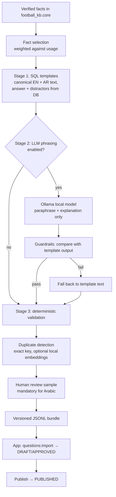

# 07 — Football Data, Knowledge Database, Question Generation

## 1. Two different kinds of football data

| | Operational football data | Football knowledge data |
|---|---|---|
| Purpose | Predictions, MOTM, fixtures UI | Trivia questions |
| Freshness | Minutes (match status, results) | Days to months (history) |
| Volume | Small (current seasons) | Large (all history, hundreds of thousands of players) |
| Owner | `football` module (app DB) | Python pipeline (`football_kb` DB) |
| Source now | **Mock provider** (Confirmed) | Free licensed datasets (research context) |

Mixing them in one schema would couple a fast-changing operational model to a large, slowly curated knowledge graph. They are kept separate and linked only by optional external ids (`external_refs.wikidata`).

## 2. Operational data: mock first, real later

### 2.1 Provider port

```ts
// football/application/ports/football-data-provider.ts (shape, not final code)
interface FootballDataProvider {
  listCompetitions(): Promise<ProviderCompetition[]>;
  listFixtures(range: { from: Date; to: Date }): Promise<ProviderMatch[]>;
  getMatch(providerMatchId: string): Promise<ProviderMatch>;
  getSquads(providerMatchId: string): Promise<ProviderSquadPlayer[]>;
}
```

`football` applies provider data through `ApplyProviderMatchUpdate`, which handles idempotency (`provider`, `provider_match_id`), out-of-order updates (`provider_updated_at`), optimistic locking (`version`), and emits the lifecycle events. The rest of the system never knows which provider is plugged in.

### 2.2 Mock provider (MVP)

- Seed JSON in `apps/backend/prisma/seed/football/`: the 5 leagues + national-team competitions (World Cup qualifiers, friendlies), one current season, teams with AR/EN names, squads (~25 players per team), and fixtures spread around "today" (past, live window, future) generated relative to the seed date.
- `MockFootballProvider` reads the seed. The simulation state is the `matches` row itself: seed updates carry a fixed `updatedAt`, so a later sync can never overwrite a newer simulator update.
- The schedule is generated from an **anchor**: the start of the first `provider_sync_runs` row for `mock`. A moving anchor would shift every kickoff on each sync.
- The seed is deliberately small: 6 clubs per league and 8 national teams, enough for every workflow. Players are fictional, 25 per team, combined from name lists; a matchday squad is 18 (11 starters, 7 substitutes).
- **Simulator CLI** (`nest-commander`): `mock:kickoff <matchId>`, `mock:score <matchId> 2-1`, `mock:finish <matchId>`, `mock:postpone`, `mock:reschedule <matchId> <iso>`, `mock:cancel`, `mock:correct-result`, `mock:correct-end-time`, `mock:scenario <name>`, and `mock:run-day --speed 60x` (plays a matchday in accelerated time). This makes every workflow and edge case testable without any external API.

### 2.3 Real providers later (free first)

| Need | Free candidate | Gap |
|---|---|---|
| Fixtures + results, top-5 leagues | openfootball (CC0; includes current seasons; community-updated, not live) | Delay of hours/days; no live status |
| International results | martj42/international_results (CC0) | Not live |
| Live status, minute-level results | No reliable free + commercially licensed option found | Needs a paid API or accepting delayed results |
| **Match squads/lineups for MOTM** | Not available free and timely (risk K-02) | Paid live provider, or candidates = current club squads from Wikidata (lower quality) |

Decision DEC-27 covers the production source. The architecture only needs a new `FootballDataProvider` adapter.

## 3. Knowledge database placement (Recommended: separate logical database)

| Option | Pros | Cons |
|---|---|---|
| A. Inside the app database, same schema | One connection, simple joins | Large batch writes compete with gameplay; migrations mix two lifecycles; Prisma schema bloats with pipeline tables |
| **B. Separate logical database `football_kb` on the same Postgres server** | Isolation of lifecycle and migrations; zero extra cost; still one server to run | No cross-database joins (not needed: the interface is the question bundle) |
| C. Separate service now | Strong isolation | Operational cost and complexity with no benefit yet |

**Choose B** (ADR-0005). In local dev both databases live in the same Postgres container (init script creates `football_kb`). The Python pipeline owns `football_kb` migrations (plain SQL files or Alembic). The app never connects to `football_kb`.

## 4. Knowledge database design (Python-owned)

Layered schemas inside `football_kb` (from the research report):

| Schema | Content |
|---|---|
| `raw` | Downloaded files/manifests: source, version (git SHA / dump date), checksum, path |
| `staging` | Per-source normalized rows, rebuilt per dataset version |
| `core` | `entity` (player, club, national team, competition, season...), `entity_alias`, `external_id` crosswalk, `claim` (every assertion with source + method), `fact` (resolved claims with `status`, `confidence`, `licenses`, `as_of`, `volatile`) |
| `projection` | Typed tables built from facts: matches, goals, career spells, honours, records |
| `quiz` | Question candidates, validation results, generation runs, bundle manifests |

Provenance per fact (Confirmed requirement): source, source identifier, license, confidence, validation status, import time, relevant timestamps (`as_of`, `valid_until`), canonical entity references. **Only `VERIFIED` facts** (or single-source facts from tier-1 structured datasets, if the reviewer approves) are eligible for questions.

Initial sources (research context, licence review pending before commercial launch): Wikidata (CC0), openfootball (CC0), martj42/international_results (CC0), Fjelstul World Cup + English Football (CC BY-SA 4.0, GitHub copies only), engsoccerdata (GPL ≥ 2), Wikipedia (CC BY-SA 4.0, for LLM-extracted long-tail facts that need corroboration). Avoid: StatsBomb open data (non-commercial), football-data.co.uk (no commercial/AI use), FBref, Transfermarkt and mirrors.

Attribution: CC BY-SA sources require attribution. The app needs a "Data sources & licences" screen, and question provenance keeps `license_flags` so attribution can be shown or CC BY-SA content filtered out if counsel advises.

## 5. Question generation pipeline (offline, zero budget)



### 5.1 Stage 1: SQL templates (primary)

- Each template = a SQL query over `projection` tables + bilingual text patterns + a distractor strategy. Examples: competition winner by season, club of a player in a season, competition top scorer, tournament winner (national teams), host country, final score.
- **Distractors come from the database**, never from the LLM: same-type entities near the answer (same competition/era/popularity) that are **provably not correct** for the question (the generator excludes every entity satisfying the question predicate).
- Template text is written by a human once per template in EN and AR, so the baseline Arabic quality does not depend on a small model.

### 5.2 Stage 2: local LLM (optional enhancement)

- Ollama runs locally (`OLLAMA_HOST`, `OLLAMA_MODEL` configurable). Start by evaluating a 7–8B multilingual instruct model on your hardware; fall back to a 3–4B model if RAM is limited. Measure Arabic quality on a fixed review set before adopting a model. This is a recommendation to evaluate, not a verified benchmark.
- The model receives the facts + template output and may only produce: alternative question wording (EN/AR), explanation text, difficulty hint. It never chooses the answer or the options.
- Guardrails (deterministic, after generation): options and correct answer unchanged; every entity name and number in the output appears in the input facts (no invented years or scores); the AR text is in Arabic script and the EN text in Latin script; length bounds; the answer text does not appear in the question. On failure, use the template text.
- Throughput is irrelevant to gameplay because this runs offline (overnight batch on a dev machine is fine).

### 5.3 Stage 3: validation (deterministic)

| Check | Rule |
|---|---|
| Correct answer | Equals the fact object; fact status eligible |
| Option correctness | Exactly one option satisfies the question predicate (re-queried against facts) |
| Answer uniqueness | Distinct options, same entity type |
| Question validity | Required locales present; length limits; no time-relative words ("current", "so far") unless `valid_until` is set |
| Provenance | Fact ids, sources, licences, KB version attached |
| Duplicates | Exact: `external_key = template + answer fact key + angle`. Semantic (optional): local embeddings (e.g., a multilingual sentence-embedding model via Ollama or sentence-transformers), cosine threshold within the same answer entity |
| Human review | Stratified sample per bundle (e.g., 200 questions), 100% of new templates' first outputs, Arabic reviewed by a native speaker |

### 5.4 Bundle format (contract between pipeline and app)

One JSON object per line; the bundle has a manifest file with `bundleVersion`, `kbVersion`, `generatorVersion`, counts, checksum.

```json
{
  "externalKey": "wc_winner_by_year:<kb-fact-key>:winner",
  "contentHash": "sha256:...",
  "type": "SINGLE_CHOICE",
  "category": "world-cup",
  "difficulty": 2,
  "locales": {
    "en": { "text": "Which country won the 2010 FIFA World Cup?", "explanation": "Spain beat the Netherlands 1-0 after extra time." },
    "ar": { "text": "أي منتخب فاز بكأس العالم 2010؟", "explanation": "فازت إسبانيا على هولندا 1-0 بعد الوقت الإضافي." }
  },
  "options": [
    { "position": 1, "isCorrect": true,  "entityRef": "wikidata:<spain-nt-qid>", "locales": { "en": "Spain", "ar": "إسبانيا" } },
    { "position": 2, "isCorrect": false, "entityRef": "wikidata:<netherlands-nt-qid>", "locales": { "en": "Netherlands", "ar": "هولندا" } },
    { "position": 3, "isCorrect": false, "entityRef": "wikidata:<germany-nt-qid>", "locales": { "en": "Germany", "ar": "ألمانيا" } },
    { "position": 4, "isCorrect": false, "entityRef": "wikidata:<uruguay-nt-qid>", "locales": { "en": "Uruguay", "ar": "الأوروغواي" } }
  ],
  "provenance": { "facts": ["fact:9f2..."], "sources": ["fjelstul_wc", "wikidata"], "licenses": ["CC0-1.0", "CC-BY-SA-4.0"], "kbVersion": "2026-11-07" },
  "validUntil": null,
  "humanReviewed": { "en": true, "ar": true }
}
```

### 5.5 Import and publish (app side, `question-bank`)

1. `npm run cli -- questions:import data/bundles/<version>` validates the manifest checksum and every line again (schema, exactly one correct option, locales, lengths). The app never trusts the pipeline blindly.
2. Upsert by `external_key`: a new key → insert as `APPROVED` if `humanReviewed` for all locales, else `DRAFT`; same key + same `content_hash` → no-op; same key + different hash → new content replaces the old only if the question has not been served yet; otherwise disable the old one and insert a new key version (served questions stay immutable for history).
3. `questions:publish --batch <id>` (or auto-publish approved ones, config) → `PUBLISHED`.
4. `questions:disable <id> --reason` for reported or wrong questions; selection excludes them immediately.

Regeneration = new bundle version. Rollback = disable a batch.

### 5.6 How many questions the app needs

Battles are the only quiz mode and can be played without limit (ADR-0010), so question volume is a product constraint, not a nice-to-have (risk K-09). A rough sizing rule: `active players' battles per week × roundCount` questions are consumed per player per week, and the exposure window (DEC-44) must not exhaust the bank for heavy players. The battle engine relaxes the window when it runs short and counts each relaxation (`question_selection_relaxed_total`). A rising count means the next bundle is due. Templates over large fact tables (match results, scorers, transfers, trophies) are the cheapest way to scale volume; LLM phrasing adds variety, not volume.
