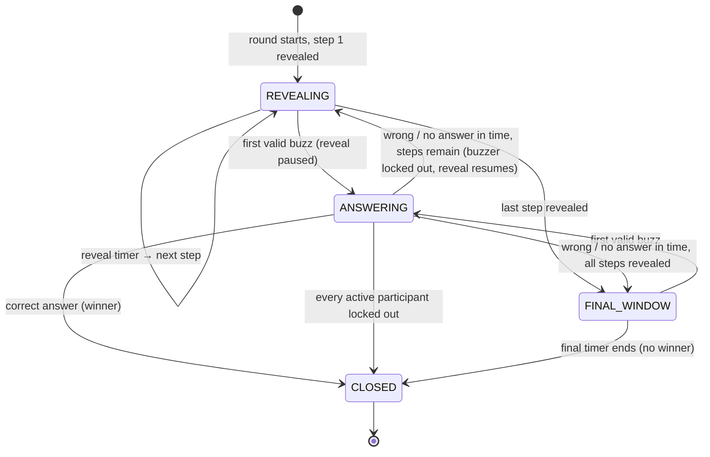
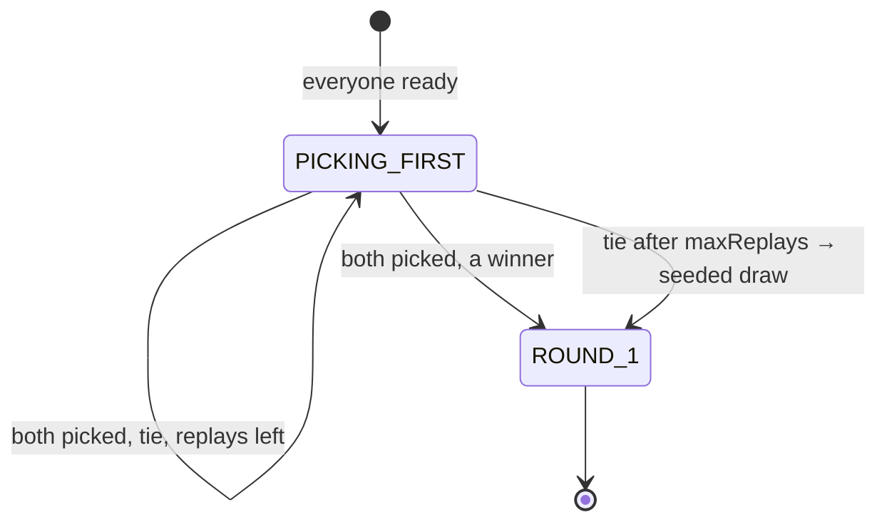
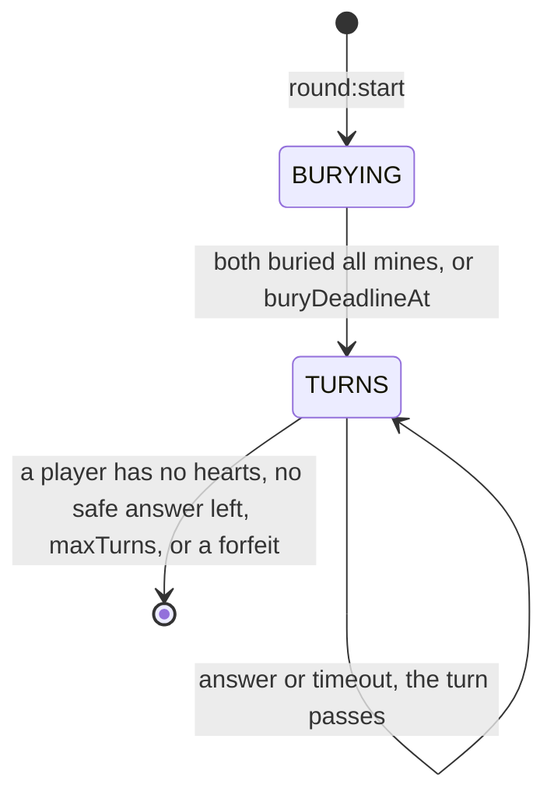

# Battle games: shared engine, game rules, answer catalog

How the game types of ADR-0015 run on one battle engine. Read with `03-workflows.md` §3-4 (matchmaking, rooms, engine lifecycle), `api/WEBSOCKET.md` (messages), `02-database.md` §4.6 and §4.8 (tables), and `07-football-data-and-questions.md` (where content comes from).

Every number in this file is configuration (per game type), never a constant. Names in `code` font are config keys.

## 1. Game types and mechanics

| Game type (`gameType`) | Mechanic | What is revealed step by step | The answer | Players |
|---|---|---|---|---|
| `BUZZER` | Reveal and buzz | The words of a question | An entity from the answer catalog, or a number | 2..N |
| `CAREER` | Reveal and buzz | A player's clubs, oldest first, with years if `showYears` | A player | 2..N |
| `WHO_IS_PLAYER` | Reveal and buzz | Clues about one player (nationality, position, birth year, a club, a trophy...), hardest first | A player | 2..N |
| `GRID` | Turns on a board | Nothing: the whole 3×3 board of criteria is shown | A player who fits a cell's row and column | exactly 2 (DEC-61) |
| `IMPOSTER` | Chat and vote (P8, DEC-58) | Not designed yet | — | rooms only |
| `MINES` (لغم) | Turns with hearts, hidden mines (N1) | A category; each player first buries mines in secret | Players of the category, no repeats | 2 |
| `AUCTION` (المزاد) | Bidding, then proof (N2) | A list title and its answer count | As many names of the list as you bid | 2 |
| `VAULT` (الخزنة) | Simultaneous race (N3) | Four questions whose answers are digits 0–9; leaks on a timer | The whole 4-digit code, all or nothing | 2 |
| `HEX` (الهجمة) | Hex board race (N4) | A board of letters; a question per picked cell | A name starting with the cell's letter | 2 |
| `LINEUP` (التشكيلة) | Simultaneous slot filling (N5) | A famous match's formation, 3 shown names (one fake) | The starting XI; accuse the fake | 2 |
| `TIME_MACHINE` (آلة الزمن) | Turns with hearts, years going back (N6) | A tournament edition per turn | One fact about that edition | 2 |
| `THREAD` (الخيط) | Simultaneous chained race (N7) | Five rooms, each question pointing at the previous answer | Each room's single answer | 2 |

The seven new game types (DEC-68) are designed one by one in track N; §9 holds what they share. A battle has **one** game type, chosen when it is created: by the queue the player joined (DEC-59), or by the host in a room. A battle is `roundCount` rounds of that game (DEC-31, per game type).

## 2. Engine and game rules

### 2.1 Who does what

| Part | Layer | Knows about |
|---|---|---|
| **Battle engine** | application (`battles`) | Participants, readiness, the round loop, timers, `seq`, persistence, reconnection, forfeits, bots, completion. It runs **one battle at a time per battle**: commands and timer firings for a battle are processed one after another, in arrival order, so two buzzes can never both "win" |
| **Game rules** | domain (`battles/domain/games/`) | One mechanic: what a round's state is, which commands are legal now, what a timer firing does, how the round ends and what it is worth. Plain TypeScript: no NestJS, no sockets, no database, time passed in |
| **Bot strategy** | domain, one per mechanic | When a bot buzzes and whether it is right (reveal and buzz); which cell it takes and whether it is right (grid) |

### 2.2 The game rules interface

The rules never perform side effects. They receive the round state and an input, and return the new state plus a list of **effects** that the engine carries out. This is the "functional core, imperative shell" pattern: the rules are pure and fully unit-testable with a fake clock, and all I/O lives in one place.

```ts
// battles/domain/games/game-rules.ts (shape, not final code)
interface GameRules<RoundState> {
  startRound(round: RoundSetup, now: Date): RulesStep<RoundState>;
  handleCommand(state: RoundState, from: ParticipantId, command: PlayerCommand, now: Date): RulesStep<RoundState> | Rejection;
  handleTimer(state: RoundState, timer: TimerKey, now: Date): RulesStep<RoundState>;
  participantLeft(state: RoundState, who: ParticipantId, now: Date): RulesStep<RoundState>;   // forfeit mid-round
}
interface RulesStep<S> { state: S; effects: Effect[] }
type Effect =
  | { type: 'EMIT'; to: 'ALL' | ParticipantId; event: BattleEvent }      // engine adds seq + serverTime
  | { type: 'SCHEDULE'; timer: TimerKey; at: Date }
  | { type: 'CANCEL'; timer: TimerKey }
  | { type: 'RECORD_ACTION'; action: RoundAction }                       // persisted to battle_round_actions
  | { type: 'END_ROUND'; result: RoundResult };                          // winner(s), points per participant
interface Rejection { code: string }                                     // becomes the ack's error code
```

- The registry maps `gameType → { rules, botStrategy, configSchema }`. `BUZZER`, `CAREER` and `WHO_IS_PLAYER` share `RevealAndBuzzRules`; `GRID` uses `GridRules`.
- Adding a game = a new rules class (or a new content kind for an existing mechanic), its bot strategy, its config schema, its content shape (§4) and its protocol events. The engine does not change.
- Rule: if the engine needs an `if (gameType === ...)`, the abstraction is wrong. Fix the interface instead.

### 2.3 What stays in the engine (all games)

Readiness and `WAITING_READY`; the first-mover phase `PICKING_FIRST` (rock-paper-scissors, §9.1); round sequencing and `roundCount`; timers (one scheduler per battle, keyed by `TimerKey`; all cancelled at battle end); `seq` and `serverTime` on every event; persistence of rounds and actions; disconnect grace and forfeit; `battle:resync` snapshots (built from the rules' state through a `snapshotFor(participant)` method, so a client only ever sees what was revealed); bot scheduling (bots send commands through the same `handleCommand` path, with no `clientMsgId`); scoring hand-off (`BattleScorer` totals the rounds' points; placements as before); completion and `BattleCompleted`.

### 2.4 Round runners (P6.4)

The engine (`LiveBattle`) owns the battle; one **round runner** per mechanic owns a round. `RevealRoundRunner` serves `BUZZER`, `CAREER` and `WHO_IS_PLAYER`; `GridRoundRunner` serves `GRID`. A runner wraps its pure rules, renders its events per viewer, drives its bot and builds its part of the snapshot. It calls back into the battle to emit, schedule timers, record actions and end the round. Picking the runner from the content's game type is the registry of §2.2; nothing else in the engine looks at the game type.

## 3. Mechanics

### 3.1 Reveal and buzz (`BUZZER`, `CAREER`, `WHO_IS_PLAYER`)

Product rules: DEC-54 (decided structure), DEC-60 (wrong answers visible), DEC-33 (points).



1. **Start:** the engine loads the round content (server side only). The rules emit `round:start` (game type, `answerKind`, `stepCount`, no clue text) and reveal step 1 with `round:clue`. They schedule the next reveal at `now + revealIntervalMs`.
2. **Reveal:** each reveal timer emits `round:clue { index, clue }`, localized per player. A client never receives a step before it is revealed.
3. **Buzz:** `round:buzz` is accepted when the round is `REVEALING` or `FINAL_WINDOW`, the sender is active and not locked out, and nobody else holds the buzz. The first accepted buzz wins because the engine processes a battle's commands in arrival order. Later buzzes get `BUZZ_TAKEN`. On acceptance: cancel the reveal timer and remember how much of the interval was left; emit `round:buzzed { participantId, answerDeadlineAt }`; schedule the answer timer at `now + answerWindowMs + latencyGraceMs`.
4. **Answer:** only the buzz holder may send `round:answer`, once per buzz. The answer is the typed text, or a number when `answerKind = NUMBER`. The server judges it (`AnswerChecker`, §5.3).
   - **Correct:** record it, `END_ROUND` with the winner. `round:result` reveals every step and the answer to everyone.
   - **Wrong or timed out:** record it; the player is locked out for this round (`attemptsPerPlayer`, default 1). Emit `round:wrong { participantId, answer? }`. Whether the wrong answer is shown is `showWrongAnswers` (DEC-60). Then resume: the next reveal fires after the remaining part of the interval, or after `resumeDelayMs` when that is larger. Emit `round:resumed { nextClueAt }`.
5. **End without a winner:** after the last step, the round stays open for `finalWindowMs` (`FINAL_WINDOW`). If nobody answers correctly by then, or every active participant is locked out, the round closes with no winner and `round:result` shows the answer.
6. **Points (DEC-33, per game type):** the winner gets `points.correct`, plus `points.perUnrevealedStep × steps not yet revealed` when that is non-zero (an early answer is worth more). `points.wrong` (default 0, may be negative) applies to a wrong answer. Everyone else gets 0.
7. **Forfeit during `ANSWERING`:** the buzz is released as a wrong answer with no penalty, and the reveal resumes.

**Content per game type** (prepared by the pipeline, §4):
- `BUZZER`: the question split into `stepCount` reveal segments **per locale, with the same count in every locale**. Arabic and English sentences have different word counts, so revealing "word by word" literally would show the two languages different amounts of the question. The pipeline splits both texts into the same number of meaningful chunks, so both players see the same share of the question at the same time.
- `CAREER`: the spells in order (`clubEntityId`, `fromYear`, `toYear`). Club names are rendered from the answer catalog in each player's locale, so no translation is needed. Loans are kept; consecutive spells at the same club are merged; youth teams are dropped (config in the pipeline).
- `WHO_IS_PLAYER`: an ordered list of clues, each with a `kind` and localized text, hardest first.

**How the engine turns content into steps** (P6.2): one step per spell or clue, in the player's locale.
- `CAREER`: `Sporting CP (2002–2003)` / `سبورتينغ لشبونة (2002–2003)`. An open spell ends with `present` / `حتى الآن`, and a loan adds `, loan` / `، إعارة` inside the brackets. With `showYears` off, only the club and the loan mark are shown. Club names come from the answer catalog.
- `WHO_IS_PLAYER`: the clue text as the pipeline wrote it (07 §5.8).
- `BUZZER`: the steps as written.

### 3.2 Grid (`GRID`, football tic-tac-toe)

Approved on condition that the data supports it. The 2026-11-10 check passed (`07` §4.1).

1. **Board:** 3 row criteria and 3 column criteria. A criterion is `{ kind: CLUB | NATIONALITY | COMPETITION_WON, entityId }`. Every cell has at least `minAnswersPerCell` valid players, guaranteed by the pipeline. The whole board is sent in `round:start`.
2. **Turns:** players alternate. Round 1 starts with the rock-paper-scissors winner (§9.1, ADR-0023); later rounds follow `firstMoverAfterRound1` (default `ALTERNATE`). The player on turn has `turnMs` to send `grid:claim { cell, answer: { text } }`.
   - Valid when: it is their turn and the cell is free. The text is judged against the cell's valid players (§5.3); naming a player already used on this board is rejected (`PLAYER_ALREADY_USED`).
   - **Correct** (the player fits both criteria): the cell is theirs. `grid:claimed`.
   - **Wrong:** the cell stays free. `grid:missed { cell, participantId, answer? }` (DEC-60). After `attemptsPerTurn` wrong tries (default 1) the turn passes.
   - **Timeout or `grid:skip`:** the turn passes. `skipsPerRound` limits skips; a skip beyond it gives the round to the opponent (as in KickBrain; config, default off).
3. **End:** three cells in a line wins the round (`round:result` with the line). A full board, or `maxTurns` reached, is a draw. At the end everyone sees one valid answer per empty cell (`revealAnswersAtEnd`).
4. **Points:** `points.roundWin`, `points.roundDraw`, plus optional `points.perCell`.
5. **Players:** exactly 2 (DEC-61). A room can start a `GRID` battle only with 2 members.
6. **Details (P6.4):**
   - Who starts round 1 comes from the first-mover phase (§9.1); it was a seeded draw until ADR-0023. Replays still start the same way, because the duel's fallbacks use the seeded random source.
   - A turn number counts every turn started. Starting turn `maxTurns + 1` ends the round as a draw (`MAX_TURNS`).
   - A wrong answer keeps the turn while `attemptsLeft > 0`, with the same deadline; it never uses the player up.
   - `skipsPerRound: null` means unlimited. With a number, the skip after the last allowed one gives the round to the opponent (`SKIP_LIMIT`).
   - A participant who leaves mid-round gives it to the other (`FORFEIT`, no points).
   - Every cell is a slot of `question_answers` (`row * 3 + col`), so `AnswerChecker` judges a claim like any typed answer, with the cell's valid players as the accepted answers.

### 3.3 Bots

Bots exist only in matchmaking (DEC-39), and their behaviour comes from a profile (DEC-43) plus the injected random source, so a battle with a fixed seed replays identically.

| Mechanic | At round start the bot strategy returns | The engine then |
|---|---|---|
| Reveal and buzz | `{ buzzAfterStep: k \| null, answersCorrectly, typingDelayMs }`, from `difficulty`, the profile's skill per difficulty, and `stepCount` | Schedules a buzz after step k is revealed (if nobody else holds the buzz), then the answer after `typingDelayMs`: the correct entity, or a wrong entity of the same kind from the catalog |
| Grid | On each of its turns: `{ cell, answersCorrectly, thinkDelayMs }`. The cell: one that wins, else one that blocks the opponent's line, else the centre, else a random free cell. Correctness comes from the profile's `knowsAnswerByDifficulty`; the delay from `typingDelayMs` | Sends `grid:claim` with the most popular valid unused player, or a wrong player of the same kind |

Bot commands go through `handleCommand` like human commands. Bots never earn ledger points (DEC-41).

## 4. Content shapes

Round content lives in `question-bank` (`02-database.md` §4.6) and comes from bundles (`07` §5.4). One content item = one round. All content is **immutable once it could have been served** (P5.1 versioning rules apply unchanged).

| `gameType` | Content (`content` JSON, validated at import) | Accepted answers (`question_answers`) |
|---|---|---|
| `BUZZER` | `{ answerKind, steps: { en: string[], ar: string[] }, explanation?: {en, ar} }`, equal step counts per locale | 1+ entity ids (slot 0), or `{ number }` in content for `NUMBER` |
| `CAREER` | `{ playerEntityId, spells: [{ clubEntityId, fromYear, toYear \| null, loan }] }` | The player (slot 0) |
| `WHO_IS_PLAYER` | `{ playerEntityId, clues: [{ kind, text: {en, ar} }] }` | The player (slot 0) |
| `GRID` | `{ rows: [criterion ×3], cols: [criterion ×3] }` | For each cell (slot 0..8), every valid player id |
| `MINES` | `{ criteria: [criterion ×2] }` (§10.4) | Slot 0: every player of the category |

`answerKind` is `PLAYER`, `CLUB`, `NATIONAL_TEAM`, `COUNTRY`, `COMPETITION`, `COACH`, or `NUMBER`. Catalog entities of kind `COUNTRY` also name the nationality criteria of `GRID`. The client uses it to filter suggestions; it gives nothing away.

## 5. Answer catalog and typed answers (DEC-55)

### 5.1 What it is
A list of football entities a typed answer can be, with names in both languages: `answer_entities` (id, external ref such as `wikidata:Q11571`, kind, `names {en, ar}`, `popularity`, normalized `search_forms`, distinctive `name_words`) and `answer_entity_aliases` (alternative names per locale: "CR7", "رونالدو", "كريستيانو"). It is imported from the bundle with the content (`07` §5.4) and **stays on the server** (ADR-0021): it judges typed text and gives names to events. The pipeline guarantees that every accepted answer is in the catalog.

### 5.2 What the player does
The player types the answer and sends it. **No suggestions are shown** (ADR-0021, DEC-55). The app sends `{ text }` (at most `answers.maxLength` characters) or `{ number }`. The app never receives the accepted answers or the catalog.

### 5.3 Judging an answer
`AnswerChecker.judgeTypedText(contentId, slot, text, rules)` compares the text **only with the accepted answers of that slot**:

1. **Normalize** the text (`07` §5.7). Empty: rejected with `EMPTY_ANSWER`, no attempt used.
2. **Exact match** with a form of an accepted answer: `CORRECT`.
3. **Exact match** with a full name or alias of **another** entity of the round's `answerKind`: `WRONG`, and that entity is the shown wrong answer (`تشابي` is Xabi Alonso, not a typo of `تشافي`).
4. **Within the typo tolerance** of a form of an accepted answer: `CORRECT`.
5. Otherwise `WRONG`, with nothing to show.

- **Forms of an entity:** its full names (`ar`, `en`), its aliases, and each distinctive single word of its names: at least 3 letters, shared by at most `answers.singleWordMaxSharedBy` entities of the same kind (default 15; `name_words`, computed by the pipeline over the whole knowledge base). `ليونيل` counts alone for Messi; `محمد` does not count alone for Mohamed Salah.
- **Typo tolerance:** edit distance in letters (one letter added, missing, changed, or two neighbours swapped is one edit), by the form's letter count without spaces: `answers.typoTolerance`, default up to 3 letters exact, 4-7 letters 1 edit, 8+ letters 2 edits. `ميسب`, `مبسي` and `ميسيي` are one edit from `ميسي`.
- **`GRID`:** the accepted answers are the cell's valid players. When the text fits several: the closest first, then one not used on this board, then the most popular. Only used players fit: `PLAYER_ALREADY_USED`.
- **Result:** `{ verdict: CORRECT | WRONG, entityId | null, match: EXACT | TYPO | OTHER_ENTITY | NONE }`. The engine records the text, the entity and `match` on the action (for tuning the tolerance), and never shows the raw text to other players (DEC-60 shows only an `OTHER_ENTITY` match).
- **Bots** answer with an entity id inside the server; they skip text judging.
- A `NUMBER` answer is compared by the game rules with `answerNumber` from the round content.

### 5.4 What `question-bank` gives the engine (P5.2b)
The interface is in `01-modules.md` §2.6. All of it is server side; the game rules decide what each event shows.

- **`ContentSelector.pickContentIds(criteria)`** returns up to `count` random content ids that pass every check in its criteria:
  - **`gameType` and `count`:** that game type, at most that many ids.
  - **`locales`:** available in every one of them.
  - **`excludeContentIds`:** none of these ids.
  - **`difficulties`, optional:** only these difficulties.
  - **`minAnswersPerSlot`, optional (`GRID`):** every cell has at least that many accepted answers.
  - **Always:** `PUBLISHED`, and not expired (`valid_until` checked with the database clock).

  It returns fewer ids when the bank is short. The caller (`battles`) then relaxes its exposure window and asks again (DEC-44); the difficulty mix is also the caller's (one call per difficulty, `selection.*` config). The order is `ORDER BY random()`, which reads every matching row: fine for a bank of thousands. Revisit above about 100k rows per game type.
- **`RoundContentQuery.getContentForEngine(contentId, locales)`** returns the content with every catalog `externalRef` replaced by the entity id, texts only in the requested locales, and the accepted answers per slot (for the reveal at the end of a round). Any status: a battle keeps playing the content it picked at creation, even if that content is disabled later.
- **`AnswerCatalogQuery.findEntitiesByIds(ids)`** returns names in both locales, because one battle can have players of both languages.
- **`QuestionBankFacade.disableQuestion(id, reason)`** is used by the CLI now and by moderation later. Selection skips the content at once.

### 5.5 `GET /v1/answer-catalog` (removed)
Built in P5.2 for on-device search. With no suggestions (ADR-0021) the app does not need the catalog, so P6.6 removed the endpoint and its in-memory gzip cache.

### 5.6 Publishing and disabling (CLI)
- **`questions:publish <bundleVersion>`:**
  - Every `APPROVED` question of that bundle becomes `PUBLISHED`, with `published_at` set.
  - `DRAFT` questions are counted as "waiting for review" and stay as they are.
  - Writes one `QuestionsPublished { batchId, publishedCount }` event.
  - Running it again publishes nothing new and writes no event.
  - `--include-drafts` also publishes `DRAFT` questions. It is for development bundles only, and is refused when `NODE_ENV=production` (`07` §5.8).
- **`questions:disable <questionId> --reason <text>`:**
  - The question becomes `DISABLED` with that reason, and a `QuestionDisabled { questionId, reason }` event is written.
  - A question that is already disabled stays as it is, with no event.
  - An unknown id is an error.

### 5.7 Question stats and reports (P6.5c)

**Stats** feed difficulty calibration later (`calibrated_difficulty`, a future job). They count **humans only**: a bot's answers come from its profile, not from knowing football.

- `BattleCompleted.questionResults` has one item per round: `{ questionId, roundNo, endReason, served, solved, wrongAnswers, stepsRevealed }`.
  - `served`: the round started (a battle ended by forfeit has rounds that never did).
  - `solved`: a human won the round. In reveal games that is the correct answer; in `GRID` it is the round's winner.
  - `wrongAnswers`: wrong `ANSWER` and `GRID_CLAIM` actions by humans.
  - `stepsRevealed`: how far the reveal got (reveal games).
- The `question-bank` handler (queue `question-bank`, subscriber `question-bank.update-question-stats`) inserts the battle id into `question_stats_applied` and, only when that insert is new, adds each served round to `question_stats` in the same transaction. Here an increment is safe: the dedup row and the increments commit or roll back together.
- `ABANDONED` and `CANCELLED` battles write no `BattleCompleted`, so they add no stats.

**Reports:** `POST /v1/questions/{questionId}/reports { reason }`, for a player who thinks a question is wrong.

- **Only content the caller was served:** a round of a battle they took part in, with `started_at` set. Anything else, including an unknown id, is `404 QUESTION_NOT_FOUND`, so the endpoint cannot be used to probe question ids.
- **One report per player per question:** a repeat changes nothing and answers `204` again (idempotent). `reason` is free text, 1 to 500 characters.
- **Where it lives:** the controller is in `battles`, the only module that knows what was served (`question-bank` cannot call `battles`: that would be a cycle). It checks the served rule, then calls `QuestionReports.reportQuestion`, which writes `question_reports`, owned by `question-bank`.
- **Moderation:** `npm run cli -- questions:reports` lists the most reported questions with their latest reasons; an operator then uses `questions:disable`. There is no automatic disabling: a threshold would be a product rule nobody has decided.

## 6. Configuration (per game type)

Stored in the battle config by game type, snapshotted on the battle row at creation (as today). Dev seeds use obviously fake `DEV_ONLY` values. Product values are picked at playtesting.

| Key | Applies to | Decision |
|---|---|---|
| `roundCount` | all | DEC-31 |
| `revealIntervalMs`, `resumeDelayMs`, `answerWindowMs`, `finalWindowMs`, `attemptsPerPlayer` | reveal and buzz | DEC-54 |
| `turnMs`, `attemptsPerTurn`, `skipsPerRound` (`null` = unlimited), `maxTurns`, `minAnswersPerCell`, `revealAnswersAtEnd`, `points.roundWin`, `points.roundDraw`, `points.perCell` | grid | DEC-54, DEC-61 |
| `showWrongAnswers` | all | DEC-60 |
| `answers.maxLength`, `answers.typoTolerance` (letters → edits), `answers.singleWordMaxSharedBy` | all typed answers | DEC-55 |
| `showYears` | `CAREER` | DEC-54 |
| `burying.*`, `hearts`, `ownMine`, `detector.*`, `points.perSafeAnswer` | `MINES` (§10.6) | DEC-72, DEC-73, DEC-75 |
| `room.difficultyLevels` (`EASY`, `MEDIUM`, `HARD` → difficulty ranges) | rooms | DEC-64 |
| `points.*` | all | DEC-33 |
| `latencyGraceMs`, `readyTimeoutMs`, `reconnectGraceMs`, `betweenRoundsMs` (pause after `round:result`) | engine | DEC-32 |
| `matchmaking.botFallbackAfterMs`, `tickMs`, `queueDisconnectGraceMs` | matchmaking | DEC-39 |
| `bots.profiles.*` (`knowsAnswerByDifficulty`, `guessChance`, `buzzAtShareOfSteps`, `reactionDelayMs`, `typingDelayMs`) | bots | DEC-43 |
| `selection.*` (`excludeLastBattles`, `difficulties`) | all | DEC-44 |

### 6.1 Leaderboard points (the `BATTLE` rule set, P6.5)

The in-game `score` (`points.*` above) decides placements inside one battle. **Ledger points** are what a battle adds to the `BATTLES` leaderboards. They come from the active `BATTLE` scoring rule set (`scoring_rule_sets`, stored by `points`), not from the battle config file, because every ledger entry records the rule set that produced it.

```json
{ "modes": {
    "matchmakingVsHuman": { "pointsByOutcome": { "WIN": 30, "DRAW": 10, "LOSS": 0 }, "forfeitWinEarnsPoints": true },
    "matchmakingVsBot":   { "pointsByOutcome": { "WIN": 0, "DRAW": 0, "LOSS": 0 }, "forfeitWinEarnsPoints": false },
    "room":               { "pointsByOutcome": { "WIN": 0, "DRAW": 0, "LOSS": 0 }, "forfeitWinEarnsPoints": false } } }
```

- **Values:** `DEV_ONLY` placeholders (DEC-33), except vs bot and room, which earn nothing (DEC-41). Points are whole numbers ≥ 0: a lost battle never removes leaderboard points (negative values would need a decision).
- **Who computes:** `battles` (the ledger only records, 01 §2.9). At creation the engine reads the active rule set, keeps the section for the battle's mode in the config snapshot and stores `battles.rule_set_id`. A rule set activated during a battle applies from the next battle; past battles keep their points.
- **At completion:** each human gets `pointsByOutcome[outcome]`, and 0 for a win by forfeit when `forfeitWinEarnsPoints` is false. Bots never get points. `CANCELLED` and `ABANDONED` battles have no placements and no points.
- **No active rule set:** the battle plays normally, `rule_set_id` stays NULL, every human gets 0 and the API logs a warning. Production activates one before launch.
- **Activation:** `npm run cli -- battles:activate-rule-set <file>`. `battles` validates the shape; `points` stores it as the next version and retires the previous `ACTIVE` one in the same transaction, and writes `ScoringRuleSetActivated`. Activating a config equal to the active one changes nothing. Dev file: `apps/backend/config/scoring/battle.dev.json`.
- **To the ledger:** `BattleCompleted` carries `ruleSetId`, `endReason` and each participant's `points`. The `points` handler writes one `point_entries` row per human with points > 0, then `PointsRecorded`. `battle:completed` tells each player `you.points`; `pointsPending` is true when they are above 0.

## 7. Fairness and abuse

- **The client never holds what it should not show:** unrevealed steps, accepted answers, valid grid answers. Snapshots on resync contain only revealed steps.
- **Buzz order is server arrival order.** A player on a slower network buzzes "later". Accepted for v1.0. Measure buzz-to-receive delays (`battle_buzz_latency_ms` from client timestamps, used for metrics only, never for ordering) before deciding whether compensation is needed.
- **Answer lookups:** a cheater could search the web during the answer window. The window is short by design (`answerWindowMs`). Not solvable on the client; accepted.
- **Monetization hook:** starting play still goes through the two entry use cases only (ADR-0016).

## 8. Question topics and difficulty in private rooms (ADR-0020, DEC-64)

- **Topics:** every round carries `topics` (07 §5.9), separate from its `category`. "General" plays everything.
- **Room setup:** in `LOBBY` the host sets `topics` (empty = General) and `difficultyLevel` (`MIXED`, `EASY`, `MEDIUM`, `HARD`; ranges in `room.difficultyLevels`). Members see them in `room:updated`. The battle snapshots them into `battles.config.selection`.
- **Selection:** `ContentSelector.pickContentIds` gets `topics` (any of them) and the level's `difficulties`. The exposure window still applies inside the filter and relaxes as usual (DEC-44).
- **Availability:** `GET /v1/battle-topics?gameType=` lists topics with published content in the caller's locale and counts per level, so the app only offers choices that can fill a battle. A room start that cannot fill `roundCount` rounds fails with `409 NOT_ENOUGH_CONTENT` and changes nothing.
- **Random matchmaking** stays unfiltered (DEC-65).

## 9. New game types: shared pieces (N0, DEC-68, ADR-0023)

Each new game gets its own section after this one when its N phase starts (rules, state diagram, content shape, bot, config, open rules as DECs; `MINES` is §10). This section holds only what several of them share.

### 9.1 Who starts: rock-paper-scissors

For a game type with `firstMover: "RPS"` the engine adds a phase between `WAITING_READY` and round 1. It is engine work: the rules only receive `RoundSetup.firstMoverId`.



1. The server emits `battle:rps-start { attempt, pickDeadlineAt }` to both players.
2. Each player sends `battle:rps-pick { choice: ROCK | PAPER | SCISSORS }` once per attempt. The server keeps the picks secret: no event says who has already picked.
3. When both have picked, or `pickDeadlineAt` passes, the server emits `battle:rps-result { attempt, picks: [{ participantId, choice, auto }], winnerId | null }`. A missing pick is drawn from the seeded random source and marked `auto: true`.
4. A tie with replays left starts the next attempt. A tie after `rps.maxReplays` replays ends the phase with a seeded draw (`winnerId` set, `decidedBy: "DRAW"`).
5. Bots pick from the seeded random source after a human-like delay (`rps.botPickDelayMs`).
6. The outcome is stored on `battles.first_mover` (picks per attempt, winner, how it was decided), so the start replays identically and can be audited.
7. Later rounds: `firstMoverAfterRound1` per game type, `ALTERNATE` (default), `LOSER_STARTS` or `RPS_EACH_ROUND` (DEC-71).
8. Rooms with 3 or more players: a seeded random order instead of a duel (DEC-70).
9. Forfeit during the phase: the battle ends as a forfeit, as in any other phase.

Config (per game type): `firstMover` (`RPS` | `RANDOM` | `NONE` for games where everyone plays at once, like `VAULT` and `THREAD`), `rps.pickMs` (default 5000), `rps.maxReplays` (default 2), `rps.revealMs` (how long a result shows before the next attempt or round 1, default 2000), `rps.botPickDelayMs` (`{ min, max }`, never sent to clients), `firstMoverAfterRound1` (required unless `firstMover` is `NONE`; `RPS_EACH_ROUND` needs `RPS`). The boot check refuses a game type with `RPS` and no `rps` section.

Implementation notes (N0, built 2026-11-19):
- The duel is pure domain (`battles/domain/first-mover/`); `LiveBattle` runs it as the engine status `PICKING_FIRST`. The database keeps `battles.status = IN_PROGRESS` during the phase.
- `battles.first_mover` holds an array with one entry per decided round: `{ beforeRound, winnerId, decidedBy: RPS | DRAW | RANDOM | ALTERNATE | LOSER_STARTS, attempts? }`.
- During the phase, `battle:snapshot` carries `firstMover: { attempt, pickDeadlineAt, youPicked, attempts }`; afterwards `firstMover: { participantId }`.

| Game type | `firstMover` | Why |
|---|---|---|
| `GRID`, `MINES`, `HEX`, `TIME_MACHINE`, `AUCTION` | `RPS` | One player moves, picks or bids first |
| `VAULT`, `THREAD`, `LINEUP` | `NONE` | Both players race on the same content at the same time |
| Reveal and buzz | `NONE` | The first buzz decides, not a turn order |

### 9.2 Shared rule helpers

Plain TypeScript in `battles/domain/games/shared/`, called by each game's own rules (ADR-0023). They are values plus pure functions with the clock passed in, unit-tested once. Each helper is written in the N phase of the first game that uses it (`UsedAnswers`, `Hearts` and `SecretChoices` with N1 `MINES`), so its shape comes from a real caller, not a guess.

| Helper | State it keeps | Config | Used by |
|---|---|---|---|
| `LockoutLadder` | wrong tries per player, locked-until time | `lockoutMs: number[]` (last value repeats) | `VAULT`, `HEX`, `THREAD` |
| `HintSchedule` | which hints are out | `hints: { firstAtMs, everyMs, max }` | `VAULT` (digit leaks), `THREAD` (first letter), `LINEUP` (first letters) |
| `UsedAnswers` | entity ids named this round | `repeatCountsAsWrong: boolean` | `MINES`, `AUCTION`, `LINEUP`, `HEX` |
| `Hearts` | lives per player | `hearts: number` | `MINES`, `TIME_MACHINE` |
| `SecretChoices` | choices per player before play | `secretChoices: { count, deadlineMs }` | `MINES` |

### 9.3 Hidden information

- A snapshot or event never carries another player's secret choices, typed answers that the game keeps private, or anything not yet revealed. This is already the rule for clues (§2.3); each new game adds a test that renders every event for the opponent and finds no hidden value.
- Per game: `MINES` hides the opponent's mines until one explodes. `THREAD` shows the opponent's room number only. `VAULT` shows the opponent's attempt count only. `AUCTION` bids are public. In `LINEUP`, which shown name is the fake is hidden until someone accuses it or the round ends.

### 9.4 Order of work

N0 (this section and the first-mover phase in the engine, built 2026-11-19) comes first; the helpers arrive with their first game. Then N1 `MINES` (data ready today), N2 `AUCTION`, N3 `VAULT`, N4 `HEX`, N5 `LINEUP`, N6 `TIME_MACHINE`, N7 `THREAD` (ROADMAP track N). Each N phase writes its own section (§10 onward) before any code.


## 10. `MINES` (لغم, N1)

Chosen by the product owner on 2026-11-17 (DEC-68; demo page: https://claude.ai/artifact/YKW4nz4GNuJsgaaavhW64X). Each player secretly buries mines among the answers of a category, then the two take turns naming answers without stepping on the other's mines. The data exists today: careers and citizenships from D.1.

### 10.1 A round



1. **Category:** two criteria that every accepted answer meets: `CLUB` plus `NATIONALITY` (citizenship, as in `GRID`) or `DECADE` (a spell at the club in those ten years) (DEC-74). The generator keeps categories with `20`–`40` answers (§10.4). `round:start` shows the category, `answerCount` and `minesPerPlayer`.
2. **Burying (`BURYING`):** each player buries `burying.minesPerPlayer` mines (default 3) within `burying.ms` by typing answers of the category, one per command. The server judges each one like any typed answer (§5.3).
   - A name outside the category is refused (`NOT_IN_CATEGORY`) and uses one of `burying.maxWrongTries`: without a cap, burying would be a free check of which names are valid. After the cap, further tries are refused (`NO_TRIES_LEFT`).
   - Burying the same player twice is refused (`ALREADY_BURIED`, no try used). A buried mine cannot be swapped in N1.
   - The phase ends early when both have buried all their mines. At the deadline, empty slots are filled from the category with the seeded random source and marked `auto` (DEC-73).
   - The opponent gets no event while you bury. Both players may bury the same player; the name is then a mine for each of them.
3. **Turns (`TURNS`):** round 1 starts with the rock-paper-scissors winner (§9.1); later rounds follow `firstMoverAfterRound1` (default `ALTERNATE`). Turns alternate, also after a lost heart. The player on turn has `turnMs` to send one answer.
4. **Judging an answer**, checked in this order:

   | The text matches | Outcome | Effect |
   |---|---|---|
   | nothing in the category | `WRONG` | −1 heart |
   | a player already said this round (safe or exploded) | `REPEATED` | −1 heart (`UsedAnswers` with `repeatCountsAsWrong`) |
   | one of the speaker's own live mines | per `ownMine` (DEC-72) | `REJECT` (default): refused with `OWN_MINE`, the turn and its clock go on, nothing is revealed. `COSTS_HEART`: outcome `OWN_MINE`, −1 heart, the mine stays hidden |
   | an opponent's live mine | `MINE` | The mine explodes: −1 heart; everyone sees the player and who buried it; the name counts as said |
   | any other player of the category | `SAFE` | `points.perSafeAnswer`; the name counts as said |
   | no answer by `turnDeadlineAt + latencyGraceMs` | `TIMEOUT` | −1 heart |

   After every outcome except a refusal, the turn passes. A name buried by both players is caught by the own-mine check first, so with `REJECT` neither of them can say it.
5. **Mine detector:** `detector.usesPerBattle` (default 1). On your turn, `mines:scan` with a name costs `detector.costMs` of your turn (a deadline already passed is a timeout). Only you get the result: `MINE` when the name is a live mine of the opponent, otherwise `CLEAR`, also for a wrong or already said name (the detector finds mines; it does not check answers). The opponent sees that you scanned and your new deadline, never the name or the result. The turn goes on.
6. **Round end:**
   - A player loses the last heart: the other wins the round (`LAST_HEART`).
   - The player on turn has no safe answer left (every unsaid answer is a live mine), or turn `maxTurns + 1` would start: the player with more hearts wins, then more safe answers this round, else a draw (`NO_SAFE_ANSWERS`, `MAX_TURNS`; DEC-75).
   - A participant leaves: the other wins (`FORFEIT`, no points).
   - Every mine is then revealed (who buried it, exploded or not, `auto`), with up to `revealAnswersAtEnd` unsaid answers.
7. **Hearts:** `hearts` per player (default 3), full again each round.
8. **Points:** `points.roundWin`, `points.roundDraw`, `points.perSafeAnswer`.
9. **On screen:** `answersLeft` (unsaid answers of the category, mines included) and `minesLeft` per player (not yet exploded) are public, so the app shows "safe answers left ≈ answersLeft − both minesLeft". It is approximate on purpose: the exact count would tell the players when they buried the same name.
10. **Players:** exactly 2 in N1. Rooms with 3 or more players (P8) would explode a mine for anyone except who buried it, with a seeded turn order (DEC-70); not built in N1.

### 10.2 Hidden information

- A live mine reaches only the player who buried it (the `mines:bury` ack, their own copy of the first `mines:turn`, their snapshot) until it explodes or the round ends. A private event would leave a `seq` gap for the other player and force a resync, so private results travel in acks or in per-viewer copies of a shared event.
- No event tells the opponent how many mines you have buried so far, and a scan result goes only to the scanner.
- The bot strategy never receives the human's mines; it can step on them like anyone.
- Test (§9.3): render every event and snapshot of a round for the opponent and find no live mine's entity id or name.

### 10.3 Protocol (details in `api/WEBSOCKET.md`)

| Direction | Message | Purpose |
|---|---|---|
| C→S | `mines:bury { roundNo, answer: { text } }` | Bury one mine; the ack carries your mines so far and `wrongTriesLeft` |
| C→S | `mines:answer { roundNo, answer: { text } }` | Your turn's answer |
| C→S | `mines:scan { roundNo, answer: { text } }` | Use the detector |
| S→C | `round:start` | Category, `answerCount`, `minesPerPlayer`, `buryDeadlineAt` |
| S→C | `mines:turn` | Whose turn, `turnDeadlineAt`, `turnNo`; the first one (burying closed) carries each viewer's own final mines, `auto` ones included |
| S→C | `mines:answered` | Outcome, the player named (wrong text only with `showWrongAnswers`), who buried an exploded mine, hearts, `answersLeft`, `minesLeft` |
| S→C | `mines:scanned` | Who scanned and the new deadline; `result` only for the scanner |
| S→C | `round:result` | `reveal: { reason, mines, sampleAnswers }` |

### 10.4 Content and generator

| `gameType` | Content | Accepted answers |
|---|---|---|
| `MINES` | `{ criteria: [{ kind: "CLUB", entityId }, { kind: "NATIONALITY", entityId } \| { kind: "DECADE", fromYear }] }` | Slot 0: every player of the category, most popular first |

Generator (`kb bundle --mines N`, 07 §5.8):
- **Category answers:** catalog players with a spell at the club and that citizenship, or with a dated spell at the club that overlaps `fromYear`..`fromYear + 9` (an open spell runs to today). Undated spells never count for a decade.
- **Clubs:** only the `--mines-clubs` most popular clubs of the catalog (default 100), so players know the names. Without the limit most categories are small clubs nobody can name (1,076 categories, 764 of them difficulty 5).
- **Size:** kept only with `--mines-min-answers` to `--mines-max-answers` answers (default 20 to 40). Measured on 2026-11-19: 123 categories (87 club × nationality, 36 club × decade; a big club has more than 40 players in a decade).
- **Difficulty:** from the popularity of the category's answers (the median sitelinks band of §5.8): famous names make an easy round.
- **Key:** `mines:<club qid>:nationality:<country qid>` or `mines:<club qid>:decade:<fromYear>`.
- **Variety:** a club appears in at most a few categories of one bundle.

### 10.5 Bot

- **Burying:** `minesPerPlayer` players of the category, drawn with the seeded random source, after a human-like delay.
- **Turn:** after `typingDelayMs`, with the chance `knowsAnswerByDifficulty[difficulty]` it names the most popular unsaid player of the category that is not its own mine. Otherwise it sends a wrong player of the same kind, or lets the turn time out (`guessChance`).
- **Detector:** bots do not use it in N1.

### 10.6 Configuration

| Key | Default (dev) | Decision |
|---|---|---|
| `roundCount` | 1 | DEC-31 |
| `firstMover`, `firstMoverAfterRound1`, `rps.*` | `RPS`, `ALTERNATE` | §9.1, DEC-71 |
| `burying.minesPerPlayer`, `burying.ms`, `burying.maxWrongTries` | 3, 20000, 3 | DEC-73 |
| `turnMs`, `maxTurns` | 10000, 60 | DEC-54 |
| `hearts` | 3 | DEC-75 |
| `ownMine` (`REJECT` \| `COSTS_HEART`) | `REJECT` | DEC-72 |
| `detector.usesPerBattle`, `detector.costMs` | 1, 3000 | DEC-75 |
| `revealAnswersAtEnd`, `showWrongAnswers` | 5, true | DEC-60 |
| `points.roundWin`, `points.roundDraw`, `points.perSafeAnswer` | 3, 1, 1 | DEC-33 |

### 10.7 How it fits the engine

- **Rules:** pure `battles/domain/games/mines-rules.ts`; `MinesRoundRunner` wraps them like `GridRoundRunner` (§2.4). The engine gets no `if (gameType === "MINES")`.
- **Helpers (§9.2), in `battles/domain/games/shared/`:** `UsedAnswers` (entity ids said this round; for `MINES` a repeat always costs a heart, so no config), `Hearts` (`giveEveryoneHearts`, `loseHeart`, `hasHeartsLeft`), `SecretChoices` (`startSecretChoices`, `addSecretChoice`, `findSecretChoiceRejection`, `fillMissingSecretChoices` with the random source).
- **Detector across rounds:** a round can hand opaque state to the next one (`carryOver` on the round result, given to the next runner). The engine stores it without reading it. `MINES` passes the detector uses left; `TIME_MACHINE` and `AUCTION` will need the same.
- **Actions (`battle_round_actions.kind`):** `MINE_BURY` (the typed entity; `is_correct` = in the category), `MINE_AUTO_BURY`, `MINE_ANSWER` (`is_correct` = safe), `MINE_HIT` (stepped on a mine), `MINE_SCAN` (`is_correct` = a mine), `TURN_TIMEOUT`. `kind` is text, so no migration; question stats count a wrong `MINE_ANSWER` as a wrong answer.
- **Acks with data:** a round command may return an accepted ack with `data` (`RoundCommandOutcome`); `mines:bury` uses it.
- **Judging:** `AnswerChecker` with slot 0 as the accepted answers, as for a `GRID` cell.
- **Snapshot `currentRound`:** `phase`, `buryDeadlineAt`, your mines (`exploded`, `auto`), `wrongTriesLeft`, the exploded mines of others, every said name with its outcome (names hidden as in `mines:answered`), hearts, the turn and its deadline, `detectorUsesLeft`, `answersLeft`, `minesLeft`.
