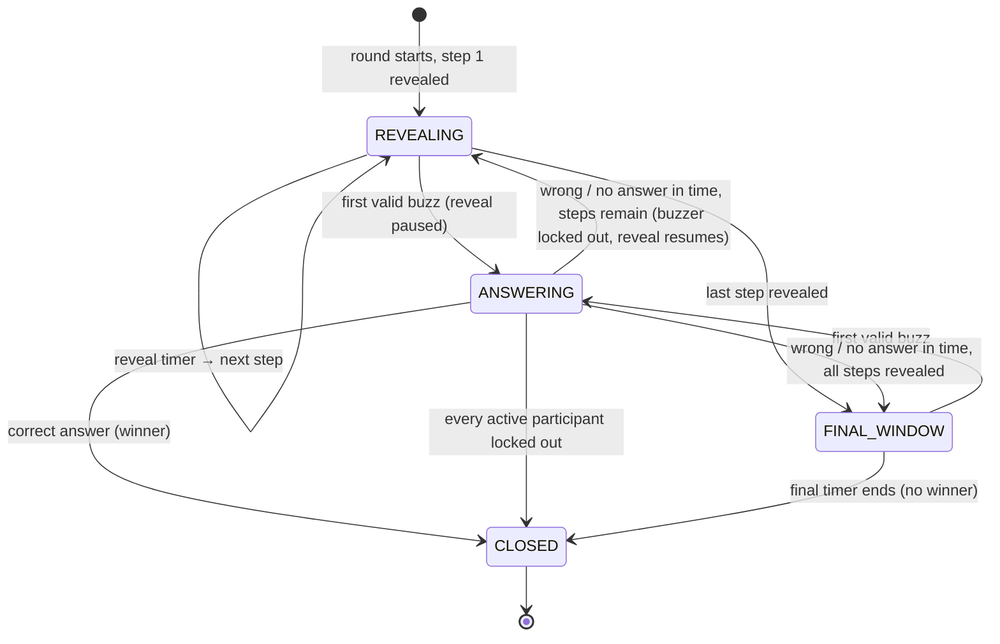

# Battle games: shared engine, game rules, answer catalog

How the game types of ADR-0015 run on one battle engine. Read with `03-workflows.md` §3-4 (matchmaking, rooms, engine lifecycle), `api/WEBSOCKET.md` (messages), `02-database.md` §4.6 and §4.8 (tables), and `07-football-data-and-questions.md` (where content comes from).

Every number in this file is configuration (per game type), never a constant. Names in `code` font are config keys.

## 1. Game types and mechanics

| Game type (`gameType`) | Mechanic | What is revealed step by step | The answer | Players |
|---|---|---|---|---|
| `BUZZER` | Reveal and buzz | The words of a question | An entity from the answer catalog, or a number | 2..N |
| `CAREER` | Reveal and buzz | A player's clubs, oldest first, with years if `showYears` | A player | 2..N |
| `WHO_IS_PLAYER` | Reveal and buzz | Clues about one player (nationality, position, birth year, a club, a trophy...), hardest first | A player | 2..N |
| `GRID` | Turns on a board | Nothing: the whole 3×3 board of criteria is shown | A player who fits a cell's row and column | exactly 2 (DEC-61) |
| `IMPOSTER` | Chat and vote (P8, DEC-58) | Not designed yet | — | rooms only |

A battle has **one** game type, chosen when it is created: by the queue the player joined (DEC-59), or by the host in a room. A battle is `roundCount` rounds of that game (DEC-31, per game type).

## 2. Engine and game rules

### 2.1 Who does what

| Part | Layer | Knows about |
|---|---|---|
| **Battle engine** | application (`battles`) | Participants, readiness, the round loop, timers, `seq`, persistence, reconnection, forfeits, bots, completion. It runs **one battle at a time per battle**: commands and timer firings for a battle are processed one after another, in arrival order, so two buzzes can never both "win" |
| **Game rules** | domain (`battles/domain/games/`) | One mechanic: what a round's state is, which commands are legal now, what a timer firing does, how the round ends and what it is worth. Plain TypeScript: no NestJS, no sockets, no database, time passed in |
| **Bot strategy** | domain, one per mechanic | When a bot buzzes and whether it is right (reveal and buzz); which cell it takes and whether it is right (grid) |

### 2.2 The game rules interface

The rules never perform side effects. They receive the round state and an input, and return the new state plus a list of **effects** that the engine carries out. This is the "functional core, imperative shell" pattern: the rules are pure and fully unit-testable with a fake clock, and all I/O lives in one place.

```ts
// battles/domain/games/game-rules.ts (shape, not final code)
interface GameRules<RoundState> {
  startRound(round: RoundSetup, now: Date): RulesStep<RoundState>;
  handleCommand(state: RoundState, from: ParticipantId, command: PlayerCommand, now: Date): RulesStep<RoundState> | Rejection;
  handleTimer(state: RoundState, timer: TimerKey, now: Date): RulesStep<RoundState>;
  participantLeft(state: RoundState, who: ParticipantId, now: Date): RulesStep<RoundState>;   // forfeit mid-round
}
interface RulesStep<S> { state: S; effects: Effect[] }
type Effect =
  | { type: 'EMIT'; to: 'ALL' | ParticipantId; event: BattleEvent }      // engine adds seq + serverTime
  | { type: 'SCHEDULE'; timer: TimerKey; at: Date }
  | { type: 'CANCEL'; timer: TimerKey }
  | { type: 'RECORD_ACTION'; action: RoundAction }                       // persisted to battle_round_actions
  | { type: 'END_ROUND'; result: RoundResult };                          // winner(s), points per participant
interface Rejection { code: string }                                     // becomes the ack's error code
```

- The registry maps `gameType → { rules, botStrategy, configSchema }`. `BUZZER`, `CAREER` and `WHO_IS_PLAYER` share `RevealAndBuzzRules`; `GRID` uses `GridRules`.
- Adding a game = a new rules class (or a new content kind for an existing mechanic), its bot strategy, its config schema, its content shape (§4) and its protocol events. The engine does not change.
- Rule: if the engine needs an `if (gameType === ...)`, the abstraction is wrong. Fix the interface instead.

### 2.3 What stays in the engine (all games)

Readiness and `WAITING_READY`; round sequencing and `roundCount`; timers (one scheduler per battle, keyed by `TimerKey`; all cancelled at battle end); `seq` and `serverTime` on every event; persistence of rounds and actions; disconnect grace and forfeit; `battle:resync` snapshots (built from the rules' state through a `snapshotFor(participant)` method, so a client only ever sees what was revealed); bot scheduling (bots send commands through the same `handleCommand` path, with no `clientMsgId`); scoring hand-off (`BattleScorer` totals the rounds' points; placements as before); completion and `BattleCompleted`.

## 3. Mechanics

### 3.1 Reveal and buzz (`BUZZER`, `CAREER`, `WHO_IS_PLAYER`)

Product rules: DEC-54 (decided structure), DEC-60 (wrong answers visible), DEC-33 (points).



1. **Start:** the engine loads the round content (server side only). The rules emit `round:start` (game type, `answerKind`, `stepCount`, no clue text) and reveal step 1 with `round:clue`. They schedule the next reveal at `now + revealIntervalMs`.
2. **Reveal:** each reveal timer emits `round:clue { index, clue }`, localized per player. A client never receives a step before it is revealed.
3. **Buzz:** `round:buzz` is accepted when the round is `REVEALING` or `FINAL_WINDOW`, the sender is active and not locked out, and nobody else holds the buzz. The first accepted buzz wins because the engine processes a battle's commands in arrival order. Later buzzes get `BUZZ_TAKEN`. On acceptance: cancel the reveal timer and remember how much of the interval was left; emit `round:buzzed { participantId, answerDeadlineAt }`; schedule the answer timer at `now + answerWindowMs + latencyGraceMs`.
4. **Answer:** only the buzz holder may send `round:answer`, once per buzz. The answer is an entity id of the round's `answerKind`, or a number when `answerKind = NUMBER`. Correctness is checked on the server (`AnswerChecker`, §5.3).
   - **Correct:** record it, `END_ROUND` with the winner. `round:result` reveals every step and the answer to everyone.
   - **Wrong or timed out:** record it; the player is locked out for this round (`attemptsPerPlayer`, default 1). Emit `round:wrong { participantId, answer? }`. Whether the wrong answer is shown is `showWrongAnswers` (DEC-60). Then resume: the next reveal fires after the remaining part of the interval, or after `resumeDelayMs` when that is larger. Emit `round:resumed { nextClueAt }`.
5. **End without a winner:** after the last step, the round stays open for `finalWindowMs` (`FINAL_WINDOW`). If nobody answers correctly by then, or every active participant is locked out, the round closes with no winner and `round:result` shows the answer.
6. **Points (DEC-33, per game type):** the winner gets `points.correct`, plus `points.perUnrevealedStep × steps not yet revealed` when that is non-zero (an early answer is worth more). `points.wrong` (default 0, may be negative) applies to a wrong answer. Everyone else gets 0.
7. **Forfeit during `ANSWERING`:** the buzz is released as a wrong answer with no penalty, and the reveal resumes.

**Content per game type** (prepared by the pipeline, §4):
- `BUZZER`: the question split into `stepCount` reveal segments **per locale, with the same count in every locale**. Arabic and English sentences have different word counts, so revealing "word by word" literally would show the two languages different amounts of the question. The pipeline splits both texts into the same number of meaningful chunks, so both players see the same share of the question at the same time.
- `CAREER`: the spells in order (`clubEntityId`, `fromYear`, `toYear`). Club names are rendered from the answer catalog in each player's locale, so no translation is needed. Loans are kept; consecutive spells at the same club are merged; youth teams are dropped (config in the pipeline).
- `WHO_IS_PLAYER`: an ordered list of clues, each with a `kind` and localized text, hardest first.

**How the engine turns content into steps** (P6.2): one step per spell or clue, in the player's locale.
- `CAREER`: `Sporting CP (2002–2003)` / `سبورتينغ لشبونة (2002–2003)`. An open spell ends with `present` / `حتى الآن`, and a loan adds `, loan` / `، إعارة` inside the brackets. With `showYears` off, only the club and the loan mark are shown. Club names come from the answer catalog.
- `WHO_IS_PLAYER`: the clue text as the pipeline wrote it (07 §5.8).
- `BUZZER`: the steps as written.

### 3.2 Grid (`GRID`, football tic-tac-toe)

Approved on condition that the data supports it. The 2026-11-10 check passed (`07` §4.1).

1. **Board:** 3 row criteria and 3 column criteria. A criterion is `{ kind: CLUB | NATIONALITY | COMPETITION_WON, entityId }`. Every cell has at least `minAnswersPerCell` valid players, guaranteed by the pipeline. The whole board is sent in `round:start`.
2. **Turns:** players alternate; who starts is random per round (seeded). The player on turn has `turnMs` to send `grid:claim { cell, answer: { entityId } }`.
   - Valid when: it is their turn, the cell is free, and the player was not already used on this board.
   - **Correct** (the player fits both criteria): the cell is theirs. `grid:claimed`.
   - **Wrong:** the cell stays free. `grid:missed { cell, participantId, answer? }` (DEC-60). After `attemptsPerTurn` wrong tries (default 1) the turn passes.
   - **Timeout or `grid:skip`:** the turn passes. `skipsPerRound` limits skips; a skip beyond it gives the round to the opponent (as in KickBrain; config, default off).
3. **End:** three cells in a line wins the round (`round:result` with the line). A full board, or `maxTurns` reached, is a draw. At the end everyone sees one valid answer per empty cell (`revealAnswersAtEnd`).
4. **Points:** `points.roundWin`, `points.roundDraw`, plus optional `points.perCell`.
5. **Players:** exactly 2 (DEC-61). A room can start a `GRID` battle only with 2 members.
6. **Details (P6.4):**
   - Who starts is drawn from the battle's seeded random source, so a replay starts the same way.
   - A turn number counts every turn started. Starting turn `maxTurns + 1` ends the round as a draw (`MAX_TURNS`).
   - A wrong answer keeps the turn while `attemptsLeft > 0`, with the same deadline; it never uses the player up.
   - `skipsPerRound: null` means unlimited. With a number, the skip after the last allowed one gives the round to the opponent (`SKIP_LIMIT`).
   - A participant who leaves mid-round gives it to the other (`FORFEIT`, no points).
   - Every cell is a slot of `question_answers` (`row * 3 + col`), so `AnswerChecker` judges a claim like any typed answer.

### 3.3 Bots

Bots exist only in matchmaking (DEC-39), and their behaviour comes from a profile (DEC-43) plus the injected random source, so a battle with a fixed seed replays identically.

| Mechanic | At round start the bot strategy returns | The engine then |
|---|---|---|
| Reveal and buzz | `{ buzzAfterStep: k \| null, answersCorrectly, typingDelayMs }`, from `difficulty`, the profile's skill per difficulty, and `stepCount` | Schedules a buzz after step k is revealed (if nobody else holds the buzz), then the answer after `typingDelayMs`: the correct entity, or a wrong entity of the same kind from the catalog |
| Grid | On each of its turns: `{ cell, answersCorrectly, thinkDelayMs }`. The cell: one that wins, else one that blocks the opponent's line, else the centre, else a random free cell. Correctness comes from the profile's `knowsAnswerByDifficulty`; the delay from `typingDelayMs` | Sends `grid:claim` with the most popular valid unused player, or a wrong player of the same kind |

Bot commands go through `handleCommand` like human commands. Bots never earn ledger points (DEC-41).

## 4. Content shapes

Round content lives in `question-bank` (`02-database.md` §4.6) and comes from bundles (`07` §5.4). One content item = one round. All content is **immutable once it could have been served** (P5.1 versioning rules apply unchanged).

| `gameType` | Content (`content` JSON, validated at import) | Accepted answers (`question_answers`) |
|---|---|---|
| `BUZZER` | `{ answerKind, steps: { en: string[], ar: string[] }, explanation?: {en, ar} }`, equal step counts per locale | 1+ entity ids (slot 0), or `{ number }` in content for `NUMBER` |
| `CAREER` | `{ playerEntityId, spells: [{ clubEntityId, fromYear, toYear \| null, loan }] }` | The player (slot 0) |
| `WHO_IS_PLAYER` | `{ playerEntityId, clues: [{ kind, text: {en, ar} }] }` | The player (slot 0) |
| `GRID` | `{ rows: [criterion ×3], cols: [criterion ×3] }` | For each cell (slot 0..8), every valid player id |

`answerKind` is `PLAYER`, `CLUB`, `NATIONAL_TEAM`, `COUNTRY`, `COMPETITION`, `COACH`, or `NUMBER`. Catalog entities of kind `COUNTRY` also name the nationality criteria of `GRID`. The client uses it to filter suggestions; it gives nothing away.

## 5. Answer catalog and typed answers (DEC-55)

### 5.1 What it is
A list of football entities a typed answer can be, with names in both languages: `answer_entities` (id, external ref such as `wikidata:Q11571`, kind, `names {en, ar}`, `popularity`) and `answer_entity_aliases` (alternative names per locale: "CR7", "رونالدو", "كريستيانو"). It is imported from the bundle with the content (`07` §5.4). The pipeline guarantees that every accepted answer is in the catalog.

### 5.2 Search happens on the phone
**Decision (technical):** the app downloads the catalog and searches it locally, instead of calling a search endpoint on every keystroke.
- **Fairness:** in a speed game, a slow network would otherwise mean slow suggestions. Local search makes typing speed the same for everyone.
- **Load:** no server call per keystroke.
- **Size:** about 20-30k entities with names and aliases, roughly 1-2 MB compressed. Downloaded once, then refreshed only when the version changes (`GET /v1/answer-catalog`, `ETag`).
- **Normalization:** the pipeline stores a normalized form of every name and alias (lower case, Latin accents removed; Arabic: alef forms أ إ آ → ا, ة → ه, ى → ي, tatweel and diacritics removed, leading "ال" ignored for matching). The app normalizes only what the user types, with the same rules. One rule list with shared test vectors lives in `07` §5.7, so the Dart and Python implementations cannot drift.
- Suggestions are ranked by prefix match, then `popularity`. Nothing about the current round is used for ranking, so suggestions never hint at the answer.

### 5.3 Checking an answer
The client sends `{ entityId }` (or `{ number }`). The server asks `AnswerChecker.checkTypedAnswer(contentId, slot, entityId)`. One indexed query returns one of three verdicts:
- `UNKNOWN_ENTITY`: the entity does not exist, or is not of the round's `answerKind`.
- `CORRECT`: the entity is in `question_answers` for that slot.
- `WRONG`: otherwise.

Text is never compared. A `NUMBER` answer is compared by the game rules with `answerNumber` from the round content.

### 5.4 What `question-bank` gives the engine (P5.2b)
The interface is in `01-modules.md` §2.6. All of it is server side; the game rules decide what each event shows.

- **`ContentSelector.pickContentIds(criteria)`** returns up to `count` random content ids that pass every check in its criteria:
  - **`gameType` and `count`:** that game type, at most that many ids.
  - **`locales`:** available in every one of them.
  - **`excludeContentIds`:** none of these ids.
  - **`difficulties`, optional:** only these difficulties.
  - **`minAnswersPerSlot`, optional (`GRID`):** every cell has at least that many accepted answers.
  - **Always:** `PUBLISHED`, and not expired (`valid_until` checked with the database clock).

  It returns fewer ids when the bank is short. The caller (`battles`) then relaxes its exposure window and asks again (DEC-44); the difficulty mix is also the caller's (one call per difficulty, `selection.*` config). The order is `ORDER BY random()`, which reads every matching row: fine for a bank of thousands. Revisit above about 100k rows per game type.
- **`RoundContentQuery.getContentForEngine(contentId, locales)`** returns the content with every catalog `externalRef` replaced by the entity id, texts only in the requested locales, and the accepted answers per slot (for the reveal at the end of a round). Any status: a battle keeps playing the content it picked at creation, even if that content is disabled later.
- **`AnswerCatalogQuery.findEntitiesByIds(ids)`** returns names in both locales, because one battle can have players of both languages.
- **`QuestionBankFacade.disableQuestion(id, reason)`** is used by the CLI now and by moderation later. Selection skips the content at once.

### 5.5 `GET /v1/answer-catalog`
- **Body:** `AnswerCatalog` (API.md §2) with every `ACTIVE` entity, most popular first.
- **`version`:** the checksum of the last imported `catalog.jsonl`. The active set is exactly that file's entities (`07` §5.5), so the same checksum always means the same body. Before any catalog import it is `none` and the list is empty.
- **Caching:** `ETag: "<version>"`. A matching `If-None-Match` gets `304` with no body. `Cache-Control: private, no-cache`: the phone keeps its copy and asks again before playing; a `304` costs a few bytes.
- **Compression:** the API process builds the JSON and its gzip once per version and keeps both in memory (about 11 MB and 2 MB for 22k entities). A request with `Accept-Encoding: gzip` gets the gzip bytes. A new catalog import changes the version, and the next request builds again.

### 5.6 Publishing and disabling (CLI)
- **`questions:publish <bundleVersion>`:**
  - Every `APPROVED` question of that bundle becomes `PUBLISHED`, with `published_at` set.
  - `DRAFT` questions are counted as "waiting for review" and stay as they are.
  - Writes one `QuestionsPublished { batchId, publishedCount }` event.
  - Running it again publishes nothing new and writes no event.
  - `--include-drafts` also publishes `DRAFT` questions. It is for development bundles only, and is refused when `NODE_ENV=production` (`07` §5.8).
- **`questions:disable <questionId> --reason <text>`:**
  - The question becomes `DISABLED` with that reason, and a `QuestionDisabled { questionId, reason }` event is written.
  - A question that is already disabled stays as it is, with no event.
  - An unknown id is an error.

**Question reports** (`POST /v1/questions/{id}/reports`) move to P6. They may only accept content the caller was served in a battle, and that needs `battle_rounds`.

### 2.4 Round runners (P6.4)

The engine (`LiveBattle`) owns the battle; one **round runner** per mechanic owns a round. `RevealRoundRunner` serves `BUZZER`, `CAREER` and `WHO_IS_PLAYER`; `GridRoundRunner` serves `GRID`. A runner wraps its pure rules, renders its events per viewer, drives its bot and builds its part of the snapshot. It calls back into the battle to emit, schedule timers, record actions and end the round. Picking the runner from the content's game type is the registry of §2.2; nothing else in the engine looks at the game type.

## 6. Configuration (per game type)

Stored in the battle config by game type, snapshotted on the battle row at creation (as today). Dev seeds use obviously fake `DEV_ONLY` values. Product values are picked at playtesting.

| Key | Applies to | Decision |
|---|---|---|
| `roundCount` | all | DEC-31 |
| `revealIntervalMs`, `resumeDelayMs`, `answerWindowMs`, `finalWindowMs`, `attemptsPerPlayer` | reveal and buzz | DEC-54 |
| `turnMs`, `attemptsPerTurn`, `skipsPerRound` (`null` = unlimited), `maxTurns`, `minAnswersPerCell`, `revealAnswersAtEnd`, `points.roundWin`, `points.roundDraw`, `points.perCell` | grid | DEC-54, DEC-61 |
| `showWrongAnswers` | all | DEC-60 |
| `showYears` | `CAREER` | DEC-54 |
| `room.difficultyLevels` (`EASY`, `MEDIUM`, `HARD` → difficulty ranges) | rooms | DEC-64 |
| `points.*` | all | DEC-33 |
| `latencyGraceMs`, `readyTimeoutMs`, `reconnectGraceMs`, `betweenRoundsMs` (pause after `round:result`) | engine | DEC-32 |
| `matchmaking.botFallbackAfterMs`, `tickMs`, `queueDisconnectGraceMs` | matchmaking | DEC-39 |
| `bots.profiles.*` (`knowsAnswerByDifficulty`, `guessChance`, `buzzAtShareOfSteps`, `reactionDelayMs`, `typingDelayMs`) | bots | DEC-43 |
| `selection.*` (`excludeLastBattles`, `difficulties`) | all | DEC-44 |

## 7. Fairness and abuse

- **The client never holds what it should not show:** unrevealed steps, accepted answers, valid grid answers. Snapshots on resync contain only revealed steps.
- **Buzz order is server arrival order.** A player on a slower network buzzes "later". Accepted for v1.0. Measure buzz-to-receive delays (`battle_buzz_latency_ms` from client timestamps, used for metrics only, never for ordering) before deciding whether compensation is needed.
- **Answer lookups:** a cheater could search the web during the answer window. The window is short by design (`answerWindowMs`). Not solvable on the client; accepted.
- **Monetization hook:** starting play still goes through the two entry use cases only (ADR-0016).

## 8. Question topics and difficulty in private rooms (ADR-0019, DEC-64)

- **Topics:** every round carries `topics` (07 §5.9), separate from its `category`. "General" plays everything.
- **Room setup:** in `LOBBY` the host sets `topics` (empty = General) and `difficultyLevel` (`MIXED`, `EASY`, `MEDIUM`, `HARD`; ranges in `room.difficultyLevels`). Members see them in `room:updated`. The battle snapshots them into `battles.config.selection`.
- **Selection:** `ContentSelector.pickContentIds` gets `topics` (any of them) and the level's `difficulties`. The exposure window still applies inside the filter and relaxes as usual (DEC-44).
- **Availability:** `GET /v1/battle-topics?gameType=` lists topics with published content in the caller's locale and counts per level, so the app only offers choices that can fill a battle. A room start that cannot fill `roundCount` rounds fails with `409 NOT_ENOUGH_CONTENT` and changes nothing.
- **Random matchmaking** stays unfiltered (DEC-65).
