# Battle games: shared engine, game rules, answer catalog

How the game types of ADR-0015 run on one battle engine. Read with `03-workflows.md` §3-4 (matchmaking, rooms, engine lifecycle), `api/WEBSOCKET.md` (messages), `02-database.md` §4.6 and §4.8 (tables), and `07-football-data-and-questions.md` (where content comes from).

Every number in this file is configuration (per game type), never a constant. Names in `code` font are config keys.

## 1. Game types and mechanics

| Game type (`gameType`) | Mechanic | What is revealed step by step | The answer | Players |
|---|---|---|---|---|
| `BUZZER` | Reveal and buzz | The words of a question | An entity from the answer catalog, or a number | 2..N |
| `CAREER` | Reveal and buzz | A player's clubs, oldest first, with years if `showYears` | A player | 2..N |
| `WHO_IS_PLAYER` | Reveal and buzz | Clues about one player (nationality, position, birth year, a club, a trophy...), hardest first | A player | 2..N |
| `GRID` | Turns on a board | Nothing: the whole 3×3 board of criteria is shown | A player who fits a cell's row and column | exactly 2 (DEC-61) |
| `IMPOSTER` (المندس) | Clue turns and a vote (P8b, §18) | A footballer's name to all but the imposter; each player's clues | The imposter, by vote; a caught imposter guesses the name | 4..`maxPlayers`, rooms only |
| `MINES` (لغم) | Turns with hearts, hidden mines (N1) | A category; each player first buries mines in secret | Players of the category, no repeats | 2 |
| `AUCTION` (المزاد) | Bidding, then proof (N2) | A list title and its answer count | As many names of the list as you bid | 2 |
| `VAULT` (الخزنة) | Simultaneous race (N3) | Four questions whose answers are digits 0–9; leaks on a timer | The whole 4-digit code, all or nothing | 2; 2..`maxPlayers` in rooms (§18.1) |
| `HEX` (الهجمة) | Hex board race (N4) | A board of letters; a question per picked cell | A name starting with the cell's letter | 2 |
| `LINEUP` (التشكيلة) | Simultaneous slot filling (N5) | A famous match's formation, 3 shown names (one fake) | The starting XI; accuse the fake | 2 |
| `TIME_MACHINE` (آلة الزمن) | Turns with hearts, years going back (N6) | A tournament edition per turn | One fact about that edition | 2 |
| `THREAD` (الخيط) | Simultaneous chained race (N7) | Five rooms, each question pointing at the previous answer | Each room's single answer | 2; 2..`maxPlayers` in rooms (§18.1) |
| `ONE_TWO` (وان تو) | Turn-based rally on a link graph (N8) | A seed name, then each answer as the next ball | A name linked to the ball by the pass type the opponent picked | 2 |
| `BRIDGE` (الكوبري) | Dots and boxes on a board of clubs (N9) | Nothing: the whole board is shown | A player who scored against both clubs of the picked line | 2 |

The new game types (DEC-68, plus `ONE_TWO` chosen on 2026-11-20) are designed one by one in track N; §9 holds what they share. A battle has **one** game type, chosen when it is created: by the queue the player joined (DEC-59), or by the host in a room. A battle is `roundCount` rounds of that game (DEC-31, per game type).

## 2. Engine and game rules

### 2.1 Who does what

| Part | Layer | Knows about |
|---|---|---|
| **Battle engine** | application (`battles`) | Participants, readiness, the round loop, timers, `seq`, persistence, reconnection, forfeits, bots, completion. It runs **one battle at a time per battle**: commands and timer firings for a battle are processed one after another, in arrival order, so two buzzes can never both "win" |
| **Game rules** | domain (`battles/domain/games/`) | One mechanic: what a round's state is, which commands are legal now, what a timer firing does, how the round ends and what it is worth. Plain TypeScript: no NestJS, no sockets, no database, time passed in |
| **Bot strategy** | domain, one per mechanic | When a bot buzzes and whether it is right (reveal and buzz); which cell it takes and whether it is right (grid) |

### 2.2 The game rules interface

The rules never perform side effects. They receive the round state and an input, and return the new state plus a list of **effects** that the engine carries out. This is the "functional core, imperative shell" pattern: the rules are pure and fully unit-testable with a fake clock, and all I/O lives in one place.

```ts
// battles/domain/games/game-rules.ts (shape, not final code)
interface GameRules<RoundState> {
  startRound(round: RoundSetup, now: Date): RulesStep<RoundState>;
  handleCommand(state: RoundState, from: ParticipantId, command: PlayerCommand, now: Date): RulesStep<RoundState> | Rejection;
  handleTimer(state: RoundState, timer: TimerKey, now: Date): RulesStep<RoundState>;
  participantLeft(state: RoundState, who: ParticipantId, now: Date): RulesStep<RoundState>;   // forfeit mid-round
}
interface RulesStep<S> { state: S; effects: Effect[] }
type Effect =
  | { type: 'EMIT'; to: 'ALL' | ParticipantId; event: BattleEvent }      // engine adds seq + serverTime
  | { type: 'SCHEDULE'; timer: TimerKey; at: Date }
  | { type: 'CANCEL'; timer: TimerKey }
  | { type: 'RECORD_ACTION'; action: RoundAction }                       // persisted to battle_round_actions
  | { type: 'END_ROUND'; result: RoundResult };                          // winner(s), points per participant
interface Rejection { code: string }                                     // becomes the ack's error code
```

- The registry maps `gameType → { rules, botStrategy, configSchema }`. `BUZZER`, `CAREER` and `WHO_IS_PLAYER` share `RevealAndBuzzRules`; `GRID` uses `GridRules`.
- Adding a game = a new rules class (or a new content kind for an existing mechanic), its bot strategy, its config schema, its content shape (§4) and its protocol events. The engine does not change.
- Rule: if the engine needs an `if (gameType === ...)`, the abstraction is wrong. Fix the interface instead.

### 2.3 What stays in the engine (all games)

Readiness and `WAITING_READY`; the first-mover phase `PICKING_FIRST` (rock-paper-scissors, §9.1); round sequencing and `roundCount`; timers (one scheduler per battle, keyed by `TimerKey`; all cancelled at battle end); `seq` and `serverTime` on every event; persistence of rounds and actions; disconnect grace and forfeit; `battle:resync` snapshots (built from the rules' state through a `snapshotFor(participant)` method, so a client only ever sees what was revealed); bot scheduling (bots send commands through the same `handleCommand` path, with no `clientMsgId`); scoring hand-off (`BattleScorer` totals the rounds' points; placements as before); completion and `BattleCompleted`.

### 2.4 Round runners (P6.4)

The engine (`LiveBattle`) owns the battle; one **round runner** per mechanic owns a round. `RevealRoundRunner` serves `BUZZER`, `CAREER` and `WHO_IS_PLAYER`; `GridRoundRunner` serves `GRID`. A runner wraps its pure rules, renders its events per viewer, drives its bot and builds its part of the snapshot. It calls back into the battle to emit, schedule timers, record actions and end the round. Picking the runner from the content's game type is the registry of §2.2; nothing else in the engine looks at the game type.

## 3. Mechanics

### 3.1 Reveal and buzz (`BUZZER`, `CAREER`, `WHO_IS_PLAYER`)

Product rules: DEC-54 (decided structure), DEC-60 (wrong answers visible), DEC-33 (points).

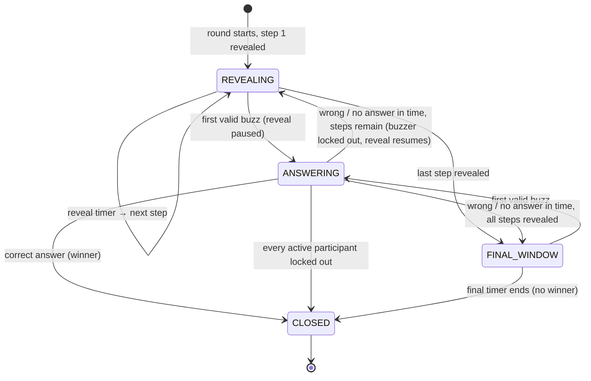

1. **Start:** the engine loads the round content (server side only). The rules emit `round:start` (game type, `answerKind`, `stepCount`, no clue text) and reveal step 1 with `round:clue`. They schedule the next reveal at `now + revealIntervalMs`.
2. **Reveal:** each reveal timer emits `round:clue { index, clue }`, localized per player. A client never receives a step before it is revealed.
3. **Buzz:** `round:buzz` is accepted when the round is `REVEALING` or `FINAL_WINDOW`, the sender is active and not locked out, and nobody else holds the buzz. The first accepted buzz wins because the engine processes a battle's commands in arrival order. Later buzzes get `BUZZ_TAKEN`. On acceptance: cancel the reveal timer and remember how much of the interval was left; emit `round:buzzed { participantId, answerDeadlineAt }`; schedule the answer timer at `now + answerWindowMs + latencyGraceMs`.
4. **Answer:** only the buzz holder may send `round:answer`, once per buzz. The answer is the typed text, or a number when `answerKind = NUMBER`. The server judges it (`AnswerChecker`, §5.3).
   - **Correct:** record it, `END_ROUND` with the winner. `round:result` reveals every step and the answer to everyone.
   - **Wrong or timed out:** record it; the player is locked out for this round (`attemptsPerPlayer`, default 1). Emit `round:wrong { participantId, answer? }`. Whether the wrong answer is shown is `showWrongAnswers` (DEC-60). Then resume: the next reveal fires after the remaining part of the interval, or after `resumeDelayMs` when that is larger. Emit `round:resumed { nextClueAt }`.
5. **End without a winner:** after the last step, the round stays open for `finalWindowMs` (`FINAL_WINDOW`). If nobody answers correctly by then, or every active participant is locked out, the round closes with no winner and `round:result` shows the answer.
6. **Points (DEC-33, per game type):** the winner gets `points.correct`, plus `points.perUnrevealedStep × steps not yet revealed` when that is non-zero (an early answer is worth more). `points.wrong` (default 0, may be negative) applies to a wrong answer. Everyone else gets 0.
7. **Forfeit during `ANSWERING`:** the buzz is released as a wrong answer with no penalty, and the reveal resumes.

**Content per game type** (prepared by the pipeline, §4):
- `BUZZER`: the question split into `stepCount` reveal segments **per locale, with the same count in every locale**. Arabic and English sentences have different word counts, so revealing "word by word" literally would show the two languages different amounts of the question. The pipeline splits both texts into the same number of meaningful chunks, so both players see the same share of the question at the same time.
- `CAREER`: the spells in order (`clubEntityId`, `fromYear`, `toYear`). Club names are rendered from the answer catalog in each player's locale, so no translation is needed. Loans are kept; consecutive spells at the same club are merged; youth teams are dropped (config in the pipeline).
- `WHO_IS_PLAYER`: an ordered list of clues, each with a `kind` and localized text, hardest first.

**How the engine turns content into steps** (P6.2): one step per spell or clue, in the player's locale.
- `CAREER`: `Sporting CP (2002–2003)` / `سبورتينغ لشبونة (2002–2003)`. An open spell ends with `present` / `حتى الآن`, and a loan adds `, loan` / `، إعارة` inside the brackets. With `showYears` off, only the club and the loan mark are shown. Club names come from the answer catalog.
- `WHO_IS_PLAYER`: the clue text as the pipeline wrote it (07 §5.8).
- `BUZZER`: the steps as written.

### 3.2 Grid (`GRID`, football tic-tac-toe)

Approved on condition that the data supports it. The 2026-11-10 check passed (`07` §4.1).

1. **Board:** 3 row criteria and 3 column criteria. A criterion is `{ kind: CLUB | NATIONALITY | COMPETITION_WON, entityId }`. Every cell has at least `minAnswersPerCell` valid players, guaranteed by the pipeline. The whole board is sent in `round:start`.
2. **Turns:** players alternate. Round 1 starts with the rock-paper-scissors winner (§9.1, ADR-0023); later rounds follow `firstMoverAfterRound1` (default `ALTERNATE`). The player on turn has `turnMs` to send `grid:claim { cell, answer: { text } }`.
   - Valid when: it is their turn and the cell is free. The text is judged against the cell's valid players (§5.3); naming a player already used on this board is rejected (`PLAYER_ALREADY_USED`).
   - **Correct** (the player fits both criteria): the cell is theirs. `grid:claimed`.
   - **Wrong:** the cell stays free. `grid:missed { cell, participantId, answer? }` (DEC-60). After `attemptsPerTurn` wrong tries (default 1) the turn passes.
   - **Timeout or `grid:skip`:** the turn passes. `skipsPerRound` limits skips; a skip beyond it gives the round to the opponent (as in KickBrain; config, default off).
3. **End:** three cells in a line wins the round (`round:result` with the line). A full board, or `maxTurns` reached, is a draw. At the end everyone sees one valid answer per empty cell (`revealAnswersAtEnd`).
4. **Points:** `points.roundWin`, `points.roundDraw`, plus optional `points.perCell`.
5. **Players:** exactly 2 (DEC-61). A room can start a `GRID` battle only with 2 members.
6. **Details (P6.4):**
   - Who starts round 1 comes from the first-mover phase (§9.1); it was a seeded draw until ADR-0023. Replays still start the same way, because the duel's fallbacks use the seeded random source.
   - A turn number counts every turn started. Starting turn `maxTurns + 1` ends the round as a draw (`MAX_TURNS`).
   - A wrong answer keeps the turn while `attemptsLeft > 0`, with the same deadline; it never uses the player up.
   - `skipsPerRound: null` means unlimited. With a number, the skip after the last allowed one gives the round to the opponent (`SKIP_LIMIT`).
   - A participant who leaves mid-round gives it to the other (`FORFEIT`, no points).
   - Every cell is a slot of `question_answers` (`row * 3 + col`), so `AnswerChecker` judges a claim like any typed answer, with the cell's valid players as the accepted answers.

### 3.3 Bots

Bots exist only in matchmaking (DEC-39), and their behaviour comes from a profile (DEC-43) plus the injected random source, so a battle with a fixed seed replays identically.

| Mechanic | At round start the bot strategy returns | The engine then |
|---|---|---|
| Reveal and buzz | `{ buzzAfterStep: k \| null, answersCorrectly, typingDelayMs }`, from `difficulty`, the profile's skill per difficulty, and `stepCount` | Schedules a buzz after step k is revealed (if nobody else holds the buzz), then the answer after `typingDelayMs`: the correct entity, or a wrong entity of the same kind from the catalog |
| Grid | On each of its turns: `{ cell, answersCorrectly, thinkDelayMs }`. The cell: one that wins, else one that blocks the opponent's line, else the centre, else a random free cell. Correctness comes from the profile's `knowsAnswerByDifficulty`; the delay from `typingDelayMs` | Sends `grid:claim` with the most popular valid unused player, or a wrong player of the same kind |

Bot commands go through `handleCommand` like human commands. Bots never earn ledger points (DEC-41).

## 4. Content shapes

Round content lives in `question-bank` (`02-database.md` §4.6) and comes from bundles (`07` §5.4). One content item = one round. All content is **immutable once it could have been served** (P5.1 versioning rules apply unchanged).

| `gameType` | Content (`content` JSON, validated at import) | Accepted answers (`question_answers`) |
|---|---|---|
| `BUZZER` | `{ answerKind, steps: { en: string[], ar: string[] }, explanation?: {en, ar} }`, equal step counts per locale | 1+ entity ids (slot 0), or `{ number }` in content for `NUMBER` |
| `CAREER` | `{ playerEntityId, spells: [{ clubEntityId, fromYear, toYear \| null, loan }] }` | The player (slot 0) |
| `WHO_IS_PLAYER` | `{ playerEntityId, clues: [{ kind, text: {en, ar} }] }` | The player (slot 0) |
| `GRID` | `{ rows: [criterion ×3], cols: [criterion ×3] }` | For each cell (slot 0..8), every valid player id |
| `MINES` | `{ criteria: [criterion ×2] }` (§10.4) | Slot 0: every player of the category |
| `AUCTION` | `{ lists: [{ kind, title } ×3] }` (§11.4) | Slots 0..2: every name of each list |

`answerKind` is `PLAYER`, `CLUB`, `NATIONAL_TEAM`, `COUNTRY`, `COMPETITION`, `COACH`, or `NUMBER`. Catalog entities of kind `COUNTRY` also name the nationality criteria of `GRID`. The client uses it to filter suggestions; it gives nothing away.

## 5. Answer catalog and typed answers (DEC-55)

### 5.1 What it is
A list of football entities a typed answer can be, with names in both languages: `answer_entities` (id, external ref such as `wikidata:Q11571`, kind, `names {en, ar}`, `popularity`, normalized `search_forms`, distinctive `name_words`) and `answer_entity_aliases` (alternative names per locale: "CR7", "رونالدو", "كريستيانو"). It is imported from the bundle with the content (`07` §5.4) and **stays on the server** (ADR-0021): it judges typed text and gives names to events. The pipeline guarantees that every accepted answer is in the catalog.

### 5.2 What the player does
The player types the answer and sends it. **No suggestions are shown** (ADR-0021, DEC-55). The app sends `{ text }` (at most `answers.maxLength` characters) or `{ number }`. The app never receives the accepted answers or the catalog.

### 5.3 Judging an answer
`AnswerChecker.judgeTypedText(contentId, slot, text, rules)` compares the text **only with the accepted answers of that slot**:

1. **Normalize** the text (`07` §5.7). Empty: rejected with `EMPTY_ANSWER`, no attempt used.
2. **Exact match** with a form of an accepted answer: `CORRECT`.
3. **Exact match** with a full name or alias of **another** entity of the round's `answerKind`: `WRONG`, and that entity is the shown wrong answer (`تشابي` is Xabi Alonso, not a typo of `تشافي`).
4. **Within the typo tolerance** of a form of an accepted answer: `CORRECT`.
5. Otherwise `WRONG`, with nothing to show.

- **Forms of an entity:** its full names (`ar`, `en`), its aliases, and each distinctive single word of its names: at least 3 letters, shared by at most `answers.singleWordMaxSharedBy` entities of the same kind (default 15; `name_words`, computed by the pipeline over the whole knowledge base). `ليونيل` counts alone for Messi; `محمد` does not count alone for Mohamed Salah.
- **Typo tolerance:** edit distance in letters (one letter added, missing, changed, or two neighbours swapped is one edit), by the form's letter count without spaces: `answers.typoTolerance`, default up to 3 letters exact, 4-7 letters 1 edit, 8+ letters 2 edits. `ميسب`, `مبسي` and `ميسيي` are one edit from `ميسي`.
- **`GRID`:** the accepted answers are the cell's valid players. When the text fits several: the closest first, then one not used on this board, then the most popular. Only used players fit: `PLAYER_ALREADY_USED`.
- **Result:** `{ verdict: CORRECT | WRONG, entityId | null, match: EXACT | TYPO | OTHER_ENTITY | NONE }`. The engine records the text, the entity and `match` on the action (for tuning the tolerance), and never shows the raw text to other players (DEC-60 shows only an `OTHER_ENTITY` match).
- **Bots** answer with an entity id inside the server; they skip text judging.
- A `NUMBER` answer is compared by the game rules with `answerNumber` from the round content.

### 5.4 What `question-bank` gives the engine (P5.2b)
The interface is in `01-modules.md` §2.6. All of it is server side; the game rules decide what each event shows.

- **`ContentSelector.pickContentIds(criteria)`** returns up to `count` random content ids that pass every check in its criteria:
  - **`gameType` and `count`:** that game type, at most that many ids.
  - **`locales`:** available in every one of them.
  - **`excludeContentIds`:** none of these ids.
  - **`difficulties`, optional:** only these difficulties.
  - **`minAnswersPerSlot`, optional (`GRID`):** every cell has at least that many accepted answers.
  - **Always:** `PUBLISHED`, and not expired (`valid_until` checked with the database clock).

  It returns fewer ids when the bank is short; the difficulty mix is the caller's (`selection.difficulties` config).
- **`ContentSelector.pickContentIdsInGivenOrder(criteria, candidateContentIds)`** returns, in the candidates' order, the first `count` of them that pass the same checks (no `excludeContentIds`). `battles` uses it when the first call came back short: the candidates are the players' seen questions, longest ago first, so the refill repeats what they are least likely to remember (DEC-44). The order is `ORDER BY random()`, which reads every matching row: fine for a bank of thousands. Revisit above about 100k rows per game type.
- **`RoundContentQuery.getContentForEngine(contentId, locales)`** returns the content with every catalog `externalRef` replaced by the entity id, texts only in the requested locales, and the accepted answers per slot (for the reveal at the end of a round). Any status: a battle keeps playing the content it picked at creation, even if that content is disabled later.
- **`AnswerCatalogQuery.findEntitiesByIds(ids)`** returns names in both locales, because one battle can have players of both languages.
- **`QuestionBankFacade.disableQuestion(id, reason)`** is used by the CLI now and by moderation later. Selection skips the content at once.

### 5.5 `GET /v1/answer-catalog` (removed)
Built in P5.2 for on-device search. With no suggestions (ADR-0021) the app does not need the catalog, so P6.6 removed the endpoint and its in-memory gzip cache.

### 5.6 Publishing and disabling (CLI)
- **`questions:publish <bundleVersion>`:**
  - Every `APPROVED` question of that bundle becomes `PUBLISHED`, with `published_at` set.
  - `DRAFT` questions are counted as "waiting for review" and stay as they are.
  - Writes one `QuestionsPublished { batchId, publishedCount }` event.
  - Running it again publishes nothing new and writes no event.
  - `--include-drafts` also publishes `DRAFT` questions. It is for development bundles only, and is refused when `NODE_ENV=production` (`07` §5.8).
- **`questions:disable <questionId> --reason <text>`:**
  - The question becomes `DISABLED` with that reason, and a `QuestionDisabled { questionId, reason }` event is written.
  - A question that is already disabled stays as it is, with no event.
  - An unknown id is an error.

### 5.7 Question stats and reports (P6.5c)

**Stats** feed difficulty calibration later (`calibrated_difficulty`, a future job). They count **humans only**: a bot's answers come from its profile, not from knowing football.

- `BattleCompleted.questionResults` has one item per round: `{ questionId, roundNo, endReason, served, solved, wrongAnswers, stepsRevealed }`.
  - `served`: the round started (a battle ended by forfeit has rounds that never did).
  - `solved`: a human won the round. In reveal games that is the correct answer; in `GRID` it is the round's winner.
  - `wrongAnswers`: wrong `ANSWER` and `GRID_CLAIM` actions by humans.
  - `stepsRevealed`: how far the reveal got (reveal games).
- The `question-bank` handler (queue `question-bank`, subscriber `question-bank.update-question-stats`) inserts the battle id into `question_stats_applied` and, only when that insert is new, adds each served round to `question_stats` in the same transaction. Here an increment is safe: the dedup row and the increments commit or roll back together.
- `ABANDONED` and `CANCELLED` battles write no `BattleCompleted`, so they add no stats.

**Reports:** `POST /v1/questions/{questionId}/reports { reason }`, for a player who thinks a question is wrong.

- **Only content the caller was served:** a round of a battle they took part in, with `started_at` set. Anything else, including an unknown id, is `404 QUESTION_NOT_FOUND`, so the endpoint cannot be used to probe question ids.
- **One report per player per question:** a repeat changes nothing and answers `204` again (idempotent). `reason` is free text, 1 to 500 characters.
- **Where it lives:** the controller is in `battles`, the only module that knows what was served (`question-bank` cannot call `battles`: that would be a cycle). It checks the served rule, then calls `QuestionReports.reportQuestion`, which writes `question_reports`, owned by `question-bank`.
- **Moderation:** `npm run cli -- questions:reports` lists the most reported questions with their latest reasons; an operator then uses `questions:disable`. There is no automatic disabling: a threshold would be a product rule nobody has decided.

## 6. Configuration (per game type)

Stored in the battle config by game type, snapshotted on the battle row at creation (as today). Dev seeds use obviously fake `DEV_ONLY` values. Product values are picked at playtesting.

| Key | Applies to | Decision |
|---|---|---|
| `roundCount` | all | DEC-31 |
| `revealIntervalMs`, `resumeDelayMs`, `answerWindowMs`, `finalWindowMs`, `attemptsPerPlayer` | reveal and buzz | DEC-54 |
| `turnMs`, `attemptsPerTurn`, `skipsPerRound` (`null` = unlimited), `maxTurns`, `minAnswersPerCell`, `revealAnswersAtEnd`, `points.roundWin`, `points.roundDraw`, `points.perCell` | grid | DEC-54, DEC-61 |
| `showWrongAnswers` | all | DEC-60 |
| `answers.maxLength`, `answers.typoTolerance` (letters → edits), `answers.singleWordMaxSharedBy` | all typed answers | DEC-55 |
| `showYears` | `CAREER` | DEC-54 |
| `burying.*`, `hearts`, `ownMine`, `detector.*`, `points.perSafeAnswer` | `MINES` (§10.6) | DEC-72, DEC-73, DEC-75 |
| `targetScore`, `pickMs`, `bidding.*`, `proof.*`, `allIn.maxWrong`, `steal.*`, `points.allInWin` | `AUCTION` (§11.6) | DEC-76, DEC-77 |
| `room.difficultyLevels` (`EASY`, `MEDIUM`, `HARD` → difficulty ranges) | rooms | DEC-64 |
| `points.*` | all | DEC-33 |
| `latencyGraceMs`, `readyTimeoutMs`, `reconnectGraceMs`, `betweenRoundsMs` (pause after `round:result`) | engine | DEC-32 |
| `matchmaking.botFallbackAfterMs`, `tickMs`, `queueDisconnectGraceMs` | matchmaking | DEC-39 |
| `bots.profiles.*` (`knowsAnswerByDifficulty`, `guessChance`, `buzzAtShareOfSteps`, `reactionDelayMs`, `typingDelayMs`) | bots | DEC-43 |
| `selection.difficulties` | all | DEC-44 |

### 6.1 Leaderboard points (the `BATTLE` rule set, P6.5)

The in-game `score` (`points.*` above) decides placements inside one battle. **Ledger points** are what a battle adds to the `BATTLES` leaderboards. They come from the active `BATTLE` scoring rule set (`scoring_rule_sets`, stored by `points`), not from the battle config file, because every ledger entry records the rule set that produced it.

```json
{ "modes": {
    "matchmakingVsHuman": { "pointsByOutcome": { "WIN": 30, "DRAW": 10, "LOSS": 0 }, "forfeitWinEarnsPoints": true },
    "matchmakingVsBot":   { "pointsByOutcome": { "WIN": 0, "DRAW": 0, "LOSS": 0 }, "forfeitWinEarnsPoints": false },
    "room":               { "pointsByOutcome": { "WIN": 0, "DRAW": 0, "LOSS": 0 }, "forfeitWinEarnsPoints": false } } }
```

- **Values:** `DEV_ONLY` placeholders (DEC-33), except vs bot and room, which earn nothing (DEC-41). Points are whole numbers ≥ 0: a lost battle never removes leaderboard points (negative values would need a decision).
- **Who computes:** `battles` (the ledger only records, 01 §2.9). At creation the engine reads the active rule set, keeps the section for the battle's mode in the config snapshot and stores `battles.rule_set_id`. A rule set activated during a battle applies from the next battle; past battles keep their points.
- **At completion:** each human gets `pointsByOutcome[outcome]`, and 0 for a win by forfeit when `forfeitWinEarnsPoints` is false. Bots never get points. `CANCELLED` and `ABANDONED` battles have no placements and no points.
- **No active rule set:** the battle plays normally, `rule_set_id` stays NULL, every human gets 0 and the API logs a warning. Production activates one before launch.
- **Activation:** `npm run cli -- battles:activate-rule-set <file>`. `battles` validates the shape; `points` stores it as the next version and retires the previous `ACTIVE` one in the same transaction, and writes `ScoringRuleSetActivated`. Activating a config equal to the active one changes nothing. Dev file: `apps/backend/config/scoring/battle.dev.json`.
- **To the ledger:** `BattleCompleted` carries `ruleSetId`, `endReason` and each participant's `points`. The `points` handler writes one `point_entries` row per human with points > 0, then `PointsRecorded`. `battle:completed` tells each player `you.points`; `pointsPending` is true when they are above 0.

## 7. Fairness and abuse

- **The client never holds what it should not show:** unrevealed steps, accepted answers, valid grid answers. Snapshots on resync contain only revealed steps.
- **Buzz order is server arrival order.** A player on a slower network buzzes "later". Accepted for v1.0. Measure buzz-to-receive delays (`battle_buzz_latency_ms` from client timestamps, used for metrics only, never for ordering) before deciding whether compensation is needed.
- **Answer lookups:** a cheater could search the web during the answer window. The window is short by design (`answerWindowMs`). Not solvable on the client; accepted.
- **Monetization hook:** starting play still goes through the two entry use cases only (ADR-0016).

## 8. Question topics and difficulty in private rooms (ADR-0020, DEC-64)

- **Topics:** every round carries `topics` (07 §5.9), separate from its `category`. "General" plays everything.
- **Room setup:** in `LOBBY` the host sets `topics` (empty = General) and `difficultyLevel` (`MIXED`, `EASY`, `MEDIUM`, `HARD`; ranges in `room.difficultyLevels`). Members see them in `room:updated`. The battle snapshots them into `battles.config.selection`.
- **Selection:** `ContentSelector.pickContentIds` gets `topics` (any of them) and the level's `difficulties`. Seen questions are still skipped inside the filter, and the refill takes seen questions that match the filter (DEC-44).
- **Availability:** `GET /v1/battle-topics?gameType=` lists topics with published content in the caller's locale and counts per level, so the app only offers choices that can fill a battle. A room start that cannot fill `roundCount` rounds fails with `409 NOT_ENOUGH_CONTENT` and changes nothing.
- **Random matchmaking** stays unfiltered (DEC-65).

## 9. New game types: shared pieces (N0, DEC-68, ADR-0023)

Each new game gets its own section after this one when its N phase starts (rules, state diagram, content shape, bot, config, open rules as DECs; `MINES` is §10, `AUCTION` §11). This section holds only what several of them share.

### 9.1 Who starts: rock-paper-scissors

For a game type with `firstMover: "RPS"` the engine adds a phase between `WAITING_READY` and round 1. It is engine work: the rules only receive `RoundSetup.firstMoverId`.

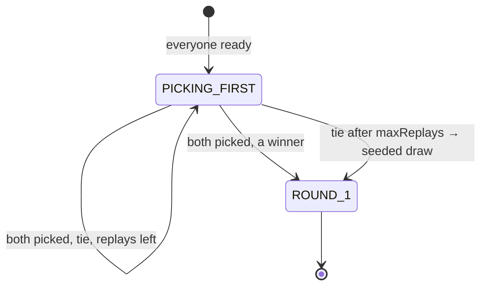

1. The server emits `battle:rps-start { attempt, pickDeadlineAt }` to both players.
2. Each player sends `battle:rps-pick { choice: ROCK | PAPER | SCISSORS }` once per attempt. The server keeps the picks secret: no event says who has already picked.
3. When both have picked, or `pickDeadlineAt` passes, the server emits `battle:rps-result { attempt, picks: [{ participantId, choice, auto }], winnerId | null }`. A missing pick is drawn from the seeded random source and marked `auto: true`.
4. A tie with replays left starts the next attempt. A tie after `rps.maxReplays` replays ends the phase with a seeded draw (`winnerId` set, `decidedBy: "DRAW"`).
5. Bots pick from the seeded random source after a human-like delay (`rps.botPickDelayMs`).
6. The outcome is stored on `battles.first_mover` (picks per attempt, winner, how it was decided), so the start replays identically and can be audited.
7. Later rounds: `firstMoverAfterRound1` per game type, `ALTERNATE` (default), `LOSER_STARTS` or `RPS_EACH_ROUND` (DEC-71).
8. Rooms with 3 or more players: a seeded random order instead of a duel (DEC-70).
9. Forfeit during the phase: the battle ends as a forfeit, as in any other phase.

Config (per game type): `firstMover` (`RPS` | `RANDOM` | `NONE` for games where everyone plays at once, like `VAULT` and `THREAD`), `rps.pickMs` (default 5000), `rps.maxReplays` (default 2), `rps.revealMs` (how long a result shows before the next attempt or round 1, default 2000), `rps.botPickDelayMs` (`{ min, max }`, never sent to clients), `firstMoverAfterRound1` (required unless `firstMover` is `NONE`; `RPS_EACH_ROUND` needs `RPS`). The boot check refuses a game type with `RPS` and no `rps` section.

Implementation notes (N0, built 2026-11-19):
- The duel is pure domain (`battles/domain/first-mover/`); `LiveBattle` runs it as the engine status `PICKING_FIRST`. The database keeps `battles.status = IN_PROGRESS` during the phase.
- `battles.first_mover` holds an array with one entry per decided round: `{ beforeRound, winnerId, decidedBy: RPS | DRAW | RANDOM | ALTERNATE | LOSER_STARTS, attempts? }`.
- During the phase, `battle:snapshot` carries `firstMover: { attempt, pickDeadlineAt, youPicked, attempts }`; afterwards `firstMover: { participantId }`.

| Game type | `firstMover` | Why |
|---|---|---|
| `GRID`, `MINES`, `HEX`, `TIME_MACHINE`, `AUCTION`, `ONE_TWO`, `BRIDGE` | `RPS` | One player moves, picks, bids or passes first |
| `VAULT`, `THREAD`, `LINEUP` | `NONE` | Both players race on the same content at the same time |
| Reveal and buzz | `NONE` | The first buzz decides, not a turn order |

### 9.2 Shared rule helpers

Plain TypeScript in `battles/domain/games/shared/`, called by each game's own rules (ADR-0023). They are values plus pure functions with the clock passed in, unit-tested once. Each helper is written in the N phase of the first game that uses it (`UsedAnswers`, `Hearts` and `SecretChoices` with N1 `MINES`), so its shape comes from a real caller, not a guess.

| Helper | State it keeps | Config | Used by |
|---|---|---|---|
| `LockoutLadder` | wrong tries per player, locked-until time | `lockoutMs: number[]` (last value repeats) | `VAULT`, `HEX`, `THREAD` |
| `HintSchedule` | which hints are out | `hints: { firstAtMs, everyMs, max }` | `VAULT` (digit leaks), `THREAD` (first letter), `LINEUP` (first letters) |
| `UsedAnswers` | entity ids named this round (or this battle, through `carryOver`) | `repeatCountsAsWrong: boolean` | `MINES`, `AUCTION`, `LINEUP`, `HEX`, `ONE_TWO` (battle-wide), `BRIDGE` |
| `Hearts` | lives per player | `hearts: number` | `MINES`, `TIME_MACHINE` |
| `SecretChoices` | choices per player before play | `secretChoices: { count, deadlineMs }` | `MINES` |

### 9.3 Hidden information

- A snapshot or event never carries another player's secret choices, typed answers that the game keeps private, or anything not yet revealed. This is already the rule for clues (§2.3); each new game adds a test that renders every event for the opponent and finds no hidden value.
- Per game: `MINES` hides the opponent's mines until one explodes. `THREAD` shows the opponent's room number only. `VAULT` shows the opponent's attempt count only. `AUCTION` bids are public. In `LINEUP`, which shown name is the fake is hidden until someone accuses it or the round ends.

### 9.4 Order of work

N0 (this section and the first-mover phase in the engine, built 2026-11-19) comes first; the helpers arrive with their first game. Then N1 `MINES` (data ready today), N2 `AUCTION`, N3 `VAULT`, N4 `HEX`, N5 `LINEUP`, then N8 `ONE_TWO` (its data exists today), N9 `BRIDGE` (on the same link graph), N6 `TIME_MACHINE`, N7 `THREAD` (ROADMAP track N). Each N phase writes its own section (§10 onward) before any code.


## 10. `MINES` (لغم, N1)

Chosen by the product owner on 2026-11-17 (DEC-68; demo page: https://claude.ai/artifact/YKW4nz4GNuJsgaaavhW64X). Each player secretly buries mines among the answers of a category, then the two take turns naming answers without stepping on the other's mines. The data exists today: careers and citizenships from D.1.

### 10.1 A round

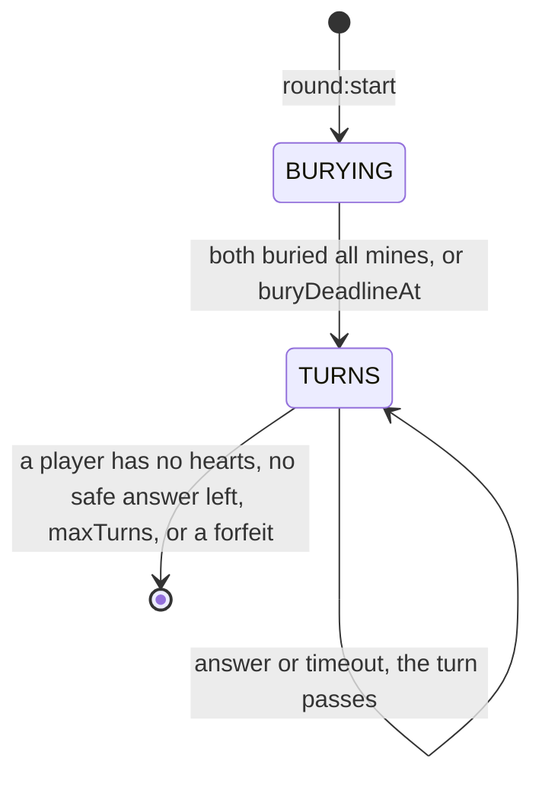

1. **Category:** two criteria that every accepted answer meets: `CLUB` plus `NATIONALITY` (citizenship, as in `GRID`) or `DECADE` (a spell at the club in those ten years) (DEC-74). The generator keeps categories with `20`–`40` answers (§10.4). `round:start` shows the category, `answerCount` and `minesPerPlayer`.
2. **Burying (`BURYING`):** each player buries `burying.minesPerPlayer` mines (default 3) within `burying.ms` by typing answers of the category, one per command. The server judges each one like any typed answer (§5.3).
   - A name outside the category is refused (`NOT_IN_CATEGORY`) and uses one of `burying.maxWrongTries`: without a cap, burying would be a free check of which names are valid. After the cap, further tries are refused (`NO_TRIES_LEFT`).
   - Burying the same player twice is refused (`ALREADY_BURIED`, no try used). A buried mine cannot be swapped in N1.
   - The phase ends early when both have buried all their mines. At the deadline, empty slots are filled from the category with the seeded random source and marked `auto` (DEC-73).
   - The opponent gets no event while you bury. Both players may bury the same player; the name is then a mine for each of them.
3. **Turns (`TURNS`):** round 1 starts with the rock-paper-scissors winner (§9.1); later rounds follow `firstMoverAfterRound1` (default `ALTERNATE`). Turns alternate, also after a lost heart. The player on turn has `turnMs` to send one answer.
4. **Judging an answer**, checked in this order:

   | The text matches | Outcome | Effect |
   |---|---|---|
   | nothing in the category | `WRONG` | −1 heart |
   | a player already said this round (safe or exploded) | `REPEATED` | −1 heart (`UsedAnswers` with `repeatCountsAsWrong`) |
   | one of the speaker's own live mines | per `ownMine` (DEC-72) | `REJECT` (default): refused with `OWN_MINE`, the turn and its clock go on, nothing is revealed. `COSTS_HEART`: outcome `OWN_MINE`, −1 heart, the mine stays hidden |
   | an opponent's live mine | `MINE` | The mine explodes: −1 heart; everyone sees the player and who buried it; the name counts as said |
   | any other player of the category | `SAFE` | `points.perSafeAnswer`; the name counts as said |
   | no answer by `turnDeadlineAt + latencyGraceMs` | `TIMEOUT` | −1 heart |

   After every outcome except a refusal, the turn passes. A name buried by both players is caught by the own-mine check first, so with `REJECT` neither of them can say it.
5. **Mine detector:** `detector.usesPerBattle` (default 1). On your turn, `mines:scan` with a name costs `detector.costMs` of your turn (a deadline already passed is a timeout). Only you get the result: `MINE` when the name is a live mine of the opponent, otherwise `CLEAR`, also for a wrong or already said name (the detector finds mines; it does not check answers). The opponent sees that you scanned and your new deadline, never the name or the result. The turn goes on.
6. **Round end:**
   - A player loses the last heart: the other wins the round (`LAST_HEART`).
   - The player on turn has no safe answer left (every unsaid answer is a live mine), or turn `maxTurns + 1` would start: the player with more hearts wins, then more safe answers this round, else a draw (`NO_SAFE_ANSWERS`, `MAX_TURNS`; DEC-75).
   - A participant leaves: the other wins (`FORFEIT`, no points).
   - Every mine is then revealed (who buried it, exploded or not, `auto`), with up to `revealAnswersAtEnd` unsaid answers.
7. **Hearts:** `hearts` per player (default 3), full again each round.
8. **Points:** `points.roundWin`, `points.roundDraw`, `points.perSafeAnswer`.
9. **On screen:** `answersLeft` (unsaid answers of the category, mines included) and `minesLeft` per player (not yet exploded) are public, so the app shows "safe answers left ≈ answersLeft − both minesLeft". It is approximate on purpose: the exact count would tell the players when they buried the same name.
10. **Players:** exactly 2 in N1. Rooms with 3 or more players (P8) would explode a mine for anyone except who buried it, with a seeded turn order (DEC-70); not built in N1.

### 10.2 Hidden information

- A live mine reaches only the player who buried it (the `mines:bury` ack, their own copy of the first `mines:turn`, their snapshot) until it explodes or the round ends. A private event would leave a `seq` gap for the other player and force a resync, so private results travel in acks or in per-viewer copies of a shared event.
- No event tells the opponent how many mines you have buried so far, and a scan result goes only to the scanner.
- The bot strategy never receives the human's mines; it can step on them like anyone.
- Test (§9.3): render every event and snapshot of a round for the opponent and find no live mine's entity id or name.

### 10.3 Protocol (details in `api/WEBSOCKET.md`)

| Direction | Message | Purpose |
|---|---|---|
| C→S | `mines:bury { roundNo, answer: { text } }` | Bury one mine; the ack carries your mines so far and `wrongTriesLeft` |
| C→S | `mines:answer { roundNo, answer: { text } }` | Your turn's answer |
| C→S | `mines:scan { roundNo, answer: { text } }` | Use the detector |
| S→C | `round:start` | Category, `answerCount`, `minesPerPlayer`, `buryDeadlineAt` |
| S→C | `mines:turn` | Whose turn, `turnDeadlineAt`, `turnNo`; the first one (burying closed) carries each viewer's own final mines, `auto` ones included |
| S→C | `mines:answered` | Outcome, the player named (wrong text only with `showWrongAnswers`), who buried an exploded mine, hearts, `answersLeft`, `minesLeft` |
| S→C | `mines:scanned` | Who scanned and the new deadline; `result` only for the scanner |
| S→C | `round:result` | `reveal: { reason, mines, sampleAnswers }` |

### 10.4 Content and generator

| `gameType` | Content | Accepted answers |
|---|---|---|
| `MINES` | `{ criteria: [{ kind: "CLUB", entityId }, { kind: "NATIONALITY", entityId } \| { kind: "DECADE", fromYear }] }` | Slot 0: every player of the category, most popular first |

Generator (`kb bundle --mines N`, 07 §5.8):
- **Category answers:** catalog players with a spell at the club and that citizenship, or with a dated spell at the club that overlaps `fromYear`..`fromYear + 9` (an open spell runs to today). Undated spells never count for a decade. Years before the player turned 17 do not count, and a spell that ended before then puts him in no category: Wikidata often stores youth years on the senior club's item (Marc-André ter Stegen at Gladbach "1996–2010").
- **Clubs:** only the `--mines-clubs` most popular clubs of the catalog (default 100), so players know the names. Without the limit most categories are small clubs nobody can name (1,076 categories, 764 of them difficulty 5).
- **Size:** kept only with `--mines-min-answers` to `--mines-max-answers` answers (default 20 to 40). Measured on 2026-11-19: 123 categories (87 club × nationality, 36 club × decade; a big club has more than 40 players in a decade).
- **Difficulty:** from the popularity of the category's answers (the median sitelinks band of §5.8): famous names make an easy round.
- **Key:** `mines:<club qid>:nationality:<country qid>` or `mines:<club qid>:decade:<fromYear>`.
- **Variety:** a club appears in at most a few categories of one bundle.

### 10.5 Bot

- **Burying:** `minesPerPlayer` players of the category, drawn with the seeded random source, after a human-like delay.
- **Turn:** after `typingDelayMs`, with the chance `knowsAnswerByDifficulty[difficulty]` it names the most popular unsaid player of the category that is not its own mine. Otherwise it sends a wrong player of the same kind, or lets the turn time out (`guessChance`).
- **Detector:** bots do not use it in N1.

### 10.6 Configuration

| Key | Default (dev) | Decision |
|---|---|---|
| `roundCount` | 1 | DEC-31 |
| `firstMover`, `firstMoverAfterRound1`, `rps.*` | `RPS`, `ALTERNATE` | §9.1, DEC-71 |
| `burying.minesPerPlayer`, `burying.ms`, `burying.maxWrongTries` | 3, 20000, 3 | DEC-73 |
| `turnMs`, `maxTurns` | 10000, 60 | DEC-54 |
| `hearts` | 3 | DEC-75 |
| `ownMine` (`REJECT` \| `COSTS_HEART`) | `REJECT` | DEC-72 |
| `detector.usesPerBattle`, `detector.costMs` | 1, 3000 | DEC-75 |
| `revealAnswersAtEnd`, `showWrongAnswers` | 5, true | DEC-60 |
| `points.roundWin`, `points.roundDraw`, `points.perSafeAnswer` | 3, 1, 1 | DEC-33 |

### 10.7 How it fits the engine

- **Rules:** pure `battles/domain/games/mines-rules.ts`; `MinesRoundRunner` wraps them like `GridRoundRunner` (§2.4). The engine gets no `if (gameType === "MINES")`.
- **Helpers (§9.2), in `battles/domain/games/shared/`:** `UsedAnswers` (entity ids said this round; for `MINES` a repeat always costs a heart, so no config), `Hearts` (`giveEveryoneHearts`, `loseHeart`, `hasHeartsLeft`), `SecretChoices` (`startSecretChoices`, `addSecretChoice`, `findSecretChoiceRejection`, `fillMissingSecretChoices` with the random source).
- **Detector across rounds:** a round can hand opaque state to the next one (`carryOver` on the round result, given to the next runner). The engine stores it without reading it. `MINES` passes the detector uses left; `TIME_MACHINE` and `AUCTION` will need the same.
- **Actions (`battle_round_actions.kind`):** `MINE_BURY` (the typed entity; `is_correct` = in the category), `MINE_AUTO_BURY`, `MINE_ANSWER` (`is_correct` = safe), `MINE_HIT` (stepped on a mine), `MINE_SCAN` (`is_correct` = a mine), `TURN_TIMEOUT`. `kind` is text, so no migration; question stats count a wrong `MINE_ANSWER` as a wrong answer.
- **Acks with data:** a round command may return an accepted ack with `data` (`RoundCommandOutcome`); `mines:bury` uses it.
- **Judging:** `AnswerChecker` with slot 0 as the accepted answers, as for a `GRID` cell.
- **Snapshot `currentRound`:** `phase`, `buryDeadlineAt`, your mines (`exploded`, `auto`), `wrongTriesLeft`, the exploded mines of others, every said name with its outcome (names hidden as in `mines:answered`), hearts, the turn and its deadline, `detectorUsesLeft`, `answersLeft`, `minesLeft`.

## 11. `AUCTION` (المزاد, N2)

Chosen by the product owner on 2026-11-18 (DEC-68; demo page: https://claude.ai/artifact/K9M3P4DBCKH9naFvG9jBbx). Each round offers a list ("Liverpool scorers in the 2018-19 Champions League"). The two players bid on how many names of it they can say; the last bidder must prove it live, and a bust gives the other player a chance to steal the round. First to 3 round wins.

### 11.1 A round

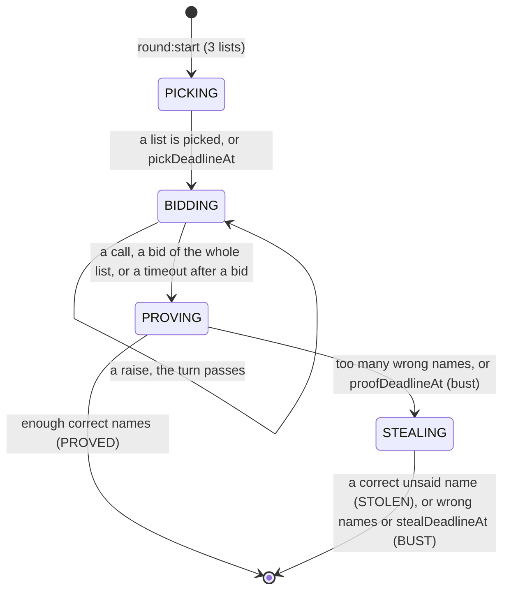

1. **Three lists:** a round's content is a lot of 3 lists (§11.4); `round:start` shows each one's title and answer count (DEC-76: the count is shown).
2. **Who picks:** round 1, the rock-paper-scissors winner (§9.1); later rounds, the loser of the last round (`firstMoverAfterRound1: LOSER_STARTS`). After a round nobody won, the pick passes to the other player.
   - The picker has `pickMs` to send `auction:pick`; at the deadline the server picks with the seeded random source (`auto`).
3. **Bidding:** the picker opens.
   - Each turn lasts `bidding.turnMs`.
   - The opening bid is at least `bidding.minOpeningBid` (DEC-76: 1); every raise is higher than the current bid, and no bid is above the list's answer count.
   - From the second turn on, a player may call (`auction:call`, "اتفضل ورّيني") instead of raising.
   - A bid equal to the answer count is the all-in ("كله يا عم"). Nobody can raise it, so the proof starts at once.
   - The opener's timeout opens with the minimum bid; any later timeout counts as a call.
4. **Proof:** the last bidder (the prover) has `proof.ms` to type that many different names of the list, one `auction:answer` at a time. Both players see every name live.
   - A correct unsaid name fills a slot. A wrong name, or one already said, is a strike (`UsedAnswers` with repeats counted as wrong).
   - Reaching the bid wins the round (`PROVED`).
   - `proof.maxWrong` strikes (`allIn.maxWrong` for an all-in, DEC-77), or the deadline, is a bust.
5. **Steal:** after a bust the other player has `steal.ms` to name `steal.names` unsaid names (DEC-76: 1).
   - Success wins them the round (`STOLEN`).
   - A wrong name ends the steal at once. A wrong name or the deadline leaves the round with no winner (`BUST`, DEC-77).
6. **Round points:**
   - `points.roundWin` for `PROVED` or `STOLEN`;
   - `points.allInWin` for a proved all-in (the demo: it counts as 2 rounds).
7. **End of the battle:** the first player whose score reaches `targetScore` (3) wins; `roundCount` is only the most rounds a battle can have (7: rounds can end with no winner). If the rounds run out first, scores decide as usual (DEC-77).
8. **Reveal:** at the end of every round, all names of the list, marked with who said them; the unsaid ones are the "how did I forget him!" moment.
9. **Players:** exactly 2.

### 11.2 Hidden information

Nothing is secret between the players: titles, counts, bids and every typed name are public, as on the demo. Only the accepted answers stay on the server until the reveal (§7).

### 11.3 Protocol (details in `api/WEBSOCKET.md`)

| Direction | Message | Purpose |
|---|---|---|
| C→S | `auction:pick { roundNo, list: 0..2 }` | The picker chooses a list |
| C→S | `auction:bid { roundNo, amount }` | Open or raise |
| C→S | `auction:call { roundNo }` | "اتفضل ورّيني" |
| C→S | `auction:answer { roundNo, answer: { text } }` | A name, during the proof (prover) or the steal (the other player) |
| S→C | `round:start` | The 3 lists (title, answer count), the picker, `pickDeadlineAt` |
| S→C | `auction:picked` | The chosen list, `auto` |
| S→C | `auction:turn` | Whose bidding turn, the current bid, `turnDeadlineAt` |
| S→C | `auction:bid` | A bid, `allIn` |
| S→C | `auction:proof` | Prover, amount, `maxWrong`, `proofDeadlineAt`; also how it started (call, all-in, timeout) |
| S→C | `auction:answered` | Phase (`PROOF` \| `STEAL`), outcome (`CORRECT` \| `WRONG` \| `REPEATED`), the name (wrong names only with `showWrongAnswers`), found so far, strikes |
| S→C | `auction:steal` | Stealer, `stealDeadlineAt` |
| S→C | `round:result` | `reveal: { list, outcome: PROVED \| STOLEN \| BUST, bid, answers: [{ player, saidBy? }] }` |

### 11.4 Content and generator

| `gameType` | Content | Accepted answers |
|---|---|---|
| `AUCTION` | `{ lists: [{ kind, title: { en, ar } } ×3] }` | Slots 0..2: every name of each list, most popular first |

The pipeline writes the titles in both languages: competitions are not catalog entities yet (07 §5.10), so titles cannot be built from catalog names at play time.

Generator (`kb bundle --auctions N`, 07 §5.8):
- **Source (N2):** built in Python from `core.goal` (no `derived` view yet). Transfermarkt goal events in usable matches (`core.usable_match`) of tier 1 and 2 competitions, from 2012 (its coverage). This is the first slice of D.3d goals (07 §5.10).
- **List kinds (N2):**
  - `SCORERS`: a club's scorers in one competition season;
  - `ASSISTERS`: its assist providers.
  - Own goals never count. An assist counts only when the assist provider is in the scoring team's lineup for that match; the rest are dropped and counted (the Söyüncü case, 07 §5.10).
  - Later kinds: scorers against a club, national-team tournament scorers, famous XIs, winners lists.
- **Kept when:**
  - 6 to 30 names (`--auction-min-answers`, `--auction-max-answers`);
  - **every name is a catalog entity** (DEC-69 stays at (a)), so any right name can be judged right;
  - at least 60% of names are known players (sitelinks ≥ 40, `--auction-known-share`);
  - no other kept list has the same names.
- **A lot:** 3 lists of close difficulty, from 3 different clubs or kinds; each list is in one lot only.
- **Difficulty:** from the share of known names and the list size.
- **Keys:**
  - a list: `auction:<kind>:<club qid>:<competition>:<season>`;
  - a lot: its three list keys.
- **Measured on 2026-11-19** (lists of 6–30 names, before the known-share filter):
  - tier 1: 1,671 scorer and 1,680 assister lists, of which 768 and 676 have every name in the catalog;
  - tier 2: 1,673 and 1,432, of which 420 and 352.
  - That is about 2,200 lists, or 730 lots.
  - **After every filter (built 2026-11-19):** 990 lists in 330 lots (difficulty 1: 153, 2: 78, 3: 44, 4: 55); the 60% known-players rule removes the most. Team names in titles are trimmed to how fans say them ("Croatia", "آرسنال", not "Croatia men's national football team").

### 11.5 Bot

- **Pick:** the list with the best expected count: answer count × its chance to know a name at that difficulty.
- **Bidding:** it raises by 1 while the current bid is below that expected count, with a small random push from its profile; otherwise it calls.
- **Proof and steal:** each name it sends is the most popular unsaid name of the list with its knowledge chance, otherwise a wrong name or silence, after `typingDelayMs`.

### 11.6 Configuration

| Key | Default (dev) | Decision |
|---|---|---|
| `roundCount` (most rounds), `targetScore` | 7, 3 | DEC-77 |
| `firstMover`, `firstMoverAfterRound1`, `rps.*` | `RPS`, `LOSER_STARTS` | §9.1, DEC-71 |
| `pickMs` | 10000 | DEC-77 |
| `bidding.turnMs`, `bidding.minOpeningBid` | 8000, 1 | DEC-76 (minimum), DEC-77 |
| `proof.ms`, `proof.maxWrong` | 45000, 3 | DEC-77 |
| `allIn.maxWrong` | 1 | DEC-77 |
| `steal.ms`, `steal.names` | 10000, 1 | DEC-76 (names), DEC-77 |
| `showWrongAnswers` | true | DEC-60 |
| `points.roundWin`, `points.allInWin` | 1, 2 | DEC-33 |

### 11.7 How it fits the engine

- **Rules:** pure `battles/domain/games/auction-rules.ts`; `AuctionRoundRunner` wraps them (§2.4), with `UsedAnswers` from §9.2.
- **Engine change (generic):** `targetScore` per game type, nullable. After each round the engine completes the battle when a score reaches it. No game-specific code.
- **Judging:** `AnswerChecker` with the picked list's slot as the accepted answers.
- **Actions:** `AUCTION_PICK`, `AUCTION_BID`, `AUCTION_CALL`, `AUCTION_ANSWER` (`is_correct`), `AUCTION_STEAL`, `TURN_TIMEOUT`. Question stats count a wrong `AUCTION_ANSWER` as a wrong answer.
- **One timer per phase:** each phase sets a single `phase` deadline timer; moving to the next phase cancels it and sets the next one, so a late timer can never act on the wrong phase.
- **Snapshot `currentRound`:**
  - `phase`, the 3 lists and the picked one;
  - the picker, the bids so far and whose turn;
  - the prover, the amount, the names found, the strikes;
  - the stealer, and the deadlines.

## 12. `VAULT` (الخزنة, N3)

Chosen by the product owner on 2026-11-17 (DEC-68; demo page: https://claude.ai/artifact/UemfyXeudLmbqPPw6gZ9ZD). Each round is a vault with a 4-digit code; each digit is the answer to a football question whose answer is 0–9. Both players race on the same vault at the same time. A try is all right or all wrong, with no per-digit feedback, so guessing does not pay. First to open 3 vaults wins.

### 12.1 A round

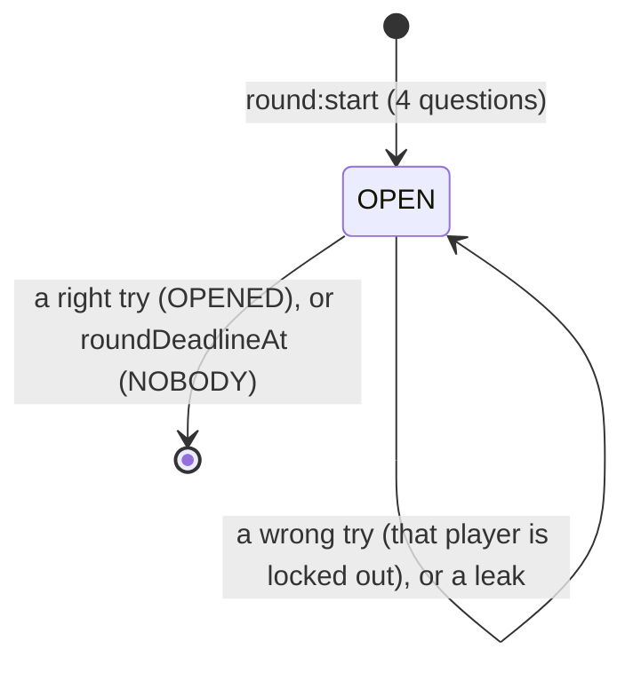

1. **The vault:** a round's content is 4 questions (§12.4), shown to both players at once in `round:start`. Digit `i` of the code is the answer to question `i`.
2. **No first mover:** both play at the same time (`firstMover: NONE`, §9.1).
3. **A try:** `vault:try { code }` with one digit per question. The server compares the whole code.
   - Right: the round ends at once, won by that player (`OPENED`). Two right tries are ordered by arrival; the second is refused with `ROUND_CLOSED`.
   - Wrong: only the player who tried learns it (in the ack, §12.3), and nothing says which digit is wrong. That player is locked out for the next step of `lockoutMs` (`LockoutLadder`, §9.2: 3 s, 6 s, 9 s, then 9 s again); a try while locked is refused with `LOCKED_OUT` (the wrong try's ack and the snapshot carry `lockedUntil`).
4. **Leaks:** if nobody has opened the vault, one digit is revealed to both players at `leaks.firstAtMs`, then another every `leaks.everyMs`, up to `leaks.max` (`HintSchedule`, §9.2). Which digit leaks is drawn from the unleaked ones with the seeded random source. A player who knows more digits opens after fewer leaks.
5. **Round end without an opener:** at `roundMs` the round ends with no winner (end reason `NO_WINNER`, reveal outcome `NOBODY`).
6. **Round points:** `points.vaultOpened` to the opener.
7. **End of the battle:** the first player whose score reaches `targetScore` (3) wins; `roundCount` is the most rounds (5, because a round can end with no winner). If the rounds run out first, scores decide as usual.
8. **Reveal:** at the end of every round, the code and each question's answer, so the players learn the facts they missed.
9. **Players:** 2 now; the rules do not depend on the count, so rooms (P8) can use them as they are.

### 12.2 Hidden information

- The opponent sees only how many tries you made (`vault:tried { participantId, tries }`), never the code you typed or when you are locked out (§9.3).
- The answers stay on the server until a leak or the reveal; `round:start` carries the question texts only.

### 12.3 Protocol (details in `api/WEBSOCKET.md`)

| Direction | Message | Purpose |
|---|---|---|
| C→S | `vault:try { roundNo, code }` | A try at the whole code (a string of `digits` digits) |
| S→C | ack of `vault:try` | Only to the player: `{ accepted: true, data: { opened: false, lockedUntil, tries } }` on a wrong try (§2.4, private results in acks) |
| S→C | `round:start` | The questions in the viewer's language, `digits`, `roundDeadlineAt`, `firstLeakAt` |
| S→C | `vault:tried` | A player's try count after a wrong try (the code is never sent) |
| S→C | `vault:leak` | `position`, `digit`, `nextLeakAt` (null after the last) |
| S→C | `round:result` | `reveal: { code, outcome: OPENED \| NOBODY, openedBy?, answers: [{ position, digit }] }` |

Refusals: `LOCKED_OUT`, `INVALID_CODE` (wrong length or not digits), `ROUND_CLOSED` (opened, or past the deadline).

### 12.4 Content and generator

| `gameType` | Content | Accepted answers |
|---|---|---|
| `VAULT` | `{ questions: [{ template, text: { en, ar }, answerNumber: 0..9 } ×4] }` | None as entities: the code is the four `answerNumber`s, compared by the rules (like a `NUMBER` answer, §5.3) |

The pipeline writes each question in both languages from a hand-written template (EN and AR, like the `BUZZER` templates of 07 §5.8). Team, player and competition names come from the knowledge base; the stage and season are written by the template. The engine strips `answerNumber` before anything reaches a client.

Generator (`kb bundle --vaults N`, 07 §5.8), built from the N3 data slice (07 §5.10):

| Template | Question (EN) | Source | Kept when |
|---|---|---|---|
| `TEAM_GOALS` | How many goals did {team} score against {opponent} in the {stage} of the {competition} {season}? | `core.match` | tier-1 knockouts (round of 16 to final) and tier-2 finals; the leg is named in two-legged ties; goals after extra time, not the shootout |
| `FINAL_TOTAL_GOALS` | How many goals were scored in the {competition} {season} final, not counting the shootout? | `core.match` | finals; total ≤ 9 |
| `PLAYER_GOALS` | How many goals did {player} score against {opponent} in the {stage} of the {competition} {season}? | `core.goal` | 2 or more goals (a "1" is the obvious guess); the match's goal rows equal its score |
| `SHOOTOUT_SCORED` | How many penalties did {team} score in the shootout of the {stage} of the {competition} {season}? | `core.match` | the shootout score is known |
| `SHIRT_NUMBER` | Which shirt number did {player} wear for {team} in the {stage} of the {competition} {season}? | `core.lineup_slot` | a starter with number 1–9; finals and semi-finals first |
| `TITLES_SINCE_2000` | How many {competition} titles have {team} won since 2000? | `core.match` finals | only competitions with a usable final for every edition since 2000; teams that played at least one final (so 0 is a real answer) |

- **Every name is a catalog entity** and every player is a known player (sitelinks ≥ 40, `--vault-min-player-sitelinks`), so a fan can know the fact.
- **A vault:** 4 facts of the same difficulty, from 4 different matches (one fact never gives away another), with at most `--vault-max-per-template` (default 2) of the same template, so every vault mixes at least two kinds of question. Each fact is in one vault only. (A limit of 1 was measured first: it allowed only 152 vaults, because each difficulty needs 4 templates with facts left.)
- **Difficulty:** from the stage (a final is better known than a round of 16), the teams' and player's popularity, and the template.
- **Keys:** a fact `vault:<template>:<match id or team:competition>[:<player qid>]`; a vault, its four fact keys.
- **Measured on 2026-11-19 (dev, before the known-player and vault filters):**
  - 793 usable knockout and final matches (541 tier-1 knockouts before the final, 252 finals; 169 `VERIFIED`), so up to 1,586 `TEAM_GOALS` and 252 `FINAL_TOTAL_GOALS` facts;
  - 758 of them have goal rows equal to the score: 236 `PLAYER_GOALS` facts (braces or more);
  - 79 shootouts: up to 158 `SHOOTOUT_SCORED` facts;
  - 570 of them have Transfermarkt lineups: 4,865 starters with a linked player and a number 1–9 (`SHIRT_NUMBER`);
  - `TITLES_SINCE_2000`: only the World Cup and the Euro have every final since 2000 today; AFCON (2025 final refused), Copa América and the Asian Cup miss one each until the curated finals arrive. Club title counts wait for the 2000–2011 curated finals.
  - That is about 2,000 facts outside `SHIRT_NUMBER`, enough for 400+ vaults with the one-per-template rule.
  - **After every filter (built 2026-11-20):** 2,790 facts (`TEAM_GOALS` 1,582, `SHIRT_NUMBER` 579 after one fact per player, team and number, `FINAL_TOTAL_GOALS` 240, `PLAYER_GOALS` 218, `SHOOTOUT_SCORED` 156, `TITLES_SINCE_2000` 15), giving 545 vaults (difficulty 1: 25, 2: 137, 3: 122, 4: 224, 5: 37). Answers lean low (0–2 are 63% of facts), as football scores do. The 2026 World Cup final (Spain 1–0 Argentina) comes from martj42 only and counts in the title totals.

### 12.5 Bot

- **Knowledge:** for each question it knows the digit with its chance at that difficulty (bot profile); leaked digits are known.
- **Trying:** when at most 1 digit is unknown to it (a runner constant, like the auction bot's decoy pool), it tries a code after `typingDelayMs`, filling the unknown digit with values it has not tried in that position; it waits out its lockout like a player. It looks again after each leak.
- It never reads the opponent's tries (it sees only the count, as a player does).

### 12.6 Configuration

| Key | Default (dev) | Decision |
|---|---|---|
| `roundCount` (most rounds), `targetScore` | 5, 3 | DEC-78 (first to 3: owner, 2026-11-17) |
| Code length | one digit per question: 4 from the generator | owner, 2026-11-17 (content, not config) |
| `firstMover` | `NONE` | §9.1 |
| `lockoutMs` | `[3000, 6000, 9000]` | owner, 2026-11-17 |
| `leaks.firstAtMs`, `leaks.everyMs`, `leaks.max` | 45000, 15000, 3 | DEC-78 (45 s and 15 s: owner, 2026-11-17; the max is open) |
| `roundMs` | 120000 | DEC-78 |
| `latencyGraceMs` | 300 | §2.3 |
| `points.vaultOpened` | 1 | DEC-33 |

### 12.7 How it fits the engine

- **Rules:** pure `battles/domain/games/vault-rules.ts`; `VaultRoundRunner` wraps them (§2.4). The first users of `LockoutLadder` and `HintSchedule` (§9.2), written here.
- **Timers:** one `round` timer (`roundMs`) and one `leak` timer, rescheduled after each leak. Lockouts need no timer: a try is checked against `lockedUntil` with the clock passed in.
- **Judging:** exact comparison of the typed code with the four `answerNumber`s; no `AnswerChecker`, no catalog.
- **Actions:** `VAULT_TRY` (`is_correct`, the typed code kept as the answer text, never shown). Leaks are events only. Question stats count each wrong try as a wrong answer of the round.
- **Snapshot `currentRound`:** the questions, `digits`, the leaked digits, every player's try count, the viewer's own `lockedUntil`, `roundDeadlineAt`, `nextLeakAt`.

## 13. `HEX` (الهجمة, N4)

Chosen by the product owner on 2026-11-18 (DEC-68; demo page: https://claude.ai/artifact/5eXj3vULNojAzdhz3jwftc). A 5×5 board of hexagons with a letter in each cell. The player on turn picks a cell; both players get its question at once, and the first right answer **that starts with the cell's letter** takes the cell. One player connects west to east, the other north to south; the first to connect wins the board. A hex board cannot end in a draw once it is full.

### 13.1 A round (one board)

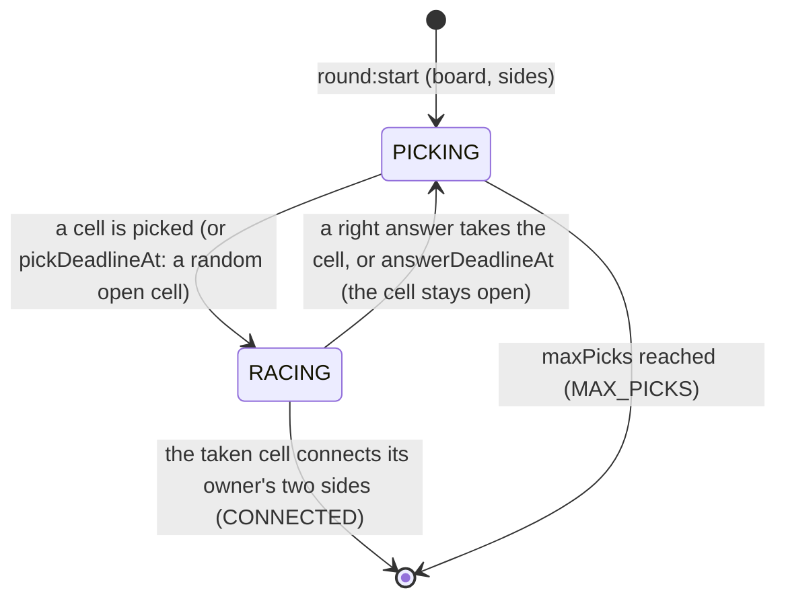

1. **The board:** `size × size` cells (5), rows offset like the demo, so each cell touches up to 6 others. Each cell shows one letter **in the viewer's language** (§13.2).
2. **Sides:** the round-1 rock-paper-scissors winner (§9.1) picks first and connects `WEST_EAST`; the other player connects `NORTH_SOUTH`.
3. **Pick:** the player on turn has `pickMs` to send `hex:pick { cell }` for an open cell; at the deadline the server picks a random open cell (`auto`).
4. **Race:** the cell's current question goes to both players at once, with `answerMs` to answer.
   - A right answer is a name from the question's list **and** the typed text starts with the cell's letter in that player's language. It takes the cell.
   - A name from the list typed with another first letter is refused with `WRONG_LETTER` (ack only, no lockout, DEC-79): it is a slip, not a wrong fact.
   - A wrong name locks that player out of this question for `lockoutMs` (`LockoutLadder`, §9.2, reset for each question). Others see that you are locked out, as in the demo.
   - Nobody right by `answerDeadlineAt`: the cell stays open and moves to its next question, so a later pick of it asks something new.
5. **Next pick:** the turn alternates after every race, whoever took the cell (DEC-79).
6. **"شيلها" (clear):** once per battle (`clear.usesPerBattle`), on your pick you may send `hex:pick { cell, clear: true }` for one of the opponent's cells. It becomes open with its next question, and that question is raced at once.
7. **Board end:** a taken cell that links its owner's two sides ends the board (`CONNECTED`, `points.boardWin`). If `maxPicks` picks pass first, the board ends with no winner (DEC-79; reveal outcome `MAX_PICKS`, round end reason `MAX_TURNS`), so a board of open cells nobody can answer does not run forever. `clearsLeft` is handed to the next board with the round's `carryOver`.
8. **Battle:** `roundCount` boards with `targetScore` (DEC-79: one board, about 4 minutes). With several boards, `firstMoverAfterRound1` decides who picks first and plays `WEST_EAST`.
9. **Reveal:** at the end of every race, up to 5 other right names for each viewer's letter (a name counts when one of its words starts with the letter; aliases are not loaded for this); at the end of the board, the winning path and the owners.
10. **Players:** exactly 2.

### 13.2 Letters in two languages

A typed answer is judged in the player's own language, and a letter belongs to one alphabet. So each cell carries a letter pair `{ ar, en }`, and every question of that cell has at least `minAnswersPerLetter` right names whose Arabic name or alias starts with the Arabic letter, and at least as many whose English name or alias starts with the English letter. Each player sees and must use their own language's letter. Two players with different languages race on the same question with different (never empty) answer sets; that is the price of mixed-language matchmaking, and it stays within one cell.

Letters are compared in matching form (07 §5.4, ADR-0021): `أ`, `إ` and `آ` are `ا`, case and accents do not count.

### 13.3 Hidden information

Nothing is secret between the players except the right answers (§7): the board, picks, lockouts and every right name are public. A wrong name is shown only with `showWrongAnswers` (DEC-60).

### 13.4 Protocol (details in `api/WEBSOCKET.md`)

| Direction | Message | Purpose |
|---|---|---|
| C→S | `hex:pick { roundNo, cell, clear? }` | The player on turn picks an open cell, or clears an opponent cell |
| C→S | `hex:answer { roundNo, answer: { text } }` | A name during the race |
| S→C | `round:start` | The board (each cell's letter in the viewer's language), `sides`, `size`, the first picker, `pickDeadlineAt`, `clearsLeft` per player |
| S→C | `hex:turn` | Whose pick, `pickDeadlineAt` |
| S→C | `hex:race` | The picked cell, by whom, `auto`, `cleared`, the question title and the letter (viewer's language), `answerDeadlineAt` |
| S→C | `hex:answered` | A wrong name: who, `lockedUntil`, the name only with `showWrongAnswers` |
| S→C | `hex:claimed` | The cell, its new owner, the right name |
| S→C | `hex:expired` | Nobody answered: the cell stays open |
| S→C | `round:result` | `reveal: { outcome: CONNECTED \| MAX_PICKS \| FORFEIT, path?: cell[], owners: (participantId \| null)[] }` |

Refusals: `NOT_YOUR_PICK`, `CELL_TAKEN`, `CELL_NOT_OPPONENTS`, `NO_CLEARS_LEFT`, `NOT_RACING`, `LOCKED_OUT`, `WRONG_LETTER`, `EMPTY_ANSWER`, `ANSWER_WINDOW_CLOSED`.

### 13.5 Content and generator

| `gameType` | Content | Accepted answers |
|---|---|---|
| `HEX` | `{ size, cells: [{ letter: { en, ar }, questions: [{ kind, title: { en, ar } } × questionsPerCell] } × size²] }` | Slot `cell × questionsPerCell + question`: every name of that question's list |

The letter check is not in the accepted answers: the slot holds the whole list, and the rules check the typed text's first letter. So one stored list serves any letter.

Generator (`kb bundle --hexes N`, 07 §5.8):
- **Source (N4):** the AUCTION lists (§11.4: scorers and assisters per club and competition season, every name in the catalog, at least 60% known players). Later: any question whose answer is a name.
- **A board:** `size²` cells. Letter pairs are drawn from letters with enough lists in both languages; a letter repeats only when the board needs more cells than there are such letters (each at most `--hex-max-letter-repeats`, default 2). Each cell gets `--hex-questions-per-cell` (default 3) lists with at least `--hex-min-answers` (default 1) right names for both of its letters; a list appears once per board.
- **Difficulty:** from the known share of the right names for each cell's letters.
- **Keys:** a board, `hex:` plus a hash of its cell list keys and letters.
- **Built 2026-11-20:** `kb bundle --hexes 30` gives 30 boards (difficulty 2 mostly: the AUCTION lists are well known), each a list used at most once; the 60% known-players rule and the both-letters rule leave every common letter with dozens of lists. Board letters include `x` and `z` in English (Xavi, Xabi, Zidane), which pass the 20-list bar.
- **Measured on 2026-11-20 (dev):** 1,026 lists after the AUCTION filters. Arabic letters that start a name in at least 20 lists: 23 (`ا م ك د ج ف ب ر ل س ت ي ن خ غ ه و ش ع ز ص ح ث`; never `ط ق ض ظ ذ`), English: 22. About 8,500 list-and-letter questions per language. So a 25-cell board repeats two or three letters.

### 13.6 Bot

- **Pick:** the first open cell of its own shortest path (`findShortestPathFor`: a 0-1 breadth-first search where its cells cost 0, open cells 1 and the opponent's are blocked); it clears an opponent cell once, when that cell is on the opponent's shortest path and the opponent needs at most 2 more open cells (a runner constant). On a 3×3 board that is almost at once.
- **Race:** it knows a right name with its chance at the question's difficulty; it answers with a right name for its letter after `typingDelayMs`, otherwise it stays silent.

### 13.7 Configuration

| Key | Default (dev) | Decision |
|---|---|---|
| `roundCount`, `targetScore` | 1, 1 | DEC-79 |
| `firstMover`, `firstMoverAfterRound1`, `rps.*` | `RPS`, `ALTERNATE` | §9.1 |
| Board size | 5, from the content (the generator's `size`) | owner, 2026-11-18 (content, not config) |
| `pickMs`, `answerMs` | 5000, 15000 | owner, 2026-11-18 |
| `lockoutMs` | `[3000]` | owner, 2026-11-18 |
| `clear.usesPerBattle` | 1 | owner, 2026-11-18 |
| `maxPicks` | 60 | DEC-79 |
| `showWrongAnswers` | true | DEC-60 |
| `points.boardWin` | 1 | DEC-33 |

### 13.8 How it fits the engine

- **Rules:** pure `battles/domain/games/hex-rules.ts` with the board as data: cell owners, the adjacency of offset rows, and a breadth-first search for a connection. `HexRoundRunner` wraps them (§2.4), with `LockoutLadder` per question.
- **Judging:** `AnswerChecker` against the cell's current slot; the runner checks the first letter of the typed text (matching form) against the viewer's letter before the rules see it.
- **One timer per phase** (§11.7): the pick deadline, then the answer deadline.
- **Actions:** `HEX_PICK`, `HEX_CLEAR`, `HEX_ANSWER` (`is_correct`), `TURN_TIMEOUT`. Question stats count a wrong `HEX_ANSWER` as a wrong answer.
- **Snapshot `currentRound`:** the board (letters in the viewer's language, owners), `sides`, `phase`, whose pick, the racing cell with its question and letter, lockouts, clears left, `picks`, and the current deadline.

## 14. `LINEUP` (التشكيلة, N5)

Chosen by the product owner on 2026-11-17 (DEC-68; demo page: https://claude.ai/artifact/5YroowQ5Qt63dNXH3NHmjo). Each round shows one team's formation in a famous match ("Liverpool, 2019 Champions League final against Tottenham") with 11 empty slots. Both players type names at the same time; the server places each right name in its slot for whoever typed it first. Three names are shown beside the pitch, and one of them is a fake. Three rounds; the most points wins.

### 14.1 A round

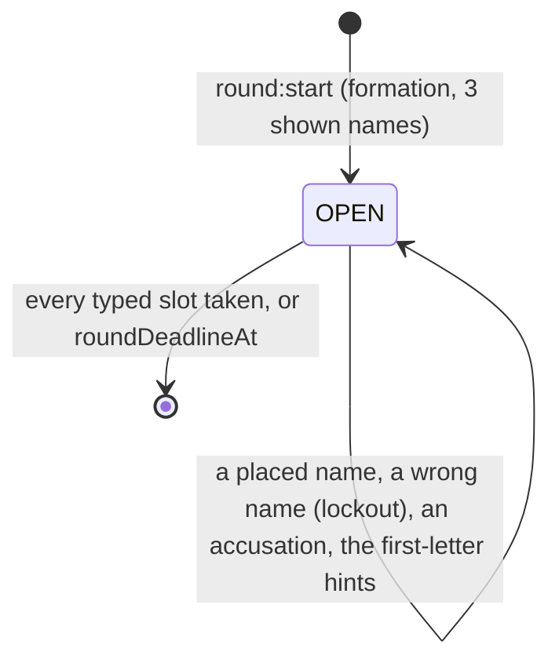

1. **The formation:** a round's content is one team's starting XI in one match (§14.4). `round:start` shows the match (competition, season, stage, both teams, score), which team, and 11 slots, each with its line and role (GK, CB, LW, ... as codes the app translates) and the captain's armband on its slot. Names and shirt numbers stay hidden.
2. **No first mover:** both play at the same time (`firstMover: NONE`, §9.1).
3. **Three shown names:** two real starters (never the captain) and one fake: a player who sat on the bench in that match (§14.4). The three are shuffled and not placed in slots, so the board does not give the fake away.
4. **Typing a name:** `lineup:answer { text }`. The server judges it against the XI and the fake (§14.7) and answers in the ack:
   - **A starter in an empty slot:** placed for that player: `points.correct`, or `points.captain` for the captain's slot. Both players see it at once (`lineup:placed`).
   - **A starter already placed:** refused with `ALREADY_TAKEN`, no penalty (knowing it was not a mistake, being slower was).
   - **A shown name:** an accusation, at most `accuse.perPlayer` (1) per player per round. The fake: `points.accuseRight`, the fake is crossed out for both, and the two real shown names are placed in their slots with no owner. A real starter: `points.accuseWrong`.
   - **Anything else:** a wrong name. The player is locked out for the next step of `lockoutMs` (`LockoutLadder`, §9.2), which stops typing every famous player of the club. With `showWrongAnswers` (DEC-60) the opponent sees which player the text matched, never the text itself (ADR-0021).
   - The same wrong name again is refused `ALREADY_TRIED` with no new lockout (`UsedAnswers`, §9.2).
   - The fake, once found, is refused `ALREADY_TAKEN` like a placed starter.
5. **Hints:** at `hints.firstAtMs` (30 s), the first letter of every empty slot's player appears, in the viewer's language (`HintSchedule`, §9.2; `hints.max` 1 for now).
6. **Round end:** when every slot that can be typed is taken (the 9 not shown, or all 11 after the fake is found; end reason `LINEUP_COMPLETE`), or at `roundMs` (60 s, `TIME_UP`). The round's winner is the player with the most points in it (none on a tie); scores add up either way.
7. **Reveal:** the whole XI with shirt numbers, who placed each name, the fake and why it was fake ("on the bench that night"), and who unmasked it.
8. **End of the battle:** after `roundCount` (3) rounds the scores decide, ties as in DEC-33. There is no `targetScore`: points add up across rounds.
9. **Players:** 2 now. The rules do not depend on the count, so rooms (P8) can use them as they are.

### 14.2 Hidden information

- Which shown name is the fake stays on the server until someone unmasks it or the round ends (§9.3).
- A wrong accusation is public only as "X accused wrongly" (`lineup:accused { right: false }` without the name), so it does not tell the opponent which shown name is real.
- Names and shirt numbers of empty slots never leave the server before the reveal; hints carry only the first letter.
- Placed names, the player a wrong name matched (DEC-60) and scores are public; typed text never is.

### 14.3 Protocol (details in `api/WEBSOCKET.md`)

| Direction | Message | Purpose |
|---|---|---|
| C→S | `lineup:answer { roundNo, text }` | A typed name: a slot, an accusation or a wrong name, decided by the server |
| S→C | ack of `lineup:answer` | Only to the player: `data: { result: PLACED \| WRONG \| ACCUSED_RIGHT \| ACCUSED_WRONG, slot?, lockedUntil }` (§2.4, private results in acks) |
| S→C | `round:start` | `title` (the match and the team, in the viewer's language), `slots: [{ slot, line, role, captain }]`, `shown: EntityRef[]`, `roundDeadlineAt`, `hintsAt` |
| S→C | `lineup:placed` | `slot`, `player`, `participantId` (null for the real shown names placed after an unmasking) |
| S→C | `lineup:wrong` | `participantId`; `player` (whom the text matched) with `showWrongAnswers` |
| S→C | `lineup:accused` | `participantId`, `right`; `player` (the fake) only when right |
| S→C | `lineup:hint` | `letters: [{ slot, letter }]` in the viewer's language |
| S→C | `round:result` | `reveal: { slots: [{ slot, player, shirtNumber, placedBy }], fake: { player, reason: "BENCH", unmaskedBy } }` |

Refusals: `LOCKED_OUT`, `ALREADY_TAKEN`, `ACCUSATION_USED` (a shown name after the player's accusation is spent), `ALREADY_TRIED`, `EMPTY_ANSWER`, `ROUND_CLOSED`.

### 14.4 Content and generator

| `gameType` | Content | Accepted answers |
|---|---|---|
| `LINEUP` | `{ title: { en, ar }, slots: [{ line, role, shirtNumber, captain, player } ×11], shown: [player ×3], fake: player }` | Slot 0: the 11 starters; slot 1: the fake |

The slots are in drawing order (goalkeeper, then defenders, midfielders and forwards, each line left to right). The engine never sends `player` or `shirtNumber` of an empty slot, nor which shown name is `fake`. Lines are `GK`, `DEF`, `MID`, `FWD`; roles are codes (`GK`, `LB`, `CB`, `RB`, `DM`, `CM`, `AM`, `LM`, `RM`, `LW`, `RW`, `SS`, `CF`) that the app translates, or null when the source only knows the line (Fjelstul's `DF`, `MF`, `FW`). The title is text written by the pipeline (as for `AUCTION` and `VAULT`), because national teams are not catalog entities yet: "Liverpool against Tottenham Hotspur, final of the 2018-19 UEFA Champions League (2–0)".

Generator (`kb bundle --lineups N`, 07 §5.8), from `core.lineup_slot` (07 §5.10, N5 slice):

- **Famous matches only** (DEC-67, the data plan: nobody remembers an ordinary league XI). Default (DEC-80): tier-1 knockouts from the round of 16 and tier-2 finals.
- **Every starter is a catalog player** with names in both languages, so every slot can be judged; at least `--lineup-min-known` (default 6) are known players (sitelinks ≥ 40).
- **The fake:** the best-known bench player of the same team in the same match (a known catalog player): the most believable starter who was not. A lineup with no such bench player is skipped.
- **The two real shown names:** drawn from the less known starters (never the captain, never the best-known player), so they help without giving away the stars.
- **Captain:** from the source; a lineup with no known captain is played without the armband (every slot `points.correct`).
- **Difficulty:** from the stage (final easiest to remember), the tier, the competition and the known share of the XI.
- **Keys:** `lineup:<competition>:<season>:<stage>[:leg<n>]:<home qid>-<away qid>:<team qid>`, stable across rebuilds (`core.match` ids are not). Both teams of one match are separate rounds; two legs of a tie are separate matches.
- **Measured on 2026-11-19 (dev, Transfermarkt lineups only, before the bench-player and known-player filters):** tier-1 lineups with all 11 starters in the catalog: finals 22, semi-finals 89, quarter-finals 148, round of 16 283 (542, almost all Champions League 2012–2026); tier-2 finals 228. Bench players in the catalog average 7–10 per tier-1 lineup, so a fake is almost always available. The World Cup comes from Fjelstul (220 knockout lineups 2002–2022 with 11 starters, before linking); the Euro has no lineup source yet.
- **Built 2026-11-20 (dev):** 760 rounds (Champions League 513, World Cup 62, super cups and cup finals the rest; finals 213, semi-finals 100, quarter-finals 162, rounds of 16 285), difficulty 1: 30, 2: 234, 3: 191, 4: 244, 5: 61; 693 with a known captain. The 2019 Champions League final comes out right (Henderson captain, Shaqiri the fake). World Cup knockouts lose most rounds to the catalog rule: 67 of 172 have all 11 starters in the catalog, because players of smaller nations are linked entities outside it (DEC-69).

### 14.5 Bot

- **Knowledge:** for each starter it knows the name with its chance at the round's difficulty, more for well-known players (bot profile, like the auction bot).
- **Typing:** it sends one known name every `typingDelayMs`, empty slots first, the captain first when it knows him; a wrong popular name now and then from its guess chance, and it waits out its lockout like a player.
- **Accusing:** only when it knows the fake (its chance at that difficulty), never a blind guess. It never reads the opponent's acks.

### 14.6 Configuration

| Key | Default (dev) | Decision |
|---|---|---|
| `roundCount`, `targetScore` | 3, null | owner, 2026-11-17 (3 rounds) |
| `firstMover` | `NONE` | §9.1 |
| `roundMs` | 60000 | owner, 2026-11-17 |
| `hints.firstAtMs`, `hints.everyMs`, `hints.max` | 30000, 0, 1 | owner, 2026-11-17 (30 s); DEC-80 (one wave) |
| `lockoutMs` | `[2000]` | DEC-80 |
| `accuse.perPlayer` | 1 | DEC-80 |
| `showWrongAnswers` | true | DEC-60 |
| `latencyGraceMs` | 300 | §2.3 |
| `points.correct`, `points.captain`, `points.accuseRight`, `points.accuseWrong` | 1, 2, 3, -2 | owner, 2026-11-17 |

### 14.7 How it fits the engine

- **Rules:** pure `battles/domain/games/lineup-rules.ts`: slot owners, the shown names, accusations per player, lockouts. `LineupRoundRunner` wraps them (§2.4), with `LockoutLadder`, `HintSchedule` and `UsedAnswers` from §9.2 (all three exist already).
- **Judging:** `AnswerChecker` against slot 0 (the XI); no match there, then slot 1 (the fake). The rules turn the matched entity into a placement (its slot from the content), an accusation (a shown entity) or a refusal. A typed name that matches a shown real starter is an accusation, not a placement.
- **Timers:** one `round` timer (`roundMs`) and one `hint` timer. Lockouts need no timer (checked against `lockedUntil` with the clock passed in, as in `VAULT`).
- **Actions:** `LINEUP_ANSWER` (`is_correct`, entity, typed text), `LINEUP_ACCUSE` (`is_correct`, points `accuseRight` or `accuseWrong`). Question stats count a wrong answer or a wrong accusation as wrong.
- **Bot (built):** it accuses the fake first when it knows it, then types the starters it knows (captain first), one per `typingDelayMs`; when it knows no more, it tries one popular wrong player with its guess chance, then stops.
- **Snapshot `currentRound`:** the header, the slots with their placed names and owners, the shown names (the fake crossed out once found), the hints out, the viewer's own `lockedUntil` and whether their accusation is spent, every player's score this round, `roundDeadlineAt`, `hintsAt`.

## 15. `ONE_TWO` (وان تو, N8)

Chosen by the product owner on 2026-11-20 (demo page: https://claude.ai/artifact/RvTPcYBeXDZQC946nVmvpX). A round is one rally between the two players, starting from a seed name. The player on the ball (the passer) picks the kind of link for the opponent; the opponent (the receiver) types a name that has that link with the ball, and that name becomes the next ball. Your answer is your opponent's question. A receiver who cannot return the pass loses the rally. The first to win `targetScore` (3) rallies wins.

Unlike every game so far, the answers are not stored per question: they come from a **link graph** between catalog entities (§15.4, ADR-0024), and the server judges each answer against the ball's neighbours of the picked link type. A rally is never a stored question, so content does not run out.

### 15.1 A round (one rally)

```mermaid
stateDiagram-v2
  [*] --> PICKING: round:start (seed, passer) + oneTwo:offer
  PICKING --> ANSWERING: oneTwo:pass, or a random pass at pickDeadlineAt
  ANSWERING --> PICKING: a right, unused name (it becomes the ball; roles swap)
  ANSWERING --> [*]: a wrong, used or late answer (the passer wins the rally)
  PICKING --> [*]: dead end (no pass type has an answer) or maxPasses reached (no winner)
```

1. **Seed:** a round's content is one well-known catalog player (§15.4). `round:start` shows it and who passes first.
2. **Who passes first:** round 1, the rock-paper-scissors winner (`firstMover: RPS`, §9.1). From round 2, the loser of the previous rally (`nextPasser: LOSER`, DEC-81), as the `AUCTION` picker: passing first is the edge.
3. **The offer:** the server lists the pass types (§15.4) that fit the ball's kind (player or club) and have at least `minAnswers` (3) neighbours not yet named in this battle. It offers up to `offerCount` (3) of them, chosen at random, to both players (`oneTwo:offer`). The counts are never sent (DEC-81): the choice is about the opponent's knowledge, not about arithmetic.
4. **The pass:** `oneTwo:pass { passType }` within `pickMs` (5 s). A type outside the offer is refused `NOT_OFFERED`. At the deadline the server picks one of the offered types at random.
5. **The answer:** the receiver has `answerMs` (10 s) for one `oneTwo:answer { text }` (one try per pass, DEC-81). The server judges it against the neighbours of the ball for that pass type (§15.7):
   - **A right name not named before in this battle:** it becomes the ball, the receiver becomes the passer, and both players see the name with its evidence ("2014 Champions League final, Real Madrid 4–1 Atlético", `oneTwo:returned`). Then a new offer (step 3).
   - **A right name already named in this battle** (the seed counts): `BURNED`, the rally is lost (DEC-81).
   - **Anything else, or no answer by the deadline:** `WRONG` or `TIME_UP`, the rally is lost. With `showWrongAnswers` (DEC-60) the passer sees which entity the text matched, never the text itself (ADR-0021).
6. **Dead end:** if no pass type has `minAnswers` unused neighbours, the offer falls back to types with at least one. With none at all, the rally ends with no winner (`DEAD_END`) and the next round starts from a new seed (DEC-81). A rule that gave the point to anyone would make players hunt for names with no links.
7. **Long rallies:** after `maxPasses` (20) returns the rally ends with no winner (`MAX_PASSES`). This bounds a round; it should almost never happen.
8. **Reveal:** `round:result` carries the chain (each ball, the pass type, who returned it and the evidence), the failed answer, and up to 3 right answers that were not named, the best known first.
9. **End of the battle:** the first player to win `targetScore` (3) rallies. Rounds with no winner do not count, so the battle stops after `maxRounds` (7): the most rallies won wins, ties as in DEC-33.
10. **Names are burned for the whole battle,** not only the rally: `UsedAnswers` (§9.2) lives in the round's `carryOver`, so a name used in rally 1 is still burned in rally 3.
11. **Players:** 2 now. With more players (rooms, P8) the ball would go round the table; that is not designed yet.

### 15.2 Hidden information

- The neighbour lists and their sizes never leave the server; the offer carries pass types only.
- Typed text is never shown to the opponent (ADR-0021); a wrong answer shows only the entity it matched (DEC-60).
- Everything else is public: the ball, the offer, the chain and the scores. That is the game: both players see the ball and think about the same names.

### 15.3 Protocol (details in `api/WEBSOCKET.md`)

| Direction | Message | Purpose |
|---|---|---|
| C→S | `oneTwo:pass { roundNo, passType }` | The passer picks the link type for the receiver |
| C→S | `oneTwo:answer { roundNo, answer: { text } }` | The receiver's one try |
| S→C | ack of `oneTwo:answer` | Only to the receiver: `data: { result: RETURNED \| WRONG \| BURNED }` |
| S→C | `round:start` | `seed: EntityRef`, `passerId`; the first `oneTwo:offer` follows |
| S→C | `oneTwo:offer` | `ball: EntityRef`, `passerId`, `passTypes: PassType[]`, `pickDeadlineAt` |
| S→C | `oneTwo:passed` | `passType`, `receiverId`, `answerDeadlineAt`, `random: boolean` |
| S→C | `oneTwo:returned` | `entity`, `passType`, `evidence` (one string in the viewer's language), `participantId` (the new passer) |
| S→C | `oneTwo:missed` | `participantId`, `reason: WRONG \| BURNED \| TIME_UP`; `entity` (what the text matched) with `showWrongAnswers` |
| S→C | `round:result` | `reveal: { seed, chain: [{ entity, passType, returnedBy, evidence }], endReason: MISSED \| DEAD_END \| MAX_PASSES \| FORFEIT, missed: { participantId, reason, passType } \| null, examples: EntityRef[] }` |

Refusals: `NOT_YOUR_TURN` (a pass from the receiver, an answer from the passer, or a second answer to the same pass), `NOT_OFFERED`, `ALREADY_PASSED`, `PICK_WINDOW_CLOSED`, `ANSWER_WINDOW_CLOSED`, `EMPTY_ANSWER`, `ROUND_CLOSED`.

### 15.4 Content and generator

**Pass types.** Five stored link types, read in one or both directions; each reading is a pass type the passer can pick:

| Link type (stored) | Between | Pass types (the question the receiver answers) |
|---|---|---|
| `FACED_IN_FINAL` | player – player, both starters on opposite sides of a final | `FACED_IN_FINAL`: "a player who faced him in a final" |
| `FACED_IN_KNOCKOUT` | player – player, both starters on opposite sides of a knockout match from the round of 16 | `FACED_IN_KNOCKOUT` |
| `SCORED_IN_SAME_MATCH` | player – player, both scored in one match (own goals do not count) | `SCORED_IN_SAME_MATCH` |
| `ASSISTED` | player → player, the assist provider → the scorer | `ASSIST_GIVEN`: "a player he set up"; `ASSIST_RECEIVED`: "a player who set him up" |
| `SCORED_AGAINST` | player → club | `SCORED_AGAINST`: "a club he scored against" (ball: player); `CONCEDED_TO`: "a player who scored against them" (ball: club) |

A player ball can get six pass types; a club ball only `CONCEDED_TO` for now, so a club is offered one pass. National teams are not catalog entities yet (DEC-69), so they are never a ball; World Cup and Euro matches still create links between players, and their evidence names the countries.

**Content.** A `ONE_TWO` question is a seed only; its accepted answers come from the graph, so `answers` is empty:

| `gameType` | Content | Accepted answers |
|---|---|---|
| `ONE_TWO` | `{ seed: entityRef }` | none stored: the link graph (`links.jsonl`) |

**Seeds** (`kb bundle --one-twos N`): well-known players (sitelinks ≥ 40) with at least 3 pass types that have 5 or more neighbours each, so the first offer is always full. Clubs are never seeds: a club ball has only `CONCEDED_TO`, so it cannot meet that bar. Difficulty from the seed's popularity and the size of its smallest offered list. DEC-44 keeps a player from getting the same seed twice; the rallies themselves are new every time.

**The graph** (`kb bundle --links`, 07 §5.10 N8 slice): every link whose two ends are catalog entities, from tier-1 and tier-2 competitions (DEC-67). Each link points at its evidence match: when two names are linked by several matches, the most memorable one is kept (a final, then the latest knockout round, then the latest match).

**Built 2026-11-20 (dev knowledge base, `kb bundle --one-twos`, full catalog):** 281,231 links (`FACED_IN_KNOCKOUT` 118,021, `SCORED_IN_SAME_MATCH` 56,653, `SCORED_AGAINST` 55,674, `ASSISTED` 32,909, `FACED_IN_FINAL` 17,974) and 33,677 evidence matches; fewer knockout links than measured below because knockout links count only from the round of 16 and a match whose teams have no names in both languages is never evidence. 1,079 seeds; difficulty from the seed's sitelinks (quintiles about 43, 47, 53 and 61), one step harder when its third pass type has fewer than 10 names. Check by hand: Godín and Modrić faced each other in the 2016 final (shootout), Modrić set up Ramos in the 2014 final, and a Champions League final beats a later Super Cup as evidence.

**Measured on 2026-11-20 (dev knowledge base, both ends in the catalog, tier 1–2):** `FACED_IN_KNOCKOUT` 199,930; `SCORED_IN_SAME_MATCH` 57,500; `SCORED_AGAINST` (clubs) 56,015; `ASSISTED` 33,517; `FACED_IN_FINAL` 17,974. Total 364,936 links, about 730,000 pass readings, about 32 per catalog player or club on average. Without the catalog and tier filters the same queries give 854,219. Plain "faced him in a match" (2.95 million pairs) is left out: almost any answer would do.

### 15.5 Bot

- **Passing:** it picks the offered type with the fewest unused answers (it is allowed to know the counts; players are not), with a chance of a random pick from its profile so it is not perfect.
- **Answering:** it knows an answer with its chance at the round's difficulty, more often when the ball is well known. When it knows one, it types the best-known unused neighbour after `typingDelayMs`; when it does not, it types a wrong popular name now and then, or lets the clock run out.
- It never reads the neighbour list in a way a player could not: its only advantage is the pass counts, as above.

### 15.6 Configuration

| Key | Default (dev) | Decision |
|---|---|---|
| `targetScore`, `maxRounds` | 3, 7 | owner, 2026-11-20 (first to 3, the demo); DEC-81 (the cap) |
| `firstMover`, `nextPasser` | `RPS`, `LOSER` | owner, 2026-11-18 (rock-paper-scissors); DEC-81 |
| `pickMs`, `answerMs` | 5000, 10000 | owner, 2026-11-20 (10 s, the demo); DEC-81 (5 s pick) |
| `offerCount`, `minAnswers` | 3, 3 | owner, 2026-11-20 (3 offers); DEC-81 |
| `maxPasses` | 20 | DEC-81 |
| `passTypes` | the 7 of §15.4 | DEC-81 |
| `showWrongAnswers` | true | DEC-60 |
| `latencyGraceMs` | 300 | §2.3 |

### 15.7 How it fits the engine

- **Rules:** pure `battles/domain/games/one-two-rules.ts`: the ball, the passer, the phase (`PICKING` or `ANSWERING`), the offer, the chain and the rallies won. `OneTwoRoundRunner` wraps them (§2.4); `UsedAnswers` (§9.2) is carried across rounds in `carryOver` (§15.1 step 10).
- **Offer:** the runner asks question-bank for the number of neighbours per pass type of the ball, minus the ones already named (one indexed query, §15.8), and picks the offer with the battle's seeded random.
- **Judging:** a new `AnswerChecker.judgeTypedTextAgainstLinks(ballEntityId, passType, text, rules, usedEntityIds)`. It loads the ball's neighbours for that pass type with their search forms (one indexed query when the pass is made, kept by the runner until the answer), then follows §5.3 exactly as for a slot: closest accepted name with typo tolerance, and a text that is exactly another entity's name is wrong. Comparing against the neighbours only also settles most same-name cases: for a 2002 World Cup final ball only one Ronaldo is a neighbour.
- **Timers:** one phase timer at a time: `pick` (`pickMs`), then `answer` (`answerMs`).
- **Actions:** `ONE_TWO_PASS` (`is_correct` false when the server picked at the deadline), `ONE_TWO_ANSWER` (`is_correct`, entity, typed text; a timeout is an answer with no entity). Question stats count a wrong, burned or late answer as wrong for the seed question (`ANSWERING_ACTIONS`).
- **Built 2026-11-20:** `LinkGraphQuery` (question-bank) gives the unused link counts per pass type and a ball's neighbours with their evidence; `AnswerChecker.judgeTypedTextAgainstLinks` judges against those neighbours, with burned names losing ties. The runner loads the neighbours once per pass (also when the server picks at the deadline) and counts the next ball's links before the rules see a return. The bot passes the offered type with the fewest unused answers (a random one with its guess chance) and returns the best-known unused answer when it knows one.
- **Snapshot `currentRound`:** the seed, the chain with evidence, the ball, the passer, the phase, the offer or the picked pass type, the deadline, rallies won per player, and the names burned in this battle.

### 15.8 The link graph in the app (question-bank)

Question-bank owns the graph, as it owns the catalog (§5):

| Table | Columns | Key and indexes |
|---|---|---|
| `entity_links` | `from_entity_id`, `pass_type`, `to_entity_id`, `match_id` | primary key `(from_entity_id, pass_type, to_entity_id)` |
| `link_matches` | `id`, `external_key`, `evidence` (`{ en, ar }`) | `external_key` unique |
| `entity_link_counts` | `entity_id`, `pass_type`, `neighbour_count` | primary key `(entity_id, pass_type)` |

- Each link is stored once per pass-type reading, so every lookup starts from the ball: a symmetric link gives two rows of the same pass type, `ASSISTED` gives an `ASSIST_GIVEN` row and an `ASSIST_RECEIVED` row, `SCORED_AGAINST` a `SCORED_AGAINST` row and a `CONCEDED_TO` row. About 730,000 rows from the measured graph; the primary key finds a ball's neighbours for one pass type without reading the rest.
- `entity_link_counts` is filled at import, so an offer needs the counts plus "how many of the burned names are neighbours", one query on the same key.
- **Re-import:** the import batch keeps the graph's checksums next to the others, so the same bundle version with a rebuilt graph is refused as a reused version instead of being skipped as already imported.
- **A catalog without a graph:** the import drops the links that touch an entity the new catalog hides and counts again, so a name that left the catalog is never a legal or counted answer.
- The graph is a snapshot of the knowledge base, not a set of questions: importing a bundle that carries a graph replaces the whole graph in one transaction, under the content-change lock that question imports already take. A battle in progress keeps judging against the rows it read; a ball whose entity is gone from the new graph simply has no neighbours (`DEAD_END`).

## 16. `BRIDGE` (الكوبري, N9)

Chosen by the product owner on 2026-11-20 (demo page: https://claude.ai/artifact/MbWyGPfnbyKbCRUax1cdnX). Dots and boxes on a board of clubs. To draw the line between two neighbouring clubs, a player types someone who scored against both. A line that closes a square wins it and gives another turn; a wrong answer still draws the line, in grey, and a square it closes goes to the opponent. Most squares wins.

**Built 2026-11-21** (as below; changes from the design are folded in: `goalsSince` in `round:start`, `result` in `bridge:drawn`, the board size in the content, the end reason `BOARD_COMPLETE`).

### 16.1 A round (one board)

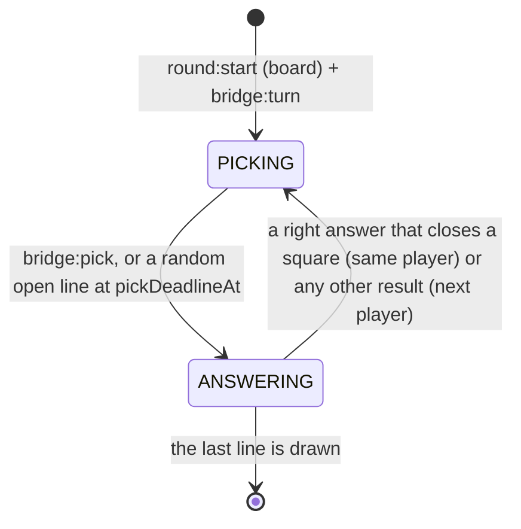

1. **The board:** `size × size` clubs (default 4 × 4: 24 lines, 9 squares, so no draw on squares). Every pair of neighbouring clubs has at least `minAnswersPerLine` (3) scorers in common (§16.4). Lines are numbered: horizontal ones row by row, then vertical ones.
2. **Who starts:** the rock-paper-scissors winner (`firstMover: RPS`, §9.1).
3. **The pick:** the player on turn picks an open line within `pickMs` (8 s): `bridge:pick { line }`. Both players see the two clubs (`bridge:question`). At the deadline the server picks a random open line, and the answer clock still runs.
4. **The answer:** one typed try within `answerMs` (12 s): `bridge:answer { text }`, judged against the players who scored against both clubs (§16.7).
   - **Right, and not used yet on this board:** the line is the player's, with the scorer's name on it. Every square it closes is theirs, and if it closed at least one, they play again.
   - **Anything else** (wrong, a scorer already used on this board, or no answer): the line is drawn grey. Every square it closes goes to the opponent (DEC-85). The turn passes.
5. **End:** when the last line is drawn. The most squares wins the round; equal squares (possible only on an even board) is a draw.
6. **Battle:** `roundCount` boards (default 1, about 4–5 minutes). Points are squares, so the battle score is the squares won.
7. **Players:** 2 now.

### 16.2 Hidden information

- The accepted scorers of every line stay on the server. After a right answer both players see the scorer and the two matches that make it true; after a grey line, nobody sees the answers until the reveal.
- The board, the picks and the owners are public. Typed text is never shown; a wrong answer shows only the entity it matched (DEC-60).

### 16.3 Protocol (`api/WEBSOCKET.md`)

| Direction | Message | Purpose |
|---|---|---|
| C→S | `bridge:pick { roundNo, line }` | The player on turn picks an open line |
| C→S | `bridge:answer { roundNo, answer: { text } }` | The one try for that line |
| S→C | ack of `bridge:answer` | Only to the sender: `data: { result: RIGHT \| WRONG \| USED }` |
| S→C | `round:start` | `size`, `clubs: EntityRef[size × size]` (row by row), `lines: [{ line, from, to }]`, `firstPickerId`, `goalsSince` (e.g. `2012-13`, from config) |
| S→C | `bridge:turn` | `participantId`, `pickDeadlineAt` |
| S→C | `bridge:question` | `line`, `clubs: [EntityRef, EntityRef]`, `auto`, `answerDeadlineAt` |
| S→C | `bridge:drawn` | `line`, `participantId`, `right`, `result: RIGHT \| WRONG \| USED \| TIME_UP`, `scorer?: EntityRef` and `evidence?: string[2]` (right only), `entity?` (what a wrong or used text matched), `squares: [{ square, ownerId }]` closed by this line, `scores` |
| S→C | `round:result` | `reveal: { lines: [{ line, drawnBy, right, scorer?, examples: EntityRef[] }], squares: (participantId \| null)[] }` |

Refusals: `NOT_YOUR_TURN`, `LINE_TAKEN`, `INVALID_LINE`, `PICK_WINDOW_CLOSED`, `ANSWER_WINDOW_CLOSED`, `EMPTY_ANSWER`, `ROUND_CLOSED`.

**"Not in our records" (DEC-85):** the server sends no extra field. A `WRONG` line whose `entity` is set means the text named a known catalog player who is not linked to both clubs; the app words it as "not in our records (goals since `goalsSince`)", because the player may well have scored before our data starts. A `WRONG` line without `entity` named nobody.

### 16.4 Content and generator

| `gameType` | Content | Accepted answers |
|---|---|---|
| `BRIDGE` | `{ size, clubs: [entityRef × size²] }` (row by row) | none stored: the link graph (§16.7, ADR-0024) |

- **Answers come from the `ONE_TWO` link graph:** the scorers of a line are the `CONCEDED_TO` neighbours both clubs have in common. Nothing new is stored per board, and every right answer has its evidence matches.
- **Generator** (`kb bundle --bridges N`, 07 §5.10 N9 slice): boards of `--bridge-size` (default 4) well-known clubs per side (the `--bridge-clubs` most popular in the written catalog, default 60) placed so that every neighbouring pair has at least `--bridge-min-answers` (3) common scorers. Deterministic: attempt `n` is a shuffle seeded with `n`, then a repair search (swap the club on a short line with a spare club or another cell, always the swap that leaves the fewest short lines; give up when no swap helps or after 40 swaps); an attempt that cannot be repaired is skipped, so the first board kept is not always attempt 0, and boards with the same clubs in the same places are dropped. The same graph and clubs give the same boards.
- **Import checks:** a board is 3 to 5 clubs per side, `size²` different catalog clubs and no answer slots, and every line has at least one active player who scored against both clubs in the link graph as it stands after the import (a line nobody can answer would make every answer on it grey). The 3-scorer minimum is the generator's rule, not the importer's. A later graph import does not re-check boards it does not carry.
- **Difficulty:** from the hardest line: 15+ answers → 1, 10+ → 2, 6+ → 3, 4+ → 4, fewer → 5; one step harder when the median line has fewer than 15.
- **Built 2026-11-21:** 200 boards from the full graph (281,231 links) in 24 s, spread over difficulties 1–5 (40, 39, 55, 36, 30), using 53 of the 60 clubs.
- **Measured on 2026-11-20 (dev graph):** random 4 × 4 boards from the 60 most popular clubs already pass the 3-answer rule 71% of the time, with a median of 31 right answers per line and 7 on the hardest line (top 40: 59%, median 38; top 100: 39%, median 24). With 16 of 60 clubs in any order, the number of possible boards runs into the billions.
- **The data's era:** the graph holds goals of tier-1 and tier-2 club competitions since 2012-13 (Transfermarkt). A scorer from before that is true but not in our records, so the board says "goals since 2012-13" and the reveal says "not in our records" instead of "wrong" for a known player with no link (DEC-85).

### 16.5 Bot

- **Picking:** it takes the line that closes the most squares whenever one closes any; otherwise it avoids a third side of a square when it can; when every line gives one away, it picks the line that gives away the fewest squares.
- **Answering:** it knows an answer with its chance at the board's difficulty, plus 0.15 on a line with 20 or more scorers; when it knows one, it names the best-known unused scorer after `typingDelayMs`, otherwise a wrong popular player with `guessChance`, or nothing (the line then times out grey).
- **Picking** waits `typingDelayMs` too; among equally good lines it picks at random.

### 16.6 Configuration

| Key | Default (dev) | Decision |
|---|---|---|
| `roundCount`, `targetScore` | 1, null | DEC-85 |
| `size` | 4 | DEC-85: a generator flag (`--bridge-size`), not battle config: the board size comes with the content, as for `HEX` |
| `firstMover` | `RPS` | owner, 2026-11-18 |
| `firstMoverAfterRound1` | `LOSER_STARTS` | DEC-71: only with `roundCount` above 1 (one board by default). The loser of the last board picks first; after a drawn board (possible only on an even board) the shared first-mover rule passes it to the other seat |
| `pickMs`, `answerMs` | 8000, 12000 | DEC-85 (the demo: 12 s answers) |
| `wrongLine` | `GREY_GIVES_SQUARES` | owner, 2026-11-20 (the demo); `GREY_GIVES_NOTHING` is the other built option. DEC-85's "no line, turn lost" is not built (`TODO(DEC-85)`) |
| `goalsSince` | `2012-13` | DEC-85: the first season of the goals behind the answers, shown on the board |
| `showWrongAnswers` | true | DEC-60 |
| `points.square` | 1 | DEC-85 |

### 16.7 How it fits the engine

- **Rules:** pure `battles/domain/games/bridge-rules.ts`: lines and their owners (a participant or grey), squares and owners, the turn and its phase, scorers used on this board; extra turn after a closing right answer. `BridgeRoundRunner` wraps them (§2.4), with `UsedAnswers` (§9.2) for the board's scorers.
- **Judging:** `LinkGraphQuery.findCommonNeighbours(clubA, clubB, CONCEDED_TO)` loads a line's scorers once, when it is picked (one query on the primary key of `entity_links`, run for both clubs); then `AnswerChecker.judgeTypedTextAgainstLinks` judges against them, used scorers losing ties, exactly as `ONE_TWO` does.
- **Evidence:** the `link_matches` of the two `SCORED_AGAINST` rows of the scorer.
- **Timers:** one phase timer: `pick`, then `answer`.
- **Actions:** `BRIDGE_PICK` (`cell` = the line; `is_correct` false when the server picked), `BRIDGE_ANSWER` (`cell` = the line, `is_correct`; a timeout is an answer with no entity). `BRIDGE_ANSWER` is an answering action, so question stats count a wrong, used or late answer as wrong for the board.
- **End:** `BOARD_COMPLETE` when the last line is drawn, `FORFEIT` when a player leaves. A used scorer counting as wrong is the DEC-85 default; "refused, try again" is not built.
- **Snapshot `currentRound`:** the board, every line's owner (with scorer and evidence for right ones), square owners, the turn, its phase, the picked line and the deadline.

## 17. `THREAD` (الخيط, N7)

Chosen by the product owner on 2026-11-18 (demo page: https://claude.ai/artifact/S7aGkxim3RBeG3QwkE4ccD). One thread through five rooms. Both players race along the same thread at the same time. Each room's question points at the previous room's answer without naming it ("who set up that goal?"), so you cannot skip a link you do not know. First to the end of the thread wins it.

**Built 2026-11-21** (as below; changes from the design are folded in: rooms are 0-based on the wire, a `thread:jumped` event, the jump ack carries the answer slot, each room carries its own `answerKind`, the reveal shows each room's hop instead of a source match).

### 17.1 A round (one thread)

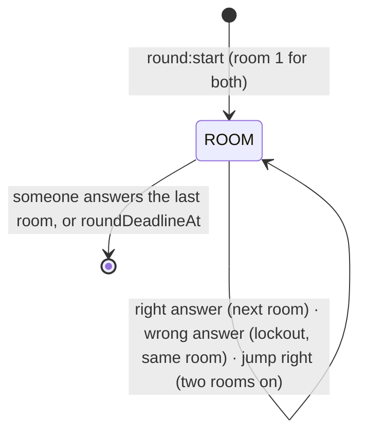

1. **The thread:** `roomCount` rooms (default 5). Room 1 names its subject in full ("the 2014 Champions League final"); every later room refers to the answer before it ("that player", "the club they beat"). Every room has exactly one right answer (§17.4).
2. **Start:** both players get room 1 at `round:start`; nobody moves first (`firstMover: NONE`).
3. **Answer:** typed text for your own current room, judged against that room's one answer (08 §5.3). **Right:** you move to the next room at once. **Wrong:** you are locked out of answering for the next step of `lockoutMs` (3, 6, 9 s; the last repeats), and you stay in the room. Tries are unlimited.
4. **Hint:** after `hint.afterMs` (20 s) on the same question, you get the first letter of its answer in your language. The hint belongs to the question on screen: one for the room, and one for the jump question, whose 20 s start when you jump and whose letter is the next room's. After a wrong jump answer the room's own question comes back with the room's own hint (due at once if its 20 s passed during the jump).
5. **The jump (القفزة):** once per thread (`jump.perThread`), instead of your current room you may ask for its jump question: one harder question that combines this room and the next ("who set up the first goal of the club they beat?"). Right: you skip both rooms. Wrong: the normal lockout, and the jump is spent. Not offered in the last room.
6. **End of a thread:** the first player to answer the last room wins it (`THREAD_COMPLETE`). At `roundDeadlineAt` (`roundMs`, default 150 s), the player in the higher room wins; the same room is a draw (DEC-86).
7. **Battle:** best of 3 threads (`roundCount` 3, `targetScore` 2), about 4 minutes. Points: `points.thread` per thread won.
8. **Players:** 2 now.

### 17.2 Hidden information

- You see only your own room's question. Of the opponent you see only their room number, their lockouts and whether they used the jump.
- Wrong answers are never shown to the opponent (`showWrongAnswers: false`): both players may be in the same room, and a wrong name would help the other rule it out (DEC-86).
- The answers stay on the server until the reveal, which shows the whole thread: each room's question, answer and the match it comes from.

### 17.3 Protocol (`api/WEBSOCKET.md`)

| Direction | Message | Purpose |
|---|---|---|
| C→S | `thread:answer { roundNo, room, answer: { text } }` | An answer to your current room, 0-based (or to its jump question after `thread:jump`) |
| C→S | `thread:jump { roundNo, room }` | Swap your current room's question for its jump question |
| S→C | ack of `thread:answer` | Only to the sender: `data: { result: RIGHT \| WRONG, lockedUntil? }` |
| S→C | ack of `thread:jump` | Only to the sender: `data: { question, slot }` (the jump question; `slot` is the next room, whose answer it asks for) |
| S→C | `round:start` | `roomCount`, `room: { room: 0, question, jumping, hintAt }`, `roundDeadlineAt`, `jumpsLeft` (the same room 0 for both) |
| S→C | `thread:progress` | `participantId`, `room` (`roomCount` when finished), `jumped`. To the mover it also carries `question`: their new room `{ room, question, jumping, hintAt }`; the opponent gets the room number only |
| S→C | `thread:locked` | `participantId`, `lockedUntil`, and `entity` (what the text matched) only when `showWrongAnswers` is on; the typed text is never sent. The locked player also gets `question`: the question now on their screen (after a wrong jump answer, the room's own with its own hint) |
| S→C | `thread:jumped` | `participantId`, `room`: the opponent sees that the jump was used. The jumper also gets `question`: the jump question with its own `hintAt` and no letter |
| S→C | `thread:hint` | `participantId`, `room`; to that player also the `letter` |
| S→C | `round:result` | `reveal: { rooms: [{ room, hop, question, answer: EntityRef }], reached: { [participantId]: room } }` |

- One event goes to every player with data per viewer, so private parts (your question, your letter) ride on events everyone receives and the `seq` stays continuous.
- Refusals: `NOT_YOUR_ROOM`, `LOCKED_OUT`, `NO_JUMP_LEFT`, `JUMP_NOT_ALLOWED` (last room), `EMPTY_ANSWER`, `ROUND_CLOSED`.

### 17.4 Content and generator

| `gameType` | Content | Accepted answers |
|---|---|---|
| `THREAD` | `{ rooms: [{ hop, answerKind, text: LocalizedText, jumpText: LocalizedText \| null }] }` | slot `r` = exactly one entity of the room's `answerKind`: room `r`'s answer |

**Hops (v1, from the data we have today):** every hop goes from the previous answer to exactly one new answer.

| Hop | From → answer | Example (English) | One answer because |
|---|---|---|---|
| `FINAL_WINNER` | a named final → its winner | "Who won the 2014 Champions League final?" | room 1 only |
| `FINAL_OPPONENT` | a team in the current final → the other team | "Who did they beat in that final?" | two teams per match |
| `FIRST_SCORER` / `LAST_SCORER` | a team in the current match → its first or last scorer by minute | "Who scored their first goal that night?" | ordered by minute; own goals left out |
| `ASSIST` | the scorer of the current goal → who set it up | "Who set that goal up?" | one recorded assist |
| `CAPTAIN` | a team in the current match → its captain | "Who wore their armband that night?" | one captain per lineup |
| `SCORED_IN_FINAL_AGAINST` | a player → the team he scored against in a named final | "Which club did he score against in the 2018 Champions League final?" | one opponent per match |
| `NATIONALITY` | a player → his country | "Which country is he from?" | one citizenship; last room only (a dead end) |

- **Every hop names its match or stays in the current one.** No hop says "ever", "first" or "next" across seasons: our club goals and lineups start in 2012-13, and an all-time claim could be false outside our data (the DEC-85 lesson).
- **No "played for" hops** (the owner's rule: no career or teammate links).
- **A thread is valid when:** every room has exactly one answer given the room before it; the five answers are all different; every answer is a catalog entity with an English and an Arabic name; players are well known (`--thread-min-player-sitelinks`, default 30); no two rooms in a row use the same hop.
- **Jump text:** each hop has a question form and a noun-phrase form ("the club they beat in that final"); the jump question is room `r + 1`'s question with room `r`'s noun phrase as its subject. Written by the generator in both languages.
- **Difficulty:** from the least known answer of the thread.
- **Import checks:** 3 to 7 rooms with text in the same locales; a jump question in every room but the last; exactly one answer per room, all different, each a catalog entity of its room's `answerKind`. Judging a room uses that kind for the "exactly another entity's name" rule (08 §5.3).
- **Safety rules found while building:** a final with an own goal, a goal without a minute or a goal by an unlinked scorer has no scorer hops ("their first goal" would be unclear or wrong); two goals in the same minute have no first or last scorer; finals played over two legs are skipped; a final needs a winner (a shootout counts).
- **Built 2026-11-21 (full catalog):** 313 threads from 154 finals at `--threads-per-final 3`, difficulty 1–5: 89, 104, 75, 34, 11. Hops used: `SCORED_IN_FINAL_AGAINST` 289, `CAPTAIN` 249, `FIRST_SCORER` 215, `FINAL_OPPONENT` 165, `NATIONALITY` 148, `LAST_SCORER` 102, `ASSIST` 84. Super cups count as finals.
- **Coaches and venues:** the demo's "the coach of that team that night" needs coaches as catalog entities (Transfermarkt has 6,137 manager names as text, not linked yet) and stadiums as a new entity kind. They come as a later data slice with their own hops (DEC-86); v1 does without them.
- **Measured on 2026-11-21 (dev knowledge base):** 2,266 tier-1 and tier-2 knockout matches (252 finals), 6,361 goals in them (3,945 with an assist), 3,571 team lineups with a captain, 46,709 players with one citizenship. A prototype walk over the v1 hops from the finals alone finds **7,740 five-room threads from 193 of 248 finals** (median 24 per final) with answers of 30+ sitelinks, and 5,867 from 166 finals at 50+.
- **Variety:** threads of the same final share room 1, so the generator keeps at most `--threads-per-final` (default 3) per final, each different from room 2 on: about 580 threads from finals alone. Knockout rounds as room 1 ("the 2019 semi-final second leg") would multiply that, and are the first thing to add if the bank runs short.

### 17.5 Bot

- It knows each room's answer with its chance at the thread's difficulty and answers after `typingDelayMs`; when it does not, it sends a wrong popular name now and then (and serves the lockout) or waits for the hint, which raises its chance.
- It never jumps in v1 (`TODO(DEC-86)`).
- Built: one try per room after `typingDelayMs`, another when the hint comes out (+0.3 chance); a wrong popular name of the room's kind with `guessChance`.

### 17.6 Configuration

| Key | Default (dev) | Decision |
|---|---|---|
| `roundCount`, `targetScore` | 3, 2 | DEC-86 |
| `firstMover` | `NONE` | 08 §9.1: both race at once |
| `roundMs` | 150000 | DEC-86 |
| `lockoutMs` | [3000, 6000, 9000] | owner, 2026-11-18 (the demo) |
| `hint` | `{ afterMs: 20000 }` | owner, 2026-11-18 (the demo) |
| `jump.perThread` | 1 | owner, 2026-11-18 (the demo); a wrong jump spends it (DEC-86) |
| `timeUp` | `HIGHER_ROOM_WINS` | DEC-86 |
| `showWrongAnswers` | false | DEC-86 |
| `points.thread` | 1 | DEC-86 |

### 17.7 How it fits the engine

- **Rules:** pure `battles/domain/games/thread-rules.ts`: each participant's room, lockout (`LockoutLadder`, §9.2), hint due time (`HintSchedule`), jump state; the round ends at the last room or the deadline. `ThreadRoundRunner` wraps them (§2.4).
- **Judging:** the room's answer slot with `AnswerChecker.judgeTypedText` (08 §5.3), like any slot game; no link graph.
- **Timers:** one round deadline, one hint timer per participant.
- **Actions:** `THREAD_ANSWER` (`cell` = the answer slot, `is_correct`), `THREAD_JUMP` (`cell` = the room). `THREAD_ANSWER` is an answering action for question stats.
- **End:** `THREAD_COMPLETE`, `TIME_UP` or `FORFEIT` (no points on a forfeit).
- **Snapshot `currentRound`:** your room, its question (or its jump question), your lockout and hint, `jumpsLeft`, and the opponent's room.

## 18. `IMPOSTER` (المندس, P8b) and players per game type in rooms

Rules chosen by the product owner on 2026-11-21 (DEC-58): everyone but the imposter sees a footballer's name; players give one short clue each in turn, twice; then everyone votes for who they think the imposter is. If the imposter is caught, they get one last guess at the name. Rooms only (friends who joined with a code), no bots.

### 18.1 Players per game type in a room

`GAME_TYPE_PLAYER_COUNT` (03 §3.4 step 6) is config per game type: `players: { min, max }`, where `max` is capped by the room's `maxPlayers` (DEC-38: config, dev 8).

| Game types | Players | Why |
|---|---|---|
| `BUZZER`, `CAREER`, `WHO_IS_PLAYER` | 2 to `maxPlayers` | Reveal and buzz already plays with any number |
| `VAULT`, `THREAD` | 2 to `maxPlayers` (owner, 2026-11-21) | Races: everyone plays at once on the same content, so more players change nothing in the rules. First to open the vault, or to reach the end of the thread, wins; at time up the highest room wins, ties are a draw |
| `IMPOSTER` | 4 to `maxPlayers` (owner, 2026-11-21) | With 3, two clues give the imposter away too easily |
| `GRID`, `MINES`, `AUCTION`, `HEX`, `LINEUP`, `ONE_TWO`, `BRIDGE` | exactly 2 | Turn-based duels |

- **Leaving a race with 3 or more players:** the leaver is out of the round and the race goes on; the round ends on a forfeit only when one player is left (today's two-player rule is that case).

### 18.2 A round (one secret)

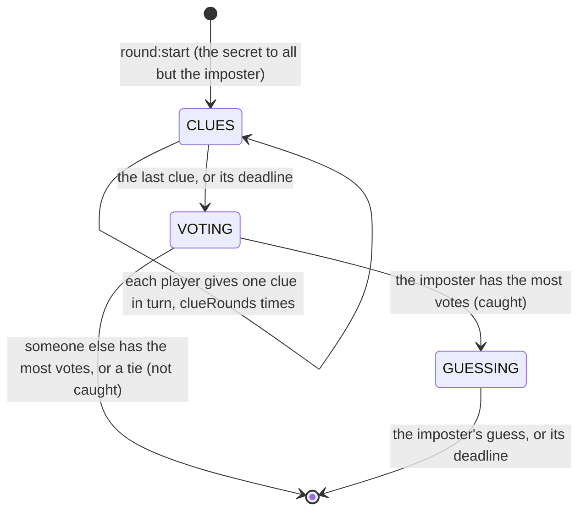

1. **Roles:** one player is the imposter, chosen at random so nobody is imposter twice before everyone has been once in the battle. Everyone else sees the secret: a well-known footballer (`EntityRef`). The imposter sees only "you are the imposter".
2. **Clues:** `clueRounds` (2) rounds; in each, every player in a random order (the same order both rounds) gives one clue within `clueMs` (20 s): `imposter:clue { text }`, 1 to `maxClueLength` (40) characters. Everyone sees every clue with who gave it. A missed turn shows as "no clue".
3. **No player names in clues:** the server refuses a clue that names any catalog player (a full name or alternative name, or a distinctive name word such as "Messi"; the same matching as typed answers, 08 §5.3): `CLUE_NAMES_A_PLAYER`, and the player may try again within their time. It refuses every player name, not only the secret's, so a refusal tells the imposter nothing. Clubs, countries, positions and numbers are allowed ("Argentina", "number 10").
4. **Vote:** within `voteMs` (30 s) every player votes for one other player: `imposter:vote { participantId }`, changeable until the deadline. Who voted is shown at once, whom they voted for only at the reveal. A missing vote counts for nobody.
5. **Reveal:** the imposter is **caught** when they alone have the most votes; a tie at the top is not a catch (DEC-58).
6. **Last guess:** a caught imposter has `guessMs` (15 s) to type the secret: `imposter:guess { text }`, judged like any typed answer (typo tolerance, 08 §5.3). A right guess wins the round back.
7. **Points (owner's outline):** each player who voted for the imposter: `points.rightVote` (1), plus `points.onlyRightVote` (1) if they were the only one. The imposter: `points.perMissedVote` (1) for every other player who did not vote for them, plus `points.rightGuess` (2) for a right last guess. The round's winner is the imposter when not caught or after a right guess; otherwise nobody (the right voters still score).
8. **Battle:** `roundCount` rounds (default: the number of players, so everyone is imposter once, capped by `maxRounds` 6). Most points wins; equal points share the place.

### 18.3 Hidden information

- The secret never reaches the imposter, before or during the round; the imposter's identity reaches nobody before the reveal; whom each player voted for stays hidden until the reveal.
- Clues are public: they are the game. Typed guesses are never shown, only whether the guess was right.
- **Moderation:** rooms are friends who share a code, and clues are 40 characters with no player names. Report and mute tools are needed before IMPOSTER is ever offered to strangers (it is not, and DEC-65 keeps matchmaking unfiltered).

### 18.4 Protocol (details in `api/WEBSOCKET.md` with the build)

| Direction | Message | Purpose |
|---|---|---|
| C→S | `imposter:clue { roundNo, text }` | Your clue, on your turn |
| C→S | `imposter:vote { roundNo, participantId }` | Your vote (changeable until the deadline) |
| C→S | `imposter:guess { roundNo, answer: { text } }` | The caught imposter's last guess |
| S→C | `round:start` | `{ roundNo, gameType, order: participantId[], clueRounds, secret?: EntityRef, isImposter }`: `secret` to everyone but the imposter, `isImposter: true` only to the imposter |
| S→C | `imposter:turn` | `{ participantId, clueRound, clueDeadlineAt }` |
| S→C | `imposter:clue` | `{ participantId, clueRound, text \| null }` (null: missed turn) |
| S→C | `imposter:vote-open` | `{ voteDeadlineAt }` |
| S→C | `imposter:voted` | `{ participantId }` (that they voted, not whom) |
| S→C | `imposter:revealed` | `{ imposterId, votes: { [voterId]: participantId \| null }, caught }`; when caught, `guessDeadlineAt` |
| S→C | `round:result` | `reveal: { secret: EntityRef, imposterId, votes, caught, guess: { right, entity? } \| null, clues: [{ participantId, clueRound, text \| null }] }` |

Refusals: `NOT_YOUR_TURN`, `CLUE_NAMES_A_PLAYER`, `CLUE_TOO_LONG`, `EMPTY_CLUE`, `VOTE_WINDOW_CLOSED`, `CANNOT_VOTE_FOR_YOURSELF`, `NOT_THE_IMPOSTER`, `GUESS_WINDOW_CLOSED`, `ROUND_CLOSED`.

### 18.5 Content and generator

| `gameType` | Content | Accepted answers |
|---|---|---|
| `IMPOSTER` | `{ secret: entityRef }` (a `PLAYER`) | slot 0 = `[secret]`, for the last guess |

- **Generator** (`kb bundle --imposters N`): the best-known catalog players (`--imposter-min-sitelinks`, default 60), spread over difficulties by sitelinks. A secret everyone at the table can describe is the point of the game.
- No round text: the clues are written by the players.

### 18.6 Configuration

| Key | Default (dev) | Decision |
|---|---|---|
| `players` | `{ min: 4, max: 8 }` | owner, 2026-11-21 (max capped by `room.maxPlayers`) |
| `roundCount`, `maxRounds` | one per player, 6 | DEC-58 |
| `clueRounds`, `clueMs`, `maxClueLength` | 2, 20000, 40 | owner, 2026-11-21 (clue turns); values DEC-58 |
| `voteMs`, `guessMs` | 30000, 15000 | DEC-58 |
| `tieIsCatch` | false | DEC-58 |
| `points` | `{ rightVote: 1, onlyRightVote: 1, perMissedVote: 1, rightGuess: 2 }` | owner's outline; values DEC-58 |

### 18.7 How it fits the engine

- **Rules:** pure `battles/domain/games/imposter-rules.ts`: the order, the clue turns, the votes, the catch, the last guess, points. `ImposterRoundRunner` wraps them (§2.4).
- **First mover:** `NONE` (the order is part of the round). **Bots:** none (rooms only, 03 §3.5).
- **Clue check:** a new `AnswerCatalogQuery.findPlayerNamedInText(text)` (question-bank): every one- to three-word run of the normalized clue against player search forms and distinctive name words.
- **Judging the guess:** slot 0 with `AnswerChecker.judgeTypedText`.
- **Actions:** `IMPOSTER_CLUE`, `IMPOSTER_VOTE`, `IMPOSTER_GUESS` (answering). Question stats count a caught imposter's wrong or missing guess as wrong.
